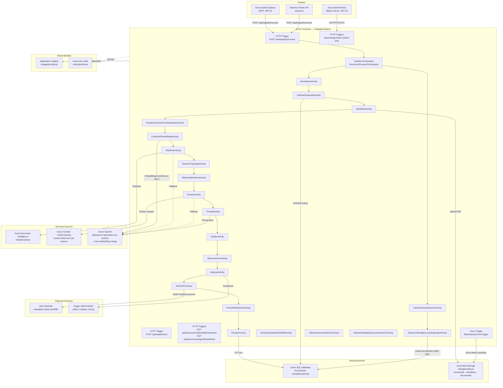
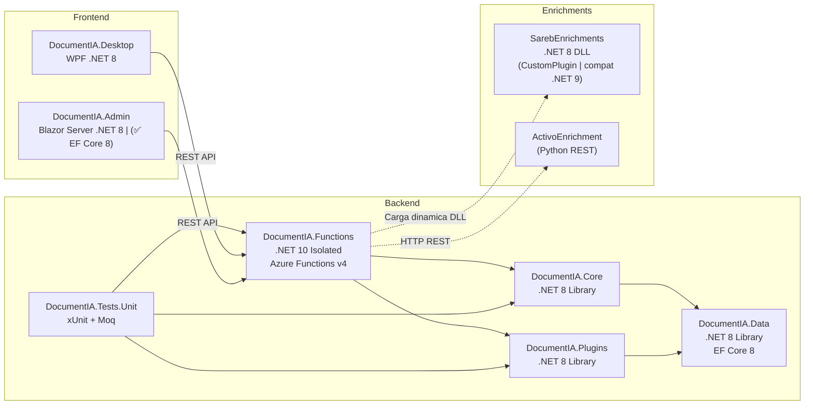
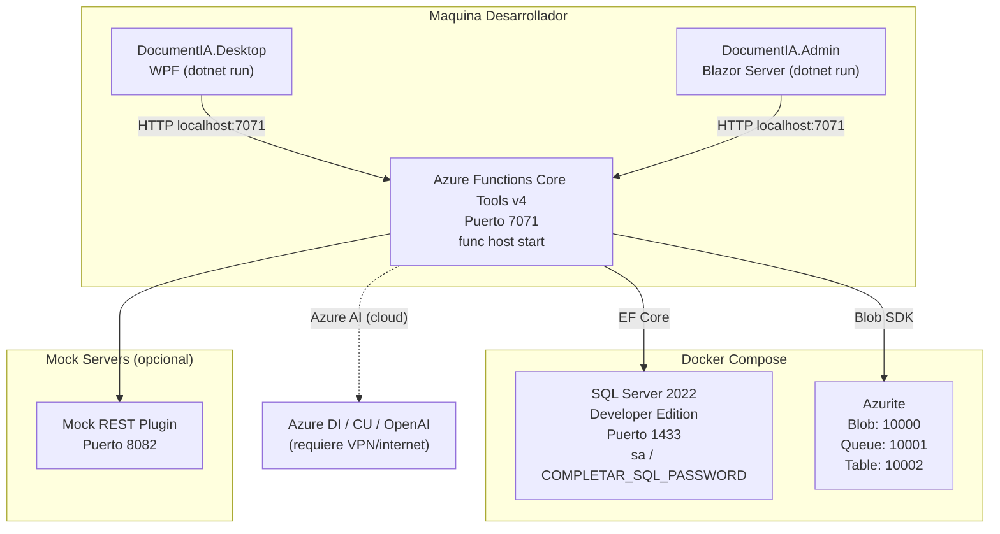
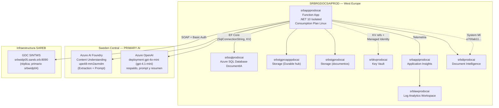
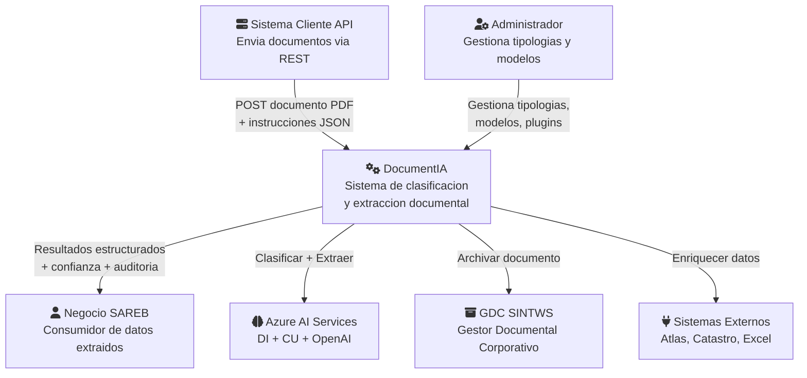
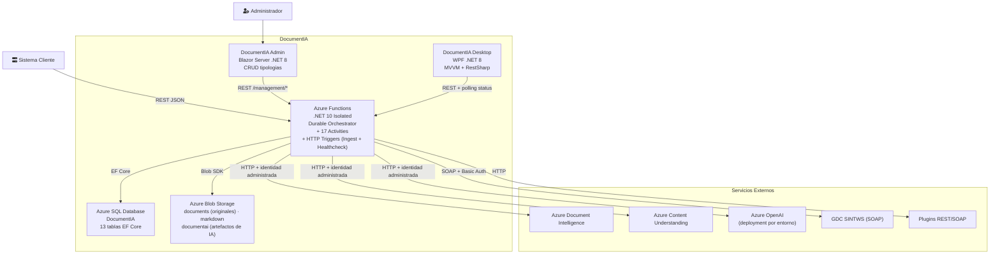

# 1. Arquitectura del Sistema — DocumentIA

> Última revisión: 2026-11-26 (AB#101570, cifras de `DocumentIA.Data`: 14 entidades y 39 migraciones con `ReleaseAplicada`). Revisión previa: 2026-11-25 (AB#101450, retirada de los app settings heredados sin efecto; AB#101553, validación TLS del GDC contra la CA de SAREB; verificada en DEV el 2026-11-25; PRE y PRO con la siguiente release). Revisiones previas: 2026-11-22 (AB#101447, contraste con el código, las migraciones EF y los pipelines)  
> Actualización anterior: 2026-06-08 (Upgrade .NET 9→10 Isolated - Extended Support)  
> Proyecto: AI DocClassExt — SAREB  
> Repositorio: Azure DevOps `sareb.visualstudio.com/AI%20DocClassExt`

---

## 1.1 Descripcion General

DocumentIA es un sistema de clasificacion y extraccion automatizada de documentos para SAREB. Procesa documentos inmobiliarios (notas simples registrales, tasaciones, resumenes documentales) empleando servicios de IA de Azure para:

1. **Clasificar** el tipo documental mediante reglas deterministas, Azure AI Document Intelligence (modelos custom entrenados) y, como respaldo, el modelo generativo de Azure OpenAI del entorno (ver «Modelo generativo por entorno»; clasificación jerárquica en dos fases: familia TDN1 → TDN2 enriquecido con metadatos de BD). Desde la Fase A de [ADR-002](decisiones/ADR-002-clasificador-embeddings-hibrido.md) un clasificador por embeddings corre antes del GPT, en modo sombra en DEV.
2. **Extraer** campos estructurados mediante Azure Content Understanding o Document Intelligence, con fallback GPT.
3. **Validar** los datos extraidos contra un motor de reglas configurable por tipologia (NIF, fechas, rangos, referencias catastrales, campos obligatorios).
4. **Enriquecer** los datos mediante un sistema de plugins de integracion (REST, SOAP, DLL custom).
5. **Archivar** el documento en el Gestor Documental Corporativo (GDC SINTWS) via SOAP.
6. **Persistir** resultados, auditoria y metricas en SQL Server.

### Stack tecnologico

| Capa | Tecnologia |
|------|-----------|
| Runtime | .NET 10 Isolated Worker |
| Orquestacion | Azure Durable Functions v4 (soportado hasta 2027) |
| Clasificacion IA | Azure AI Document Intelligence (custom classifier) |
| Extraccion IA | Azure Content Understanding + Azure DI (custom models) |
| LLM (respaldo de clasificación y extracción, prompt libre, resumen) | Azure OpenAI; el deployment depende del entorno (ver «Modelo generativo por entorno») |
| Base de datos | Azure SQL Database `DocumentIA` (EF Core 8.0.1 Code-First); SQL Server 2022 en Docker solo para desarrollo local |
| Almacenamiento blob | Azure Blob Storage (Azurite en local) |
| Gestor documental | GDC SINTWS (SOAP, srbwidp04.sareb.srb:8090) |
| Frontend operativo | WPF .NET 8 (MVVM, RestSharp) |
| Frontend Admin | Blazor Server .NET 8 | 
| Estado del backend | .NET 10 Isolated desde junio de 2026 (`DocumentIA.Functions` y `DocumentIA.Tests.Unit` en net10.0; el resto de proyectos en net8.0) |
| CI/CD | Azure DevOps Pipelines (self-hosted agent) |
| Observabilidad | Application Insights + Log Analytics |

### Modelo generativo por entorno (2026-11-22)

El modelo de Azure OpenAI que atiende la clasificación GPT de respaldo, el prompt libre, el resumen y la extracción GPT de respaldo no es el mismo en los tres entornos. Se resuelve por configuración, no por código: filas de `ModeloConfigs` con los indicadores `IsDefault` y `UseAsFallback`, y el app setting `PromptDefaults__ModelKey` que cada pipeline fija por entorno (variable `PROMPT_DEFAULTS_MODEL_KEY` en `azure-pipelines.yml` y `azure-pipelines-functions.yml`).

| Entorno | Deployment generativo | Desde | Fuente |
|---------|----------------------|-------|--------|
| DEV | `gpt-5.6-luna` (modelo gpt-5.6-luna, Data Zone Standard, `reasoning_effort` none, caché de prompt explícita en clasificación) | 2026-11-20 | [ADR-004](decisiones/ADR-004-cambio-modelo-ia-generativa-gpt56-luna.md); `PROMPT_DEFAULTS_MODEL_KEY = prompt.gpt56-luna` |
| PRE | `gpt-4o-mini` (el deployment se llama así, pero sirve el modelo gpt-4.1-mini) | hasta la siguiente release | `PROMPT_DEFAULTS_MODEL_KEY = default.gpt4o-mini` |
| PRO | `gpt-4o-mini` (modelo gpt-4.1-mini) | hasta la siguiente release | `PROMPT_DEFAULTS_MODEL_KEY = default.gpt4o-mini` |

Las menciones a GPT-4o-mini en el resto del documento describen PRE y PRO. Las filas de gpt-4 se conservan en DEV para la vuelta atrás y el deployment `gpt-4o-mini` sigue en los tres entornos durante la convivencia (ADR-004). Azure OpenAI retira gpt-4.1-mini el 2027-04-14.

---

## 1.2 Diagrama de Arquitectura de Alto Nivel



> El orden de las activities es el simplificado del camino feliz; el orquestador tiene salidas tempranas (duplicado con reutilización, fallo GDC, límite de páginas) y pasos opcionales (prompt, AssetResolver, markdown). Los nombres `{env}` se sustituyen por `dev`, `pre` o `pro`; el inventario real por entorno está en [INFRAESTRUCTURA_REAL_DESPLEGADA.md](infraestructura/INFRAESTRUCTURA_REAL_DESPLEGADA.md).

---

## 1.3 Diagrama de Componentes de la Solucion .NET



### Responsabilidades por proyecto

| Proyecto | Responsabilidad |
|----------|----------------|
| **DocumentIA.Functions** | Triggers HTTP (`IngestDocument`, `healthcheck`, consulta de markdown por documento y por ejecución, tipologías publicadas y la Admin API `management/*`), timer de limpieza de blobs, Orchestrator Durable, **21 activities invocadas** (hay 22 declaradas: `ApplyPdfPageLimitActivity` existe pero el orquestador no la llama; el recorte de páginas para clasificar lo hace `PrepararDocumentoClasificacionActivity`), providers de IA (reglas, DI, embeddings, CU, GPT), servicios GDC y AssetResolver, autenticación |
| **DocumentIA.Core** | Modelos de dominio (ContratoEntrada/Salida), motor de validacion (11 reglas), configuracion de tipologias, interfaces de servicio |
| **DocumentIA.Data** | DbContext EF Core, 14 entidades, repositorios, 39 migraciones (la última `20261126190743_ReleaseAplicada`), seed data |
| **DocumentIA.Plugins** | Infraestructura de plugins: IIntegrationPlugin, PluginFactory, PluginManager, ResilientPlugin, RestPlugin, SoapPlugin, CustomPlugin |
| **DocumentIA.Tests.Unit** | 154 ficheros de test (xUnit + Moq + FluentAssertions; recuento del 2026-11-22). Hay además `DocumentIA.Tests.Admin`, `DocumentIA.Tests.E2E` (contra entornos desplegados) y `DocumentIA.AssetResolver.Tests` |
| **DocumentIA.Desktop** | WPF MVVM: ingesta de documentos, polling de estado, visualización de timeline. Existe en `src/frontend/`, pero **no forma parte de `DocumentIA.sln` ni de los pipelines**; es una herramienta de desarrollo, no un cliente desplegado |
| **DocumentIA.Admin** | Blazor Server: CRUD tipologias, gestion modelos AI, configuracion plugins, Monitor de ejecuciones (KPIs, serie temporal y detalle por GUID consultados en servidor via `/management/ejecuciones*`) |
| **SarebEnrichments** | Plugin custom .NET: enriquecimiento de Nota Simple (cargas, riesgo, datos de activo) |

---

## 1.4 Principios y Patrones Arquitectonicos

### 1.4.1 Durable Functions — Orquestacion tipo Saga

El pipeline de procesamiento se implementa como un **Durable Function Orchestrator** (`DocumentProcessOrchestrator`) que coordina **21 activities** (22 declaradas, una sin invocar; no todas se ejecutan en cada peticion: hay early exits por duplicado, fallos GDC, skip de pasos opcionales como Prompt/AssetResolver). Las ventajas:

- **Durabilidad**: el estado de la orquestacion persiste automaticamente en Azure Storage. Si el host se reinicia, el orquestador resume donde quedo.
- **Replay-safe logging**: usa `context.CreateReplaySafeLogger` para evitar logs duplicados durante replays.
- **customStatus**: publica progreso en tiempo real que el frontend consume via polling del status endpoint de Durable.
- **Timeout patterns**: `SubirGDCActivity` usa `Task.WhenAny` con timer de 120s para evitar bloqueos indefinidos.

### 1.4.2 Strategy Pattern — Proveedores Configurables

Tanto clasificacion como extraccion usan el patron Strategy con un **router configurable**:

```
IClasificarDataProvider (interfaz)
  ├─ ConfigurableClasificarDataProvider (router)
  │   ├─ RuleBasedTdnClassifier                                          ← reglas deterministas
  │   ├─ AzureDocumentIntelligenceClasificarProvider
  │   ├─ FoundryTdnRescueClassifier                                      ← Foundry LLM fallback
  │   ├─ GptClasificarDataProvider (two-phase hierarchy)                 ← Phase 1: TDN1 family, Phase 2: TDN2 enriquecido
  │   └─ MockClasificarDataProvider

ClasificarEmbeddingsActivity (previa a ClasificarActivity, ADR-002 Fase A)
  └─ EmbeddingsClasificarProvider ← embedding con text-embedding-3-large + inferencia en C# del artefacto JSON del blob `documentai`
      └─ DecisorHibrido           ← modo off | sombra | hibrido y umbrales de la fila `clasificador.embeddings` (TipoModelo.Embeddings = 5)
```

En `sombra` la predicción por embeddings se persiste junto a la del GPT sin alterar el resultado; en `hibrido` contestaría por confianza y derivaría al GPT el resto. Estado el 2026-11-22: DEV en `sombra` (código en producción desde la release v1.0.0; artefacto v4 desde el 2026-11-18, AB#101405); PRE y PRO llevan el código con la fila en `off` y el artefacto v1 (comprobado en BD el 2026-11-23, AB#101449). El umbral de operación se fija con los cortes de la sombra (AB#101421).

**GptClasificarDataProvider**:
- **Phase 1**: Resuelve familia TDN1 (ej., ESCR) desde catálogo dinámico
- **Phase 2**: Resuelve tipología TDN2 enriquecida (ej., ESCR-06) desde catálogo filtrado + metadatos (tipologiaNombre, gptdescripcion) de BD
- **Caching**: 5 min TTL per-family via IMemoryCache
- **Enriquecimiento**: ConfiguracionJson contiene tipologiaNombre + gptdescripcion (pobladas 2026-06-02, 204 tipologías)
- **Fallback**: integrado en la cadena tras DI y Foundry LLM. El deployment que atiende la fase 1 y 2 es el del entorno (gpt-5.6-luna en DEV, gpt-4o-mini en PRE y PRO; ver «Modelo generativo por entorno»); con gpt-5.6-luna la fase 1 usa caché de prompt explícita
- **Documentación**: Ver la sección «Clasificación Jerárquica GPT (nivelClasificacion)» de [03_DISENO_TECNICO_DETALLADO.md](03_DISENO_TECNICO_DETALLADO.md)

```
IExtraerDataProvider (interfaz)
  ├─ ConfigurableExtraerDataProvider (router)
  │   ├─ AzureContentUnderstandingProvider            ← provider = "azure-content-understanding"
  │   ├─ AzureDocumentIntelligenceExtraerDataProvider ← provider = "azure-document-intelligence"
  │   ├─ GptDirectExtraerDataProvider                 ← provider = "azure-openai" | "gpt" | "openai"
  │   ├─ GptFallbackExtraerDataProvider               ← fallback automático cuando CU es insuficiente
  │   └─ MockExtraerDataProvider                      ← provider = "mock"

ILayoutMarkdownDataProvider (interfaz)
  └─ AzureDocumentIntelligenceLayoutMarkdownProvider  ← provider = "azure-document-intelligence-layout"
```

> El proveedor se resuelve por prioridad: instrucciones de la petición → campo `extraction.provider` de la tipología → `Extraction.DefaultProvider` de configuración global.
> `GptDirectExtraerDataProvider` extrae directamente con OpenAI (sin CU previo), validando upfront que el modelo tiene endpoint, deployment y API key configurados.

Para `AzureContentUnderstandingProvider` está activo un patrón de resiliencia específico:

- Selección de modelo por tipología con `modelKey` + `secondaryModelKey` (round-robin cuando existe réplica).
- Timeout duro por intento (`HardTimeoutSeconds`) con evento de telemetría `CU.HardTimeout`.
- Circuit breaker por `ModelKey` con failover al modelo alternativo (`CU.CircuitOpen`, `CU.CircuitFailover`, `CU.CircuitClosed`, `CU.CircuitRejected`).
- Retorno de metadatos efectivos de ejecución (`ModelKeyEfectivo`, `EndpointEfectivo`, `ProcessingLocationEfectiva`) para trazabilidad.

### 1.4.2a Patrón RegistryLoader — Configuración de Proveedores IA desde BD

Todos los parámetros de conexión de los proveedores IA (**endpoint, apiKey, authMode, apiVersion**, etc.) se almacenan **exclusivamente en la tabla `ModeloConfigs` de BD**. No hay ninguna clave de configuración en `appsettings` ni en `local.settings.json` para estos parámetros.

Cada tipo de modelo tiene su propio loader que hereda de `ModelRegistryLoader<TConfig>`:

| Loader | Tipo modelo | Configuración cargada |
|--------|-------------|----------------------|
| `ClassificationModelRegistryLoader` | `TipoModelo.Clasificacion` | `ClassificationModelConfig` |
| `ExtractionModelRegistryLoader` | `TipoModelo.Extraccion` | `ExtractionModelConfig` |
| `PromptModelRegistryLoader` | `TipoModelo.Prompt` | `PromptModelConfig` |
| `LayoutModelRegistryLoader` | `TipoModelo.Layout` | `LayoutModelConfig` |
| `TarifaRegistryLoader` | `TipoModelo.Tarifas` (4) | Catálogo de tarifas `tarifas.ia` para el coste por ejecución (ADR-007 de este documento) |
| `EmbeddingsClasificadorConfigLoader` | `TipoModelo.Embeddings` (5) | Fila única `clasificador.embeddings`: deployment de embeddings, artefacto, modo y umbrales (ADR-002) |

Los proveedores reciben el loader por inyección de dependencias y obtienen el modelo con `GetModel(key)` o `GetDefaultModel()`. Los archivos `config/{tipo}/models.json` solo actuan como seed/bootstrap de un entorno sin datos o como referencia historica; la configuracion valida en runtime es la publicada en BD y puede diferir de esos JSON.

### 1.4.3 Repository Pattern

Acceso a datos mediante repositorios inyectados (`IDocumentoRepository`, `ITipologiaRepository`, `IAuditoriaRepository`, etc.) sobre EF Core DbContext.

### 1.4.4 Plugin Architecture — Carga Dinamica

Los plugins de integracion siguen una arquitectura extensible:

- **IIntegrationPlugin**: interfaz comun con `InitializeAsync`, `ExecuteAsync`, `HealthCheckAsync`.
- **PluginFactory**: crea instancias segun configuracion (`REST` → `RestPlugin`, `SOAP` → `SoapPlugin`, `Custom` → `CustomPlugin`).
- **PluginManager**: registro y lookup de plugins por clave.
- **CustomPlugin**: carga DLLs externas desde `AppContext.BaseDirectory/plugins/` usando reflection.
- **Configuracion de plugins por tipologia**: se lee desde la tabla `PluginTipologiaConfigs` en BD. El fichero `config/tipologias/{codigo}.plugins.json` queda limitado a seed inicial, plantilla o referencia historica.

> Regla general: tipologias, modelos IA y plugins por tipologia tienen como fuente de verdad la BBDD gestionada por Admin API/DocumentIA.Admin. Los JSON fisicos no deben editarse como mecanismo de cambio productivo ni borrarse sin confirmacion explicita.

### 1.4.5 Circuit Breaker + Retry (Decorator Pattern)

La resiliencia se implementa mediante decoradores:

- **ResilientPlugin**: envuelve cualquier `IIntegrationPlugin` con retry exponencial y circuit breaker.
  - Retry: `MaxRetries` intentos con backoff `InitialDelayMs * 2^(attempt-1)`.
  - Circuit breaker: abre tras 5 fallos consecutivos, se resetea tras 5 minutos (half-open trial).
- **ResilientGdcService**: envuelve `GdcService` (SOAP) con la misma logica.
  - Configurable via `GDC:MaxRetries`, `GDC:CircuitBreakerFailures`, `GDC:CircuitBreakerDurationMs`.

### 1.4.6 Dual Authentication Mode

Los proveedores de IA soportan dos modos de autenticacion (`AuthMode`):

| Modo | Mecanismo | Uso actual |
|------|-----------|-----------|
| `ApiKey` | Header `Ocp-Apim-Subscription-Key` (DI) / `api-key` (OpenAI/CU) | Filas de `ModeloConfigs` con `AuthMode = ApiKey` (ninguna activa en los tres entornos desde octubre de 2026). Los app settings `Extraction__AzureContentUnderstanding__*` (conexión), `Classification__AzureDocumentIntelligence__*` y `GptFallback__*` que el pipeline fijaba con la clave desde Key Vault **no se leían en el código** (comprobado el 2026-11-22) y se retiraron en AB#101450 |
| `DefaultAzureCredential` | Bearer token via Managed Identity | Filas de `ModeloConfigs` en DEV, PRE y PRO. PRO paso a identidad en la release v1.0.0 (2026-10-08) y sus `ApiKey` se purgaron; ver `docs/infraestructura/INFRAESTRUCTURA_REAL_DESPLEGADA.md` |

`DocumentIntelligenceAuthHelper` implementa la logica con lazy singleton de `DefaultAzureCredential` thread-safe.

---

## 1.5 Decisiones Arquitectonicas (ADR)

> **Registro historico del diseno inicial (nota del 2026-10-27).** Los siete bloques siguientes se conservan tal
> como se escribieron y su campo de estado puede no reflejar la situacion actual: el estado vigente de la
> autenticacion esta en §1.4.6 y la IA es propia de cada entorno desde la Epic AB#100298. Su numeracion es local a
> este documento y no coincide con la de los ADR formales de `docs/decisiones/` (`ADR-NNN-<slug>.md`), que son los
> vigentes: cuando una referencia cita "ADR-001", "ADR-002" o "ADR-003" sin otro contexto, se refiere a
> `docs/decisiones/` (ADR-001 a ADR-004 el 2026-11-22; ADR-005 a ADR-007 el 2026-11-26). En particular, el bloque ADR-005 de abajo describe un estado de autenticación
> superado (la identidad administrada está activa en los tres entornos, §1.4.6) y el ADR-006 habla de un SQL temporal que ya es
> Azure SQL Database en los tres entornos.

### ADR-001: Azure Durable Functions como motor de orquestacion

| Aspecto | Detalle |
|---------|---------|
| **Contexto** | Se necesita orquestar un pipeline de 8-13 pasos asincrono con llamadas a servicios externos de IA (latencia 5-60s por paso), gestion de estados, retry y monitorizacion en tiempo real. |
| **Opciones** | (A) Azure Durable Functions, (B) Azure Logic Apps, (C) Colas + funciones independientes, (D) Microservicios con Dapr |
| **Decision** | **(A) Azure Durable Functions** |
| **Justificacion** | - Modelo de codigo C# nativo (no YAML/JSON designer). <br/>- Persistencia automatica de estado en Storage. <br/>- customStatus para polling de progreso. <br/>- Retry policies y timer support built-in. <br/>- Consumption plan (pago por ejecucion). <br/>- Todo en un unico proyecto .NET desplegable. |
| **Riesgos** | Replay semantics requieren cuidado (no I/O en el orchestrator). Tamaño de input/output limitado por Storage. |

### ADR-002: EF Core Code-First sobre SQL Server

| Aspecto | Detalle |
|---------|---------|
| **Contexto** | Se necesita persistir documentos, resultados, auditoria y configuracion con schema evolutivo durante la evolución del sistema. |
| **Opciones** | (A) EF Core Code-First, (B) Database-First, (C) Dapper raw SQL |
| **Decision** | **(A) EF Core Code-First** |
| **Justificacion** | - Migraciones automaticas aplican cambios de schema sin scripts manuales. <br/>- `DbContext.Database.Migrate()` en startup para dev local. <br/>- Seed data desde archivos JSON de config. <br/>- Facilidad de evolucionar el modelo durante la evolución del sistema. <br/>- Repository pattern para desacoplamiento. |
| **Trade-offs** | Menos control sobre SQL generado. Para consultas criticas de rendimiento futuras se puede usar raw SQL/Dapper puntualmente. |

### ADR-003: Azure DI + GPT fallback para clasificacion

| Aspecto | Detalle |
|---------|---------|
| **Contexto** | La clasificacion requiere alta precision (>85%) pero los modelos custom de DI pueden tener baja confianza en documentos atipicos. |
| **Opciones** | (A) Solo Azure DI, (B) Solo GPT-4o-mini, (C) DI + GPT fallback |
| **Decision** | **(C) DI con fallback a GPT** |
| **Justificacion** | - DI es rapido y barato para documentos que coinciden con el entrenamiento. <br/>- GPT maneja documentos fuera de distribucion con reasoning. <br/>- Umbral configurable por tipologia (`clasifUmbralFallback`). <br/>- Mismo patron para extraccion: CU primario + GPT fallback. |
| **Metricas** | DI: ~2-5s, GPT: ~5-15s. Fallback solo se activa cuando confianza DI < umbral. |

### ADR-004: Sistema de plugins DLL dinamico

| Aspecto | Detalle |
|---------|---------|
| **Contexto** | Cada tipologia puede requerir enriquecimiento diferente (REST a catastro, SOAP a atlas, logica custom). Debe ser extensible sin modificar el core. |
| **Opciones** | (A) Plugins como DLLs cargadas dinamicamente, (B) Microservicios por plugin, (C) Azure Logic Apps por plugin |
| **Decision** | **(A) Plugins DLL + REST/SOAP** |
| **Justificacion** | - DLLs compiladas externamente (SarebEnrichments.dll), cargadas desde `AppContext.BaseDirectory/plugins/`. <br/>- Plugins REST/SOAP no requieren codigo .NET. <br/>- PluginFactory + ResilientPlugin abstraen la complejidad. <br/>- Prioridad configurable: plugins criticos (P1) detienen la cadena si fallan. |

### ADR-005: Dual AuthMode (ApiKey + Managed Identity)

| Aspecto | Detalle |
|---------|---------|
| **Contexto** | El sistema necesita funcionar rapidamente con API Keys, pero la produccion final debe usar Managed Identity (zero-secret). |
| **Decision** | Implementar ambos modos desde el inicio, seleccionables por configuracion (`AuthMode: "ApiKey"` o `"DefaultAzureCredential"`). |
| **Estado** | ApiKey activo en produccion. MI preparado en codigo, pendiente asignacion roles RBAC (`Cognitive Services User`) a la System Managed Identity `e700ab11-6478-4aa3-ad3c-b6b7a92279ab`. |

### ADR-006: Docker SQL local con auto-migraciones

| Aspecto | Detalle |
|---------|---------|
| **Contexto** | El desarrollo local necesita SQL Server sin depender de Azure SQL (coste + conectividad). |
| **Decision** | `docker-compose.yml` con SQL Server 2022 Developer + Azurite. `Program.cs` aplica migraciones automaticamente en startup (`RunDatabaseMigrationsOnStartup=true`). |
| **Transicion** | Cuando Azure SQL (`srbsqlprodocai`) este disponible, solo cambia `SqlConnectionString`. El seed se aplica desde `config/` automaticamente. |

### ADR-007: Coste de IA por ejecucion con tarifa por modelo fisico

| Aspecto | Detalle |
|---------|---------|
| **Contexto** | El coste de IA solo se conocia a posteriori y de forma agregada, cruzando Cost Management con la volumetria de la BD. No se podia saber lo que cuesta un documento, una tipologia ni un solicitante. |
| **Opciones** | (A) Tarifa por fila de `ModeloConfigs`, (B) tarifa por modelo fisico consumido con vigencia temporal, (C) calculo externo periodico contra la facturacion |
| **Decision** | **(B) Catalogo de tarifas por modelo fisico**, en una fila unica de `ModeloConfigs` (`Tipo=4`), con una linea por modelo y fecha de vigencia. |
| **Justificacion** | - Varias filas de configuracion comparten el mismo deployment: ligar el precio a la fila lo duplicaria y se desalinearia. <br/>- La vigencia por linea permite cambiar precios sin reescribir el pasado: cada ejecucion se tarifa con lo que se facturaba entonces. <br/>- Reutiliza una columna JSON existente: sin cambio de esquema y editable desde Admin. <br/>- El calculo vive en las actividades, no en el orquestador, que debe seguir siendo determinista y no puede leer BD. |
| **Riesgos** | El catalogo se mantiene a mano: da estimacion, no facturacion. Un modelo sin tarifa no rompe nada, pero deja el agregado marcado como incompleto. La suma por entorno no es comparable con la factura del grupo de recursos, que mezcla DEV, PRE y PRO sobre la misma cuenta de IA. |

---

## 1.6 Diagrama de Despliegue

### 1.6.1 Entorno Local (Desarrollo)



### 1.6.2 Entorno Azure (PRO; DEV y PRE replican la topología con sus recursos)



> DEV (`SRBRGDEVDOCSAI`) y PRE (`SRBRGPREDOCSAI`) tienen la misma topología con recursos propios de IA en West Europe (`srbaisrv01<env>docai`, `srbaisrv02<env>docai`, `srbdi<env>docai`); DEV usa el deployment `gpt-5.6-luna` desde el 2026-11-20. Inventario completo en [INFRAESTRUCTURA_REAL_DESPLEGADA.md](infraestructura/INFRAESTRUCTURA_REAL_DESPLEGADA.md).

---

## 1.7 Diagramas de Contexto C4

### 1.7.1 C4 Level 1 — Contexto del Sistema



### 1.7.2 C4 Level 2 — Contenedores



---

## 1.8 Escalabilidad, Disponibilidad y Resiliencia

### Escalabilidad

| Aspecto | Estrategia |
|---------|-----------|
| **Compute** | Azure Functions Consumption Plan: escala automatica de 0 a N instancias segun carga. Sin gestion de servidores. |
| **Concurrencia** | Durable Functions gestiona multiples orquestaciones en paralelo. Cada instancia es independiente. |
| **Storage** | Azure Blob Storage: escalado nativo sin limites practicos. Durable task hub en Storage separado (`srbstgproapppdocai`). |
| **Base de datos** | Azure SQL Database `DocumentIA` en `srbsql{env}docai`, una por entorno; PRO con límite de 20 GB desde el 2026-08-31. El plan de almacenamiento y sus índices están en [OPTIMIZACION_ALMACENAMIENTO_BD_PRO.md](especificaciones/OPTIMIZACION_ALMACENAMIENTO_BD_PRO.md) y en [DATA_MODELS_ER_DIAGRAM.md](especificaciones/DATA_MODELS_ER_DIAGRAM.md). |
| **AI Services** | Azure AI tiene rate limits por región. En PRO, CU y OpenAI primarios en Sweden Central y CU secundario, DI y el resto en West Europe; DEV y PRE tienen sus recursos de IA en West Europe. Cuota del deployment por entorno (gpt-5.6-luna en DEV: 150K TPM). |

### Disponibilidad

| Aspecto | Estrategia |
|---------|-----------|
| **Function App** | Consumption plan con SLA 99.95%. Health checks integrados. |
| **Durabilidad** | Durable Functions persiste estado en Storage. Tolerante a reinicios del host. |
| **Idempotencia** | Deduplicacion por SHA256: un documento identico no se reprocesa (salvo `forceReprocess=true`). |
| **GDC** | Consulta previa (`ConsultarDocumentoAsync`) antes de subir. Si ya existe, no duplica. |

### Resiliencia

| Componente | Mecanismo |
|-----------|-----------|
| **Plugins** | `ResilientPlugin`: retry exponencial (`InitialDelayMs * 2^attempt`) + circuit breaker (5 fallos → open, 5 min → half-open) |
| **GDC SOAP** | `ResilientGdcService`: retry configurable (`GDC:MaxRetries`) + circuit breaker (`GDC:CircuitBreakerFailures/DurationMs`) |
| **SubirGDC timeout** | `Task.WhenAny` con timer de 120s en el orchestrator. Si timeout, marca "Timeout" y continua a persistencia. |
| **Clasificacion fallback** | Si confianza DI < umbral, automaticamente se invoca el modelo generativo del entorno (ver «Modelo generativo por entorno»). |
| **Extraccion fallback** | Si completitud CU < umbral, se redirige a GPT para campos faltantes. |
| **Plugin critico** | Plugin con `Priority=1` falla → se detiene la cadena de plugins. Plugins no criticos: log warning y continua. |
| **Error general** | Try/catch global en el orchestrator. Estado final `ERROR` con mensaje. Siempre persiste lo que tenga hasta ese punto. |

### Limites conocidos

| Limite | Valor | Mitigacion |
|--------|-------|-----------|
| Tamaño input Durable Functions | ~60 KB (Storage entity) | Patrón blob-reference ya aplicado: el trigger vuelca el contenido al blob y pone `Content.Base64` a `null`; la orquestación viaja con `BlobPath` y el base64 solo queda como entrada legada |
| Timeout Activity | Sin limite explicito (excepto GDC: 120s) | Considerar timeouts por activity en futuras fases |
| Rate limit Azure DI | Varía por tier (S0: 15 TPS) | Durable Functions serializa por instancia; N instancias paralelas podrian saturar |
| SSL GDC | Certificado emitido por la CA corporativa SAREB, no confiada en el host Linux | Desde el despliegue de AB#101553 (pendiente) el handler valida la cadena contra `config/certs/sareb-ca-chain.pem` (raíz y emisora de SAREB) con `CustomRootTrust`; `GDC:BypassSslValidation=false` y `true` solo como interruptor de emergencia |

### Seguridad del Admin (DocumentIA.Admin) — estado (AB#99999)

Estado el 2026-11-22: **App Service Authentication (EasyAuth) activo en los tres entornos** (DEV desde el 2026-08-06, PRE y PRO desde el 2026-09-04) con app registration single-tenant por entorno y grupo de seguridad `GSEC-DocumentIA-Admin-<ENV>` con `Assignment required = Yes`; detalle en la sección «Identidad y acceso al Admin» de [INFRAESTRUCTURA_REAL_DESPLEGADA.md](infraestructura/INFRAESTRUCTURA_REAL_DESPLEGADA.md). Histórico: el 2026-07-31 los App Service del Admin de dev y prod estaban sin autenticación, con acceso "Allow all" y `publicNetworkAccess` habilitado. La solicitud al equipo de identidad y la configuración aplicada se documentan en:

- [guias/SOLICITUD_APP_REGISTRATION_ADMIN.md](guias/SOLICITUD_APP_REGISTRATION_ADMIN.md) — solicitud a identidad (app registration + grupo de usuarios autorizados).
- [guias/GUIA_EASYAUTH_ADMIN.md](guias/GUIA_EASYAUTH_ADMIN.md) — activación de App Service Authentication en el Admin.
- [guias/GUIA_RESTRICCION_ACCESO_ADMIN.md](guias/GUIA_RESTRICCION_ACCESO_ADMIN.md) — restricción de acceso de red al Admin (limita desde dónde, no quién; el sitio scm tiene reglas propias).

**Salvaguarda que sigue vigente:** modo solo lectura automático — sin identidad (`X-MS-CLIENT-PRINCIPAL-NAME` ausente), la capa de servicios del Admin (`TipologiaAdminService`, `PromptManagementService`) rechaza toda operación de escritura; solo quedan disponibles las consultas. Ver [03_DISENO_TECNICO_DETALLADO.md](03_DISENO_TECNICO_DETALLADO.md) §3.8.4.

---

## 1.9 Referencias a Documentacion Relacionada

| Documento | Contenido |
|-----------|-----------|
| [02_ANALISIS_FUNCIONAL.md](02_ANALISIS_FUNCIONAL.md) | Problema de negocio, casos de uso y requisitos |
| [03_DISENO_TECNICO_DETALLADO.md](03_DISENO_TECNICO_DETALLADO.md) | Flujo pipeline, secuencias, modelo ER, contratos |
| [INFRAESTRUCTURA_REAL_DESPLEGADA.md](infraestructura/INFRAESTRUCTURA_REAL_DESPLEGADA.md) | Infraestructura desplegada por entorno (DEV, PRE, PRO) |
| [DATA_MODELS_ER_DIAGRAM.md](especificaciones/DATA_MODELS_ER_DIAGRAM.md) | Modelo de datos, migraciones y versionado del esquema |
| [decisiones/](decisiones/) | ADR formales vigentes (ADR-001 a ADR-007) |
| [RELEASE_MANAGEMENT.md](procedimientos/RELEASE_MANAGEMENT.md) | Runbook de release y despliegue DEV → PRE → PRO |
| [CONTRATO_API_HTTP.md](contratos/CONTRATO_API_HTTP.md) | Contrato de API REST detallado |
| [MANUAL_PLUGINS.md](manuales/MANUAL_PLUGINS.md) | Guia de desarrollo de plugins |
| [MANUAL_COSTES_IA.md](manuales/MANUAL_COSTES_IA.md) | Coste de IA por ejecucion: medicion, tarifas y consulta |
| [ESPECIFICACION_CAPA_SERVICIO_GDC_SINTWS.md](especificaciones/ESPECIFICACION_CAPA_SERVICIO_GDC_SINTWS.md) | Integracion con GDC SINTWS |
| [guias/GUIA_EASYAUTH_ADMIN.md](guias/GUIA_EASYAUTH_ADMIN.md) | Activar App Service Authentication en el Admin |
| [guias/GUIA_RESTRICCION_ACCESO_ADMIN.md](guias/GUIA_RESTRICCION_ACCESO_ADMIN.md) | Restringir el acceso de red al Admin |
| [guias/SOLICITUD_APP_REGISTRATION_ADMIN.md](guias/SOLICITUD_APP_REGISTRATION_ADMIN.md) | Solicitud a identidad (app registration + grupo) para el Admin |
