# 3. Diseno Tecnico Detallado — DocumentIA

> Última revisión: 2026-11-25 (AB#101450, retirada de los app settings heredados sin efecto; AB#101553, retirada de la mención a la omisión TLS en `Development`). Revisiones previas: 2026-11-22 (AB#101447, contraste con el orquestador, los proveedores, el contrato y la Admin API)  
> Actualización anterior: 2026-09-14  
> Proyecto: AI DocClassExt — SAREB  
> **Modelo generativo por entorno:** El deployment generativo depende del entorno: DEV usa `gpt-5.6-luna` desde el 2026-11-20 (ADR-004) y PRE y PRO siguen con el deployment `gpt-4o-mini` (modelo gpt-4.1-mini) hasta la siguiente release; el pipeline fija `PromptDefaults__ModelKey` por entorno y las filas `UseAsFallback` de `ModeloConfigs` deciden el de clasificación y extracción. Las menciones a GPT-4o-mini de este documento describen PRE y PRO.  
> **Nota:** Versión v1.4+ con ConfiguracionJson refactorizado. 
> - Campo `Tipologias.PromptGPT` retirado en v1.4 (la guía de migración `12_MIGRACION_PROMPTGPT_V1_4.md` es material histórico de `docs/auxiliares/`, carpeta no versionada).
> - **Fase 3.1 (2026-06-05):** 4 columnas legacy retiradas; `ConfiguracionJson` es la única fuente de verdad (registro histórico `20_FASE3_1_SCHEMA_CLEANUP_2026-06-05.md`, no versionado).

---

## 3.1 Diagrama de Flujo del Pipeline

El pipeline de procesamiento esta orquestado por `DocumentProcessOrchestrator` (Durable Functions). Invoca 21 activities (22 declaradas: `ApplyPdfPageLimitActivity` existe pero no se llama; el recorte lo hace `PrepararDocumentoClasificacionActivity`) con multiples puntos de decision y salidas tempranas. El diagrama siguiente es el camino simplificado; el preflujo GDC (MD5, metadatos, descarga), `CalcularClaveIntencionActivity`, `PrepararDocumentoClasificacionActivity`, `ClasificarEmbeddingsActivity` (ADR-002, sombra en DEV), `PersistirMarkdownActivity` y la salida por limite de paginas (`PAGINAS_EXCEDIDAS`) se describen en el texto y en 3.1.1.

```mermaid
flowchart TD
    START([Inicio]) --> NORM["NormalizarActivity<br/>SHA256 + MD5 + CRC32<br/>+ paginas PDF"]

    NORM --> DUP{"VerificarDuplicadoActivity<br/>SHA256 en BD?"}
    DUP -->|"Duplicado +<br/>!forceReprocess"| SEL{"ObtenerUltimaEjecucionDuplicadoActivity<br/>historica con la misma<br/>clave de intencion?"}
    SEL -->|"Si (completa<br/>resumen o prompt<br/>si faltan)"| REUSE["PersistirActivity<br/>(rama reutilizacion)<br/>fila propia vinculada<br/>a la ejecucion original"]
    REUSE --> CACHE["Retorna resultado<br/>de la misma intencion<br/>(ReutilizadaPorDuplicado=true,<br/>InstanceId real,<br/>EjecucionOriginalGuid)"]
    CACHE --> FIN_OK([Completed])
    SEL -->|"No: sin historica<br/>compatible<br/>(motivoNoReutilizacion)"| LAST

    DUP -->|"No duplicado /<br/>forceReprocess"| LAST([continua])
    LAST --> BLOB

    BLOB["SubirBlobActivity<br/>Azure Blob Storage"] --> CLASIF{"expectedType<br/>informado?"}

    CLASIF -->|"Si"| SKIP_CLASIF["Confianza = 1.0<br/>TipologiaDetectada = expectedType"]
    CLASIF -->|"No"| CLASIF_ACT["ClasificarActivity<br/>Pipeline por flujo + fallback global final"]

    SKIP_CLASIF --> RESOL
    CLASIF_ACT --> CHK_CONF{"Confianza <br/>< umbral?"}
    CHK_CONF -->|"Si"| BAJA["Estado =<br/>BAJA_CONFIANZA_CLASIFICACION<br/>(catalogo: se devuelve sin persistir;<br/>tipologia virtual: se persiste)"]
    CHK_CONF -->|"No"| RESOL

    RESOL["ResolverTipologiaActivity<br/>familia@version → config"] --> CHK_TIP{"Tipologia<br/>resuelta?"}
    CHK_TIP -->|"No"| ERR_TIP["Estado = NO_CLASIFICADO<br/>tipologia no resuelta (AB#100178)"]
    ERR_TIP --> PERSIST_ERR
    CHK_TIP -->|"Si"| EXTRACT

    EXTRACT["ExtraerActivity<br/>CU / DI / GPT fallback"] --> CHK_LAYOUT{"Markdown layout<br/>habilitado?"}
    CHK_LAYOUT -->|"Si"| LAYOUT["ObtenerMarkdownActivity"]
    CHK_LAYOUT -->|"No"| CHK_PROMPT
    LAYOUT --> CHK_PROMPT

    CHK_PROMPT{"Prompt<br/>habilitado?"}
    CHK_PROMPT -->|"Si"| PROMPT["PromptActivity<br/>modelo de PromptDefaults:ModelKey"]
    CHK_PROMPT -->|"No"| VALID
    PROMPT --> VALID

    VALID["ValidarActivity<br/>ValidationEngine + reglas JSON"] --> CHK_ASSET{"AssetResolver<br/>habilitado?"}

    CHK_ASSET -->|"Si"| ASSET["ObtenerActivoActivity<br/>Busca en DM_POSICION_AAII_TB"]
    CHK_ASSET -->|"No"| INTEG
    ASSET --> INTEG

    INTEG["IntegrarActivity<br/>PluginManager + prioridad"] --> CHK_GDC{"SkipGDCUpload?"}

    CHK_GDC -->|"Si"| PERSIST
    CHK_GDC -->|"No"| GDC["SubirGDCActivity<br/>SOAP + timeout 120s"]
    GDC --> PERSIST

    PERSIST["PersistirActivity<br/>SQL Server + auditoria"]
    PERSIST_ERR["PersistirActivity<br/>(estado error parcial)"]

    PERSIST --> FIN_OK
    PERSIST_ERR --> FIN_OK

    style CACHE fill:#f9f,stroke:#333
    style BAJA fill:#ff9,stroke:#333
    style ERR_TIP fill:#f99,stroke:#333
    style FIN_OK fill:#9f9,stroke:#333
```

### Detalle de las actividades del camino principal

| # | Actividad | Clase | Input principal | Output principal | Notas |
|---|-----------|-------|----------------|-----------------|-------|
| 1 | Normalizar | `NormalizarActivity` | byte[] PDF | SHA256, MD5, CRC32, Paginas | Calculo de hashes e info PDF |
| 2 | VerificarDuplicado | `VerificarDuplicadoActivity` | SHA256 | `bool` (existe en BD) | Busca en BD por SHA256 (indice unico). Con duplicado y sin `forceReprocess`, `ObtenerUltimaEjecucionDuplicadoActivity` decide la reutilizacion por clave de intencion (ADR-003) |
| 3 | PrepararDocumentoClasificacion | `PrepararDocumentoClasificacionActivity` | documento + `ClassificationPreparation` | documento recortado para clasificar + metricas | Solo con `ClassificationPreparation.Enabled`; recorte por paginas solo en PDF. Antes de clasificar, `ClasificarEmbeddingsActivity` (ADR-002) calcula el embedding e infiere en sombra (DEV) u off (PRE y PRO) |
| 4 | SubirBlob | `SubirBlobActivity` | byte[] + nombre | URL blob | Container `documents/` |
| 5 | Clasificar | `ClasificarActivity` | byte[] PDF | TipologiaDetectada, Confianza | Pipeline configurable por flujo (resuelto desde `Classification.Flows` + `Classification.DefaultFlow`), secuencial hasta satisfactorio y fallback global final. PostConfigure en Program.cs carga diccionario Flows desde configuracion. |
| 6 | ResolverTipologia | `ResolverTipologiaActivity` | codigo tipologia | TipologiaConfig completa | Resuelve familia@version → config |
| 7 | Extraer | `ExtraerActivity` | byte[] + tipologia config | DatosExtraidos (Dictionary) | CU/DI/GPT segun config |
| 8 | ObtenerMarkdown | `ObtenerMarkdownActivity` | `NecesidadMarkdown` + `ContextoMarkdown` | `ResultadoMarkdown` (markdown, paginas, cobertura, consumos) | Delega en `MarkdownResolver`, que decide la fuente (cache, BD, Layout) segun lo que declare el paso llamante. Ver GUIA_CLASIFICACION_DOCUMENTOS.md §3.3. **Se omite** si `instrucciones.classification.markdown` viene informado (D4): en ese caso el markdown aportado se inyecta directamente en `datosNormalizados["Markdown"]` y se persiste via `PersistirMarkdownActivity`. |
| 9 | Prompt | `PromptActivity` | datos + markdown + prompt config | Datos prompt enriquecidos | Prompt libre o resumen (opcional) con el modelo que resuelve `PromptModelKeyResolver` (peticion → tipologia → `PromptDefaults:ModelKey` del entorno) |
| 10 | Validar | `ValidarActivity` | DatosExtraidos + reglas JSON | ValidationReport | 11 tipos de validador |
| 11 | ObtenerActivo | `ObtenerActivoActivity` | DatosExtraidos + config AssetResolver | ResultadoAssetResolver | Busca activo por IDUFIR/RefCatastral/Direccion en DM_POSICION_AAII_TB. Criterios configurables con AND/OR. Ver [ESPECIFICACION_PLUGIN_ASSETRESOLVER.md](especificaciones/ESPECIFICACION_PLUGIN_ASSETRESOLVER.md). |
| 12 | Integrar | `IntegrarActivity` | datos + tipologia + plugins config | DatosFinales + plugins results | Ejecucion por prioridad |
| 13 | SubirGDC | `SubirGDCActivity` | documento + metadata GDC | ObjectId GDC | SOAP (`searchEntities` + `create`) con timeout 120s |
| 14 | Persistir | `PersistirActivity` | `PersistirInput` (ContratoSalida completo + `SubmittedBy` de `trazabilidad`; opcionalmente `Reutilizacion` = `{ EjecucionOriginalGuid, Sha256, Completada }`) | void | BD + auditoria. `PersistirInput` es un envoltorio interno del orquestador (no altera los contratos de entrada/salida): permite guardar el solicitante en `DocumentoEjecucionEntity.SubmittedBy`. Con `Reutilizacion` informado toma la **rama de reutilizacion** (AB#100258): inserta solo una fila de `DocumentoEjecuciones` marcada y vinculada a la original, mas auditoria; no toca `Documentos`, resultados, plugins ni validaciones. Con `Completada = true` (AB#100930: la reutilizacion ejecuto un prompt o resumen) la fila lleva ademas el contrato devuelto y el coste de ese paso. En toda fila persiste `ClaveIntencion`, `ClaveIntencionJson` y `MotivoReutilizacion`. |
| — | CalcularClaveIntencion | `CalcularClaveIntencionActivity` | `Instrucciones` de la peticion | `ClaveIntencion` (clave de 32 hex + componentes) | Previa a todas las demas (no entra en el orden 1-14). Fuera de la tabla quedan tambien `VerificarDuplicadoPorMD5Activity`, `ObtenerMetadatosDocumentoGDCActivity` y `ObtenerDocumentoGDCActivity` (preflujo GDC), `ClasificarEmbeddingsActivity` (ADR-002) y `PersistirMarkdownActivity` (markdown aportado por el caller o por cobertura). Calcula la clave de intencion con `ClaveIntencionBuilder` (Core) a partir de la peticion y la configuracion activa (el registro de modelos lee BD, de ahi que sea actividad). Se persiste en toda ejecucion y alimenta `ObtenerUltimaEjecucionDuplicadoActivity`. AB#100930. |

### 3.1.1 Comportamiento del orquestador segun entrada y configuracion

El flujo del orquestador no depende solo del tipo de documento, sino tambien de la combinacion de entrada y configuracion activa. Este diagrama resume las ramas que cambian el comportamiento real.

```mermaid
flowchart TD
    INICIO([Entrada HTTP / Durable Input]) --> SRC{"Fuente de documento"}

    SRC -->|content.base64| DOC["Documento Base64"]
    SRC -->|objectIdGDC| GDCIN["Documento desde GDC"]

    GDCIN --> PREGDC["Preflujo GDC:<br/>Metadatos + duplicado MD5 + descarga"]
    PREGDC --> NORM["NormalizarActivity<br/>SHA256 + MD5 + CRC32 + paginas"]
    DOC --> NORM

    NORM --> DUP{"VerificarDuplicadoActivity<br/>SHA256 en BD?"}
    DUP -->|duplicado + !forceReprocess| SEL{"Historica con la<br/>misma clave de intencion?"}
    SEL -->|si| CACHE["Retorno de la misma intencion<br/>ReutilizadaPorDuplicado=true<br/>+ traza de reutilizacion en BD<br/>(completa resumen o prompt si faltan)"]
    CACHE --> FIN([Completed])
    SEL -->|"no: continua<br/>(motivoNoReutilizacion)"| SKIP

    DUP -->|no duplicado / forceReprocess| SKIP{"skipDuplicateCheck?"}
    SKIP -->|si| BLOB
    SKIP -->|no| BLOB

    BLOB["SubirBlobActivity<br/>Azure Blob Storage"] --> PREP{"ClassificationPreparation.Enabled?"}
    PREP -->|si| RECORTE["PrepararDocumentoClasificacionActivity<br/>recorte por paginas"]
    PREP -->|no| CLASIFCFG
    RECORTE --> CLASIFCFG

    CLASIFCFG{"expectedType informado?"} -->|si| TIPOSKIP["Clasificacion omitida<br/>confianza=1.0"]
    CLASIFCFG -->|no| EMB["ClasificarEmbeddingsActivity<br/>ADR-002: sombra en DEV, off en PRE/PRO"]
    EMB --> FLOW["ClasificarActivity<br/>flow: DefaultFlow + UseGlobalFallback"]

    FLOW --> CONF{"Confianza < umbral?"}
    CONF -->|si| BAJA["BAJA_CONFIANZA_CLASIFICACION<br/>catalogo: sin persistir; virtual: persistida"]
    CONF -->|no| RESOL
    TIPOSKIP --> RESOL

    RESOL["ResolverTipologiaActivity<br/>config tipologia"] --> TIPO{"Tipologia resuelta?"}
    TIPO -->|no| ERR["NO_CLASIFICADO<br/>tipologia no resuelta"]
    ERR --> PERSISTERR["PersistirActivity<br/>estado parcial"]
    TIPO -->|si| CLY{"classificationOnly?"}

    CLY -->|si| RED["Rama reducida:<br/>Extraer/Validar/ObtenerActivo pueden omitir"]
    CLY -->|no| EXTRACT

    RED --> PROMPTCHK
    EXTRACT["ExtraerActivity<br/>CU / DI / GPT fallback"] --> PROMPTCHK{"Prompt habilitado<br/>o forzarResumenPorDefecto?"}
    PROMPTCHK -->|si| PROMPT["PromptActivity<br/>PromptDefaults / prompt tipologia"]
    PROMPTCHK -->|no| VALID
    PROMPT --> VALID["ValidarActivity<br/>reglas JSON"]

    VALID --> ASSETCHK{"AssetResolver habilitado?"}
    ASSETCHK -->|si| ASSET["ObtenerActivoActivity"]
    ASSETCHK -->|no| INTEG
    ASSET --> INTEG

    INTEG["IntegrarActivity<br/>plugins por prioridad"] --> GDCCHK{"SkipGDCUpload?"}
    GDCCHK -->|si| PERSIST
    GDCCHK -->|no| GDCUP["SubirGDCActivity<br/>SOAP + timeout"]
    GDCUP --> PERSIST

    PERSIST["PersistirActivity<br/>SQL + auditoria"] --> FIN

    style CACHE fill:#f9f,stroke:#333
    style BAJA fill:#ff9,stroke:#333
    style ERR fill:#f99,stroke:#333
    style FIN fill:#9f9,stroke:#333
```

La configuracion que mas impacta este flujo es `Classification.DefaultFlow`, `Classification.UseGlobalFallback`, `ClassificationPreparation.Enabled`, `PromptDefaults` y `SkipGDCUpload` resuelto desde la tipologia o la peticion. En la entrada, los disparadores mas decisivos son `objectIdGDC`, `expectedType`, `classificationOnly`, `skipDuplicateCheck` y `forzarResumenPorDefecto`.

### Preflujo adicional cuando se usa `documento.objectIdGDC`

Cuando la entrada viene por referencia GDC (`objectIdGDC`), antes del pipeline estándar se ejecuta un preflujo con operaciones SOAP `get`:

1. `ObtenerMetadatosDocumentoGDCActivity` (lectura de metadatos sin contenido).
2. `VerificarDuplicadoPorMD5Activity` (deduplicación temprana por checksum MD5 en BD local).
3. `ObtenerDocumentoGDCActivity` (descarga de contenido Base64 para hidratar el documento).

En este modo se fuerza `SkipGDCUpload=true` para evitar re-subida del mismo documento origen.

### Actualizacion PRD v2.1: Paso 2.7 (Preparacion para clasificacion)

Se incorpora una preparacion explicita del PDF para clasificacion entre `SubirBlobActivity` y `ClasificarActivity`.

Implementacion:

- Activity: `PrepararDocumentoClasificacionActivity`
- Servicio: `PdfRecorteService`
- Contrato: `PrepararDocumentoClasificacionInput` / `PrepararDocumentoClasificacionResultado`

Comportamiento:

1. Si `ClassificationPreparation.Enabled=true`, se calcula `MaxPaginas` efectivo con precedencia `tipologia > familia > default`.
2. Se recorta el PDF para clasificacion cuando el total de paginas excede `MaxPaginas`.
3. Se propagan metadatos a clasificacion mediante `ClasificacionInput`:
  - `DocumentoBase64Override`
  - `CharsTextoNativo`
  - `TotalPaginas`
4. Si la preparacion falla, el orquestador continua con documento completo (fallback seguro).

Alcance:

- Impacta la etapa de clasificacion y el resumen inicial cuando ese resumen se obtiene en clasificacion.
- En flujo completo (`classificationOnly=false`), antes de `Extraer`/`Prompt` se recompone `datosNormalizados["Markdown"]` con el documento completo cuando la clasificacion trabajo con recorte.
- `ExtraerActivity` y `SubirGDCActivity` siguen usando el documento completo.

### Rama ClassificationOnly (nuevo)

Cuando `instrucciones.classificationOnly=true`, tras `Clasificar` y `ResolverTipologia` se aplica una rama reducida:

- `Extraer`, `Validar` y `ObtenerActivo` no se ejecutan y quedan como `Skipped` en `detalleEjecucion.seguimiento`.
- `Prompt` se ejecuta solo si hay prompt propio/ad-hoc aplicable o si `instrucciones.forzarResumenPorDefecto=true` y no hubo una llamada GPT previa que produjera `Resumen`.
- `Integrar` solo se ejecuta si `instrucciones.executeIntegrarWhenClassificationOnly=true` y existe `trazabilidad.idActivo`. Con nivel TDN1 (solo familia) `Integrar` y `SubirGDC` se omiten siempre.
- `SubirGDC` mantiene la prioridad de `SkipGDCUpload` y requiere `idActivo` resuelto/disponible.
- `Persistir` siempre se ejecuta.

Trazas operativas expuestas en salida:

- `detalleEjecucion.classificationOnly`: confirma si la ejecución quedó en rama reducida.
- `detalleEjecucion.recorteAplicado` y `detalleEjecucion.paginasIncluidas`: auditan el recorte real usado para clasificación. **El recorte por páginas solo aplica a PDF**: con cualquier otro formato (Office, imágenes) `PdfRecorteService` detecta que la cabecera no es `%PDF`, devuelve el documento completo y marca `recorteAplicado = false`.
- `detalleEjecucion.markdownGenerado` y `detalleEjecucion.origenMarkdown`: indican si se generó markdown y en qué etapa quedó fijado. Valores de `origenMarkdown`: `InstruccionesCallerPreClasificacion`, `LayoutPreClasificacion`, `MarkdownPersistidoBD`, `Clasificacion`, `LayoutResumenClassificationOnly`, `LayoutDocumentoCompletoPostClasificacion`, `LayoutPrevioExtraccion`, `FallbackLayout` y `LayoutBajoDemandaPrompt` (este último, cuando el markdown se obtuvo específicamente para poder ejecutar un prompt o un resumen).
- `detalleEjecucion.modeloLLMUsado`: refleja el modelo LLM efectivo cuando hubo fallback/prompt.
- `detalleEjecucion.motivoErrorTipologia`: registra el motivo cuando la tipología no pudo resolverse.

Restricción de entrada:

- `classificationOnly=true` es incompatible con `expectedType` informado (validación en trigger HTTP, respuesta `400`).

### Prompt por defecto y prompt de tipologia

El sistema separa dos salidas de prompting para mantener compatibilidad y controlar coste de llamadas LLM:

- `DatosExtraidos["Resumen"]`: resumen ejecutivo generado con la configuracion global `PromptDefaults`.
- `DatosExtraidos["ResultadoPrompt"]`: salida del prompt propio de tipologia o del prompt ad-hoc de la peticion.

Reglas de ejecucion:

- Si la clasificacion o extraccion ya usa GPT, el orquestador solicita `Resumen` en esa misma llamada cuando es posible.
- En clasificacion jerarquica GPT con `nivelClasificacion="TDN1"`, la fase 1 puede devolver `resumen` y se propaga a `DatosExtraidos["Resumen"]` sin esperar a fase 2.
- Si la ruta DI/CU es satisfactoria y no llega a GPT, no se hace llamada adicional solo para resumen salvo que `instrucciones.forzarResumenPorDefecto=true`.
- Si `forzarResumenPorDefecto=true` y no existe `Resumen`, `PromptActivity` ejecuta una llamada dedicada.
- Si esa llamada dedicada coincide con un prompt propio/ad-hoc pendiente, ambos objetivos se combinan en una unica llamada y se devuelven `Resumen` y `ResultadoPrompt` por separado.
- Una tipologia con `promptConfig.enabled=true` pero `systemPrompt` y `userPromptTemplate` vacios no activa `ResultadoPrompt`; requiere definicion real o prompt ad-hoc.
- Si el resumen procede de una clasificacion con recorte real (`paginasIncluidas < paginasDocumento`), se anade sufijo de transparencia: `* Resumen basado en las primeras {N} paginas del documento`.

#### Resolucion del modelo de prompt

La clave del modelo de prompt (`ModeloConfigs` de Tipo 2) se resuelve en `PromptModelKeyResolver.Resolve(peticion, tipologia, defecto)`, con este orden:

1. La clave de la peticion (prompt ad-hoc).
2. `promptConfig.modelKey` de la tipologia.
3. `PromptDefaults:ModelKey` del entorno.

Una clave vacia o solo con espacios se salta y hereda el siguiente nivel. Los defectos de `PromptConfig.ModelKey` y `PromptDefaultsSettings.ModelKey` son cadena vacia; `appsettings.json` mantiene `default.gpt4o-mini` como valor base (el host en Azure no carga ese fichero) y el pipeline fija el valor de cada entorno (`PromptDefaults__ModelKey`): `prompt.gpt56-luna` en DEV desde el 2026-11-20 (ADR-004) y `default.gpt4o-mini` en PRE y PRO hasta la siguiente release.

- Si las tres claves estan vacias, se lanza `InvalidOperationException("PromptDefaults:ModelKey no configurado")`.
- Si la clave efectiva no existe en el registro o esta inactiva, `GetModel` falla siempre con la clave en el mensaje. No hay vuelta silenciosa a otro modelo ni comprobacion al arrancar.
- Todos los consumidores usan la clave efectiva, no la cruda de la tipologia. En el modo combinado de extraccion (`ConfigurableExtraerDataProvider.DebeUsarModoCombinado`) solo se hereda la clave del modelo, no el resto de campos del prompt.
- El resumen de clasificacion falla con error claro si el defecto esta vacio.
- En «tipologia no identificada» el orquestador deja `Modelo` vacio (antes ponia `gpt-4o-mini`).
- El deployment sale siempre del registro de modelos: `Classification__GptFallback__DeploymentName` y `Extraction__GptFallback__DeploymentName` son legacy y no se leen (retirados en AB#101450).

Cambiar el modelo de prompt y resumen de un entorno es cambiar `PromptDefaults__ModelKey`, sin tocar tipologias.

### Clasificación Jerárquica GPT (nivelClasificacion) — D1, D2, D4, D6, D7

Cuando se informa `instrucciones.classification.nivelClasificacion`:

**D2 — Force provider GPT** (`IngestAPITrigger.cs`):
- Si `nivelClasificacion` no está vacío, se aplica `ClassificationLevelResolver.ApplyTo()` para resolver el nivel.
- Tras el resolver, si el nivel fue explícito, se fuerza `classification.Provider = "gpt"` independientemente de lo indicado en la petición.

**D4 — Markdown pre-procesado** (`DocumentProcessOrchestrator.cs`, antes del paso 2.8):
- Si `entrada.Instrucciones.Classification.Markdown` no es null ni vacío, se inyecta en `datosNormalizados["Markdown"]`
  y gana siempre en `MarkdownResolver` (fuente `Caller`, no se persiste). Ver GUIA_CLASIFICACION_DOCUMENTOS.md §3.3.

**Paso 2.8 — Layout pre-clasificación y transporte del documento**:
- Se ejecuta cuando no hay markdown previo, `expectedType` viene vacío y el proveedor de clasificación
  no genera su propio markdown. Garantiza contexto textual a los proveedores `gpt`, `hybrid-tdn` y `rules`.
- El documento se envía **por recorte cuando es PDF** (`docClasif.DocumentoBase64Clasif`) y **por
  `BlobPath` cuando ese base64 viene vacío**, que es lo que ocurre en modo blob-first con cualquier
  formato no-PDF: el trigger pone `Documento.Content.Base64` a `null` al subir el blob (la propiedad es `string?`; los
  fallbacks legados que decodifican base64 sin `BlobPath` lanzan `InvalidOperationException`) y el recorte no puede
  producir un base64 alternativo. `BlobPath` **solo** se informa en ese caso: el resolutor de origen
  de Document Intelligence lo prioriza sobre el base64, de modo que informarlo siempre anularía el
  recorte de los PDF y encarecería cada clasificación.
- Sin esta doble vía, todo XLSX, PPTX y DOCX llegaba a Document Intelligence con contenido vacío y
  recibía un `400 InvalidContent` que se capturaba en silencio: la clasificación de Office corría sin
  contexto textual y el conteo de páginas del layout nunca se informaba.

**Contenido bajo demanda para prompt y resumen** (`EjecutarPromptLibreAsync`):
- Si al ejecutar un prompt o un resumen no hay markdown disponible, se invoca `ObtenerMarkdownActivity`
  en ese momento (origen `LayoutBajoDemandaPrompt`) y se propaga `identificacion.paginas` si nadie la
  informó antes. Cubre el caso de `expectedType` sobre tipologías sin extracción ni layout, donde el
  paso 2.8 no llega a ejecutarse. Ver GUIA_CLASIFICACION_DOCUMENTOS.md §3.3.
- La llamada se paga solo cuando hay un prompt o un resumen que la necesita, no en todas las
  ejecuciones con tipología esperada.

**D1 — Clasificación parcial reestructurada** (`DocumentProcessOrchestrator.cs`, bloque `ClasificacionParcial`):
- Si `clasificacion.ClasificacionParcial = true`:
  - Si `tipologiaParcial == null || "Desconocido"` → **tipología virtual**: `salida.Identificacion.PropuestaTipologia = propuestaLibre`,
    `salida.Identificacion.Tipologia = "Desconocido"`, pipeline detenido, estado `OK`.
  - Si `tipologiaParcial` es un código TDN1 conocido → **código conocido**: `salida.Identificacion.Tdn1 = tipologiaParcial`,
    el pipeline continúa normalmente (extracción, validación, plugins). Estado final determinado por el resto del pipeline.
- **`Tdn1` de la tipología virtual** (AB#101411): cuando la clasificación informa la familia de la fase 1
  (`ResultadoClasificacion.Tdn1Detectado`, que rellena `GptClasificarDataProvider`), `salida.Identificacion.Tdn1`
  toma esa familia. Si no la informa, se mantiene la regla anterior: `Tdn1` = código virtual cuando no es nulo
  ni `Desconocido`. Sin esto, los modelos que escriben el TDN2 en `propuesta` (caso de `gpt-5.6-luna`) dejaban
  `Tdn1 = Tdn2`. `Tipologia` y `TipologiaFamilia` siguen recibiendo el código virtual sin cambios.

**D6 — PropuestaTipologia en salida** (`ContratoSalida.cs`):
- Nueva propiedad `Identificacion.PropuestaTipologia` (string, inicializada a `string.Empty`). Solo se informa cuando hay tipología virtual.

**D7 — NivelClasificacion en clave de deduplicación**:
- `ContratoSalida.DetalleEjecucion.NivelClasificacion` (string?) — refleja el valor de la petición.
- `DocumentoEjecucionEntity.NivelClasificacion` (nvarchar(20) NULL) — migración `20260525151946_AddNivelClasificacionToEjecuciones`.
- Hasta AB#100930, `ObtenerUltimaEjecucionDuplicadoActivity` incluia `NivelClasificacion` en un filtro LINQ in-memory. Desde AB#100930 el nivel es un componente de la clave de intencion (ver Deduplicacion); el filtro solo sigue vigente con `Dedup__ModoEstricto = false`.
- `PersistirActivity` persiste el valor en la entidad BD.

Deduplicación:

- La reutilización de ejecuciones previas se confronta por documento (`SHA256`) y **clave de intención** (AB#100930): modo (`ClassificationOnly`), nivel de clasificación, universo de tipologías, `ExpectedType` y modelo de clasificación efectivo, normalizados por `ClaveIntencionBuilder` (Core) y hasheados (SHA-256 truncado a 32 hex). Evita mezclar procesos completos con procesos de solo clasificación, ejecuciones con distinto nivel o restricción, y peticiones con `ExpectedType`. Sustituye a la regla anterior (`SHA256 + ClassificationOnly + NivelClasificacion` con fallback a la última con contrato, AB#100177).
- `CalcularClaveIntencionActivity` calcula la clave al inicio de la orquestación y viaja en `DetalleEjecucion.ClaveIntencion` / `ClaveIntencionComponentes`; `PersistirActivity` la graba en toda ejecución.
- `ObtenerUltimaEjecucionDuplicadoActivity` recibe la clave y la necesidad de páginas: consulta una candidata por `(DocumentoId, ClaveIntencion)` con el índice `IX_DocumentoEjecuciones_Documento_Clave`, aplica una segunda fase (modelo de extracción de la tipología y cobertura de páginas) y examina hasta `Dedup__MaxCandidatas` candidatas. Las filas antiguas sin clave se derivan al vuelo (hasta `Dedup__MaxDerivacionAlVuelo`) con `ClaveIntencionDerivador`, la misma función que el backfill.
- Sin candidata válida el orquestador **continúa por el flujo normal** (también en la rama de MD5 de GDC, descargando el documento) y la ejecución queda con `MotivoNoReutilizacion` (`sin-historica`, `clave-distinta`, `modelo-extraccion-distinto`, `paginas-insuficientes`, `historica-fallida`, `contrato-invalido`); las históricas en estado de fallo (`EstadoEjecucion.NoReutilizables`) nunca son candidatas (AB#100956). Con `Dedup__ModoEstricto = false` rige la regla anterior.
- `CompletarReutilizacionAsync` (orquestador): si la histórica no trae el resumen o el prompt pedidos, ejecuta solo `PromptActivity` sobre su markdown guardado (sin Document Intelligence); sin markdown que cubra marca `Prompt.Omitido = "markdown-insuficiente"`.
- Persistencia: columnas `ClaveIntencion nvarchar(32)`, `ClaveIntencionJson nvarchar(max)` y `MotivoReutilizacion nvarchar(40)` en `DocumentoEjecuciones` (migración `20261013092225_ClaveIntencionDedup`) e índice `IX_DocumentoEjecuciones_Documento_Clave`; en PRO se aplican con `scripts/database/indice-documento-clave-pro.sql`. El Monitor muestra clave, componentes y motivo, y filtra por motivo (`EjecucionFiltro.MotivoReutilizacion`, parámetro `motivo`).

Traza de la reutilización (AB#100258):

- `ObtenerUltimaEjecucionDuplicadoActivity` rellena `DetalleEjecucion.EjecucionOriginalGuid` con el `EjecucionGuid` de la fila cuyo contrato devuelve. Es el único puente hacia la original: ese GUID se genera al persistir y no viaja en el contrato (`Identificacion.Guid` es el del documento; usarlo dejaba la traza sin vínculo, corrección `36dbd24`). En modo estricto, `GetCandidatasPorClaveAsync` excluye las filas con `ReutilizadaPorDuplicado`, las de estado `DUPLICADO` y las filas en estado de fallo (`EstadoEjecucion.NoReutilizables`, AB#100956), así que una reutilización nunca se reutiliza aunque, si completó un prompt o resumen (AB#100930), tenga contrato propio.
- `RegistrarReutilizacionAsync` (orquestador) sustituye en el contrato reutilizado `InstanceId`, `OperationId`, `Seguimiento`, `ClassificationOnly` y `NivelClasificacion` por los de la llamada actual y llama a `PersistirActivity` con `ReutilizacionInput { EjecucionOriginalGuid, Sha256, Completada }` (`Completada` es true si la reutilización ejecutó `PromptActivity`, AB#100930). Va en su propio `try/catch` y no usa `EjecutarPasoNegocioSinResultado`: un fallo escribiendo la traza se loguea y no convierte en error una petición ya resuelta.
- `PersistirActivity.PersistirReutilizacionAsync` inserta una fila en `DocumentoEjecuciones` con `ReutilizadaPorDuplicado = 1`, `EjecucionOriginalId` (por `GetByGuidAsync`), `ContratoSalidaCompletoJson = NULL` y sin coste (salvo reutilización completada, AB#100930, que persiste contrato y coste del prompt), con identidad y duración de esta llamada y `Tipologia`/`EstadoFinal`/confianzas copiados de la original; más una fila de `Auditoria` (`REUTILIZACION_DUPLICADO`). Idempotente por `InstanceId` (índice filtrado `IX_DocumentoEjecuciones_InstanceId_Reutilizadas`). No toca `Documentos`, `ResultadosProcesamiento`, plugins ni validaciones.
- Lectura: `EjecucionFiltro.Reutilizadas` (`FiltroReutilizadas.Excluir` por defecto, `Incluir`, `Solo`) se aplica en `AplicarFiltro`, embudo común de listado, agregados, histograma, matriz y costes, de modo que las cifras históricas no cambian. `EjecucionAgregadosResult` añade `Reutilizadas` y `CosteEvitadoEur`, calculados aparte con `Solo` y por join con la original. El SP `sp_ObtenerDocumentoEjecucionesPorIdActivo` excluye salvo `@IncluirReutilizadas = 1` (script `scripts/database/sp-obtener-ejecuciones-por-idactivo-reutilizaciones.sql`, fuera de EF).
- La rama `DUPLICADO` sin histórico reutilizable (persistida desde AB#100178 con el flag a 0) solo existe con `Dedup__ModoEstricto = false`; en modo estricto el documento se procesa (AB#100930).

Limit pages en ClassificationOnly:

- Si `instrucciones.maxPagesForClassificationOnly > 0`, ese valor fija el máximo de páginas para clasificar; el recorte lo aplica `PrepararDocumentoClasificacionActivity` antes de `Clasificar`, solo si `ClassificationPreparation.Enabled` (`ApplyPdfPageLimitActivity` existe en el código pero el orquestador no la invoca).
- El documento original completo se mantiene para integridad, blob y trazabilidad; el recorte afecta solo al payload utilizado en clasificación.
- En flujo no `classificationOnly`, tras clasificar con recorte se regenera markdown del documento completo antes de extraccion/prompt para evitar contaminar pasos posteriores con contexto parcial.
- Si el resumen se genera durante la clasificacion recortada, se marca explicitamente como parcial con el sufijo de transparencia indicado arriba.
- Se registran métricas operativas: páginas originales, páginas usadas, límite configurado y si el recorte fue aplicado.

Adicionalmente, cuando `documento.name` llega vacio y se resuelve desde GDC durante este preflujo, el nombre se sincroniza en `salida.Identificacion.Documento` antes de persistir. Como defensa final, `PersistirActivity` aplica fallback determinista si el nombre siguiera vacio para cumplir la restriccion `NOT NULL` de `Documentos.NombreArchivo`.

### Anexo integrado: detalle operativo de Activities

El contenido operativo del antiguo `docs/not in use/MANUAL_ACTIVITIES_AZURE_FUNCTIONS.md` queda integrado en este documento canonico.

Resumen de comportamiento por activity:

- `NormalizarActivity`: hidrata/decodifica documento y calcula integridad (`SHA256`, `MD5`, `CRC32`) y metadatos de páginas.
- `VerificarDuplicadoActivity`: consulta duplicidad por `SHA256`; con `forceReprocess=false` permite retorno temprano de ejecución previa.
- `CalcularClaveIntencionActivity`: calcula la clave de intención de la petición (AB#100930).
- `ObtenerUltimaEjecucionDuplicadoActivity`: recupera y rehidrata el contrato de la última ejecución con la misma clave de intención (y que supere la segunda fase de modelo de extracción y páginas), o informa del motivo de no reutilización (AB#100930); lo devuelve con `EjecucionOriginalGuid` informado (AB#100258).
- `SubirBlobActivity`: persiste binario en blob (`documents/`) para trazabilidad operativa.
- `ClasificarEmbeddingsActivity` (ADR-002, previa a `ClasificarActivity`): `EmbeddingsClasificarProvider` calcula el embedding con `text-embedding-3-large`, infiere en C# con el artefacto JSON del blob `documentai` y `DecisorHibrido` aplica el modo de la fila `clasificador.embeddings` (`off`, `sombra`, `hibrido`; `TipoModelo.Embeddings = 5`). En sombra solo persiste la prediccion (`ClasificacionResultado.Embeddings`, `RamaClasificacion`, `DetalleProveedores`); ante cualquier fallo deriva al GPT sin excepcion. DEV en sombra; PRE y PRO con la fila en `off`.
- `ClasificarActivity`: resuelve un flujo configurable de providers (`Classification:Flows` + `DefaultFlow`; por defecto `hybrid-rules-gpt-di`: reglas → GPT → DI) y los ejecuta en orden hasta resultado satisfactorio; si no hay resultado, aplica el fallback global (`gpt`) si `UseGlobalFallback`. Cosa distinta es la cadena interna del provider `hybrid-tdn` (`HybridTdnClasificarProvider`: RuleBasedTdnClassifier → DI → FoundryTdnRescueClassifier, que delega en GPT).
- `GptClasificarDataProvider`: implementa clasificación jerárquica de dos fases:
  - **Phase 1 (TDN1 Family Selection)**: Consulta prompts enriquecidos con todas las familias TDN1 disponibles. Envía al LLM: catálogo TDN1 con formato "- CODIGO_TDN1: Descripcion". Espera respuesta JSON: `{"tdn1": "CODIGO" | null, "propuesta": "...", "confianza": 0.0-1.0}`. Cache por petición, 5 min TTL vía IMemoryCache.
  - **Phase 2 (TDN2 Specific Typology)**: Una vez resuelta familia TDN1, consulta catálogo enriquecido de tipologías para esa familia. Catálogo contiene: `- TIPOLOGIA_CODIGO [TDN2_CODE: TDN2_NAME] gptdescription` donde TipologiaNombre y gptdescripcion provienen de ConfiguracionJson (poblados desde BD). Envía al LLM: instrucciones mejoradas con contexto SAREB sector, ejemplos de formato fallback, límite 200 caracteres. Espera: `{"tdn2": "CODIGO_TDN2", "confianza": 0.0-1.0}`.
  - **Self-Reported Confidence**: GPT reporta su certeza sobre la clasificación mediante campo `confianza` (0.0 = incierto, 1.0 = muy seguro). El parser extrae el valor, aplica `Math.Clamp(0.0, 1.0)` automático, y usa fallback a 0.9 si el campo está ausente. Logging detallado: `ConfianzaSelfReported` vs `ConfianzaFinal`. Implementado en AB#99725 (2026-06-03). 
  - **Catalog Enrichment**: Cada tipología publicada en la familia aporta: tipologiacodigo (ESCR-06), tipologiaNombre (Escritura: venta), tdn2 (ESCR-06), gptdescripcion (texto enriquecido con descripción principal, contexto descriptivo, criterio de clasificación automática).
  - **Model Resolution**: Modelo LLM resuelto por petición desde `instrucciones.classification.model` (si viene explícito y válido). `auto`/vacío usa fallback del registro (`useAsFallback=true`). Cliente de chat creado dinámicamente por petición para evitar lock-in de deployment.
  - **Capacidades por familia de modelo** (`OpenAiModelCapabilities`, `DocumentIA.Functions/Services`): los modelos de razonamiento (familias `gpt-5*` y o-series) rechazan `temperature` con HTTP 400, así que solo se envía a los clásicos (`gpt-4x`, `gpt-35`). Las configuraciones de modelo de clasificación y de prompt (`ClassificationModelConfig`, `PromptModelConfig`) admiten `ReasoningEffort` (`none`, `minimal`, `low`, `medium`, `high`; nulo = no enviar; inválido = aviso y no enviar). La sobrecarga de cinco parámetros de `ConfigureChatOptions` envía a los modelos de razonamiento `reasoning_effort` y, si hay límite de salida, `max_completion_tokens` (activando `SetNewMaxCompletionTokensPropertyEnabled()` del cliente de Azure) solo cuando el esfuerzo está informado y es válido; sin esfuerzo se comporta como la sobrecarga de cuatro, que conserva la extracción con fallback GPT sin cambios (`GptFallbackExtraerDataProvider`). La usan `GptClasificarDataProvider` y `OpenAIPromptDataProvider` (prompt libre y resumen). SDK: `Azure.AI.OpenAI` fijado en `2.9.0-beta.1` (sin comodín), que usa la api-version `2025-04-01-preview` para los cuatro clientes de Azure OpenAI del Function App (clasificación, prompt/resumen, `OpenAiClientFactory` de extracción y `AzureOpenAIEmbeddingsCliente`). Introducido en AB#99934 (prueba de `gpt-5.6-luna` en DEV, 2026-11-17); tests en `OpenAiModelCapabilitiesTests` y el test de serialización en el cable.
  - **Caché de prompt por modelo** (AB#101412 y AB#101428): `ClassificationModelConfig.PromptCache` (`PromptCacheConfig`, Core) con `Enabled` (por defecto `false`), `KeyPrefix` (`documentia-clasif`), `Breakpoint` (`true`), `Ttl` (`30m`) y `Mode` (`implicit` por defecto; vacío o desconocido se trata como `implicit`). Solo vale para GPT-5.6 y posteriores: los modelos anteriores responden HTTP 400 a estos campos, así que en ellos el bloque se deja sin informar o con `enabled: false`. El SDK instalado no expone los campos, por eso `PromptCacheRequestPolicy` (política de pipeline, `DocumentIA.Functions/Services`) reescribe el cuerpo JSON de la petición. Añade `prompt_cache_key`, que construye `PromptCacheKeyBuilder` como `{keyPrefix}:{operación}:{12 primeros hex del SHA-256 del system}`, y `prompt_cache_options` (`mode`, `ttl`). Con `breakpoint` añade también `prompt_cache_breakpoint: {"mode":"explicit"}` en el mensaje de sistema y en la primera parte del mensaje de usuario. Con la caché activa, `CompleteChatAsync` envía el usuario en dos partes de texto: `UserPromptSplitter` corta la plantilla en el primer `{DOCUMENT_TEXT}`, de modo que la primera parte es el tramo estable (instrucciones y catálogo) y la segunda el documento y lo que va detrás. Sin caché, el cuerpo es idéntico al anterior (una sola parte). En GPT-5.6 las lecturas solo casan en breakpoints y las escrituras se cobran: en modo `explicit` solo se escriben los dos prefijos marcados, una vez por TTL, mientras que `implicit` marca además el último mensaje y escribe el prompt entero, documento incluido, en cada llamada. Por eso la fila de DEV usa `explicit`. El consumo lee `usage.prompt_tokens_details.cache_write_tokens` del cuerpo crudo de la respuesta (`UsoOpenAiMapper.LeerCacheWriteTokens`). Medido en DEV (muestra de 50, run 80164): fase 1 con el 74,1% de la entrada en caché y coste de clasificación de luna 0,49 veces el del control.
  - **Fallback Mapping**: ResolveTipologiaByTdn2() mapea TDN2 code a tipología final (ej., ESCR-06 → tipología con ResolvedTdn2='ESCR-06').
- `ClassificationTipologiaPromptBuilder`: construye catálogos dinámicos. BuildTdn1Catalog() devuelve todas las familias TDN1 publicadas. BuildTdn2CatalogByFamilia(tdn1Code) consulta ITipologiaRepository directamente, filtra por ResolvedTdn1 = familia, retorna todas las tipologías published+activas con ConfiguracionJson poblado (incluyendo tipologiaNombre [nuevo campo] + gptdescripcion campos). El campo `Nombre` en TdnCatalogItem se resuelve desde TipologiaConfig.TipologiaNombre en tiempo de consulta, enriqueciendo los catálogos con nombre legible de tipología para GPT. Respeta cache 5-min TTL.
- `ResolverTipologiaActivity`: resuelve configuración efectiva por familia/version.
- `ExtraerActivity`: ejecuta extracción principal y fallback cuando aplica.
- `ValidarActivity`: ejecuta motor de reglas y produce reporte de validación.
- `ObtenerActivoActivity`: resuelve activo vía AssetResolver según criterios configurados.
- `IntegrarActivity`: aplica plugins por prioridad y consolida `DatosFinales`.
- `SubirGDCActivity`: gestiona deduplicación previa (`searchEntities`) y subida (`create`) con timeout de 120s en orquestación.
- `PersistirActivity`: persiste resultado integral y auditoría. Con `PersistirInput.Reutilizacion` informado toma la rama de reutilización: una única fila marcada y vinculada a la original, sin contrato ni coste (AB#100258); si la reutilización se completó con un prompt o resumen (`Reutilizacion.Completada`, AB#100930), la fila persiste además el contrato devuelto y el coste de ese paso.

Estados funcionales de cierre del pipeline:

- `OK`
- `EXTRACCION_INCOMPLETA`: la extracción no alcanzó la completitud exigida y no hubo fallback que la completara.
- `PAGINAS_EXCEDIDAS`: el documento supera `tipologia.MaxPaginasDocumento` o `Pipeline:MaxPaginasDocumento` y la petición no trae `forzarProcesadoSinLimitePaginas`; se persiste y se omiten Extraer, Prompt, Validar, ObtenerActivo, Integrar y SubirGDC (ver ESPECIFICACION_LIMITE_PAGINAS_DOCUMENTO.md).
- `PENDIENTE_REINTENTO`: cuota de Azure OpenAI agotada (no se persiste, 3.9.5) o texto no obtenido por causa transitoria (se persiste, AB#100880).
- `OK` _(clasificación parcial — tipología virtual)_: cuando `nivelClasificacion` activo y tipología no mapeada al catálogo. `identificacion.tipologia = "Desconocido"`, `identificacion.propuestaTipologia` informado. Pipeline detenido antes de extracción.
- `BAJA_CONFIANZA_CLASIFICACION` _(tipología virtual)_ (AB#101435): la misma salida de tipología virtual pero con la confianza de clasificación por debajo del umbral. El umbral es el de las instrucciones o, si no lo traen, el `UmbralFallbackAplicado` del proveedor, que en DEV es 0,6 según el `FallbackThreshold` del modelo de fallback; si no hay ninguno, 0,6. No hay tipología de catálogo, así que `ClasifUmbralFallback` no interviene. A diferencia del camino de catálogo, la ejecución se persiste con el contrato completo de la rama virtual. En el Monitor no entra en ninguna de las categorías `EstadoEjecucion.Ok`, `Revision` ni `Error`: se ve en el desglose por estado de proceso. Al desplegarlo, parte del volumen que antes cerraba en `OK` pasa a este estado, lo que es un cambio esperado en las métricas de operación. Como queda persistida y es reutilizable por la deduplicación, para que se vuelva a clasificar hay que reenviar con `forceReprocess = true`.
- `NO_CLASIFICADO`: clasificación parcial con código TDN1 conocido pero tipología TDN1/TDN2 no resuelta. Pipeline continúa con tipología parcial. Cuando el estado viene de una salida temprana (tipología no resoluble o `Desconocido`), el prompt y el resumen se ejecutan igualmente si la petición los pidió.
- `SIN_CONTENIDO_DOCUMENTO`: se pidió clasificación GPT, prompt o resumen y Document Intelligence Layout respondió sin texto (documento vacío de verdad). Si lo que falló fue la obtención del texto, `ResultadoMarkdown.CausaSinContenido` lleva el motivo (`MotivoSinContenido`: `SinFuente`, `FormatoNoSoportado`, `LayoutTimeout`, `LayoutError` con código HTTP) desde `MarkdownResolver`, las guardas lo propagan en `FallbackRazon` / `PromptResultado.Error` y el orquestador cierra en `PENDIENTE_REINTENTO` (causa transitoria: timeout, 429, 5xx) o `ERROR`, persistiendo igual (AB#100880). No se invoca al LLM; la actividad `Prompt` queda en `Failed` y no se persiste ni `Resumen` ni `ResultadoPrompt`. **Cuenta y se filtra como error** (`EstadoEjecucion.Error` en `DocumentIA.Data/Repositories/EstadoEjecucion.cs`), de modo que los agregados del Monitor y el badge lo tratan como fallo, no como estado desconocido. Al desplegarlo, parte del volumen que antes cerraba en `OK` —con un resumen inventado sobre un documento que el sistema nunca leyó— pasa a contarse aquí: es un cambio esperado en las métricas de operación.
- `VALIDACION_CON_ERRORES`
- `DUPLICADO`: solo con `Dedup__ModoEstricto = false` (modo de vuelta atrás), cuando el documento existe y **no hay ninguna ejecución reutilizable**; en modo estricto (defecto, AB#100930) ese documento se procesa y `Resultado.Estado` es el del procesamiento, con `DetalleEjecucion.MotivoNoReutilizacion`. Si hay ejecución con la misma intención, el estado devuelto es el de aquella ejecución con `Resultado.ReutilizadaPorDuplicado = true`, y la petición queda registrada como fila de reutilización (AB#100258).
- `BAJA_CONFIANZA_CLASIFICACION` _(tipología de catálogo)_: el contrato se devuelve pero **no se persiste** (solo se persiste la variante de tipología virtual).
- `ERROR`: excepción no controlada o causa no transitoria; se persiste lo que haya hasta ese punto con `MensajeError`.

---

## 3.1.2 Vinculación de flujos de clasificación — Estructura de configuración

### Binding de Configuration en Program.cs

La configuración de flujos se define en `appsettings.json` como una estructura anidada compleja:

```json
"Classification": {
  "DefaultFlow": "hybrid-rules-gpt-di",
  "UseGlobalFallback": true,
  "GlobalFallbackProvider": "gpt",
  "Flows": {
    "hybrid-rules-gpt-di": { "Providers": ["rules", "gpt", "di"] },
    "hybrid-rules-di-gpt": { "Providers": ["rules", "di", "gpt"] },
    "hybrid-tdn": { "Providers": ["hybrid-tdn"] },
    "di": { "Providers": ["di"] },
    "gpt": { "Providers": ["gpt"] }
  }
}
```

**Problema conocido:** .NET ConfigurationBuilder no deserializa automáticamente estructuras anidadas complejas como `Dictionary<string, ClassificationFlowSettings>` desde JSON. Por ello, en `Program.cs` se implementa un patrón `PostConfigure` explícito:

```csharp
services.Configure<ClassificationRoutingSettings>(context.Configuration.GetSection("Classification"));

// Manual binding para diccionario Flows (limitación de .NET config binding con estructuras JSON complejas)
services.PostConfigure<ClassificationRoutingSettings>(settings =>
{
    var flowsSection = context.Configuration.GetSection("Classification:Flows");
    if (flowsSection.Exists())
    {
        foreach (var flowSection in flowsSection.GetChildren())
        {
            var flowName = flowSection.Key;
            var flowSettings = new ClassificationFlowSettings();
            flowSection.Bind(flowSettings);
            settings.Flows[flowName] = flowSettings;
        }
    }
});
```

**Impacto:** Sin este PostConfigure, el diccionario `Flows` quedaria vacio en runtime, causando que `ConfigurableClasificarDataProvider` no encontrara flujos nombrados y fallara con `NotSupportedException`.

**Sincronización local.settings.json:** Para desarrollo local, asegurar que `local.settings.json` incluya la misma estructura de `Classification:Flows` que `appsettings.json` (Variables de entorno en formato plano). Ejemplo:

```json
"Classification:Flows:hybrid-rules-di-gpt:Providers:0": "rules",
"Classification:Flows:hybrid-rules-di-gpt:Providers:1": "di",
"Classification:Flows:hybrid-rules-di-gpt:Providers:2": "gpt"
```

### Resolución de flujo en tiempo de ejecución

En `ConfigurableClasificarDataProvider.ResolveFlowName()` y `ResolveFlowProviders()`:

1. Si `instrucciones.classification.provider` viene informado y distinto de `auto`, ese valor es el nombre de flujo y se busca en `_routingSettings.Flows`; con `auto` o vacío se usa `DefaultFlow` y, si no hay, `DefaultProvider`.
2. Si la clave existe, se devuelve la secuencia configurada de providers.
3. Si no existe, se devuelve `[flowName]` directamente (fallback: intenta ese nombre como single provider).
4. Si en `ExecuteProviderAsync` no hay case para ese nombre, falla con `NotSupportedException`.

Esta estructura garantiza backward-compatibility: configuraciones legacy con un único provider siguen funcionando.

---

## 3.2 Diagrama de Secuencia End-to-End

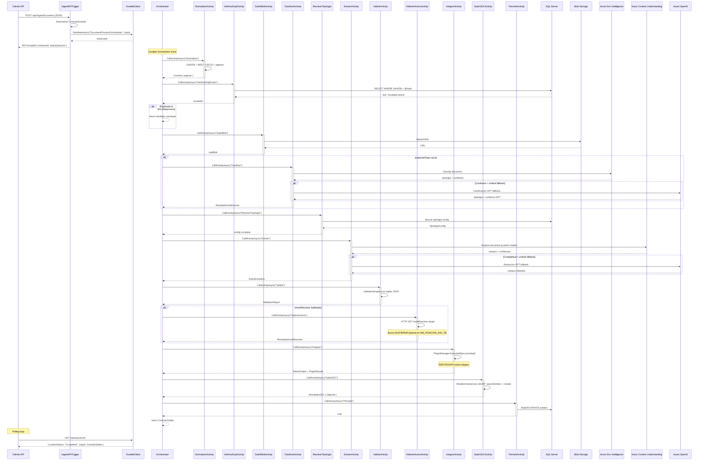

## 3.3 Estructura de tipología v1.2 (gdc/classification)

Desde mayo 2026, la configuración JSON de tipologías adopta bloques jerárquicos para metadatos de clasificación y GDC.

Estructura canónica:

```json
{
  "tipologiaId": "nota-simple",
  "tipologiaNombre": "Nota simple",
  "version": "1.4",
  "gdc": {
    "skipUpload": false,
    "matricula": "AI-01-NOTS-01",
    "tipoDocumento": "NOTS",
    "subtipoDocumento": "NOTS01",
    "serie": "AI09"
  },
  "classification": {
    "tdn1": "...",
    "tdn2": "...",
    "gptDescripcion": "...",
    "enableRules": true
  },
  "classificationConfig": {
    "examplePhrases": [],
    "disambiguationHints": []
  }
}
```

Compatibilidad backward:

- El backend mantiene fallback por propiedades resueltas (`Resolved*`) para leer tanto el formato v1.2 como el legacy de raíz (`gdcTipoDocumento`, `tdn1`, `gptDescripcion`, etc.). Esas propiedades de raíz están marcadas `[Obsolete]` en `TipologiaValidationConfig`: el código nuevo y los tests usan `gdc.*` y `classification.*`. `DocumentIA.Functions` silencia CS0618 a propósito para seguir leyendo configuraciones antiguas (AB#100288).
- En edición/creación se persiste formato v1.2 y, temporalmente, también campos legacy redundantes para no romper consumidores previos.

Fuente de configuración:

- Producción opera exclusivamente contra BBDD (`Tipologias.ConfiguracionJson`).
- Se elimina la ruta legacy de lectura por ficheros para resolver/cargar tipologías en runtime.

---

## 3.3 Diagrama de Secuencia — Motor de Validacion

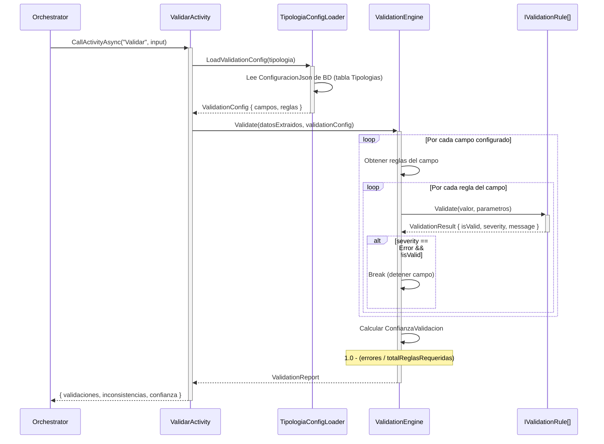

---

## 3.4 Diagrama de Clases — Subsistemas Principales

### 3.4.1 Contratos API

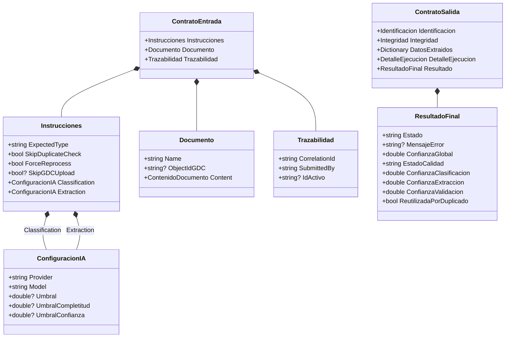

### 3.4.2 Interfaces de Proveedores

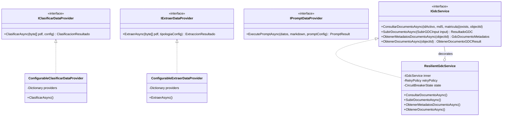

### 3.4.3 Sistema de Plugins

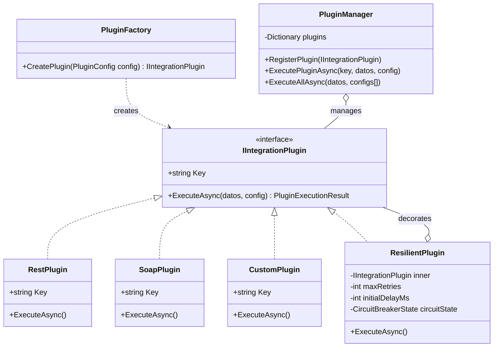

### 3.4.4 Motor de Validacion

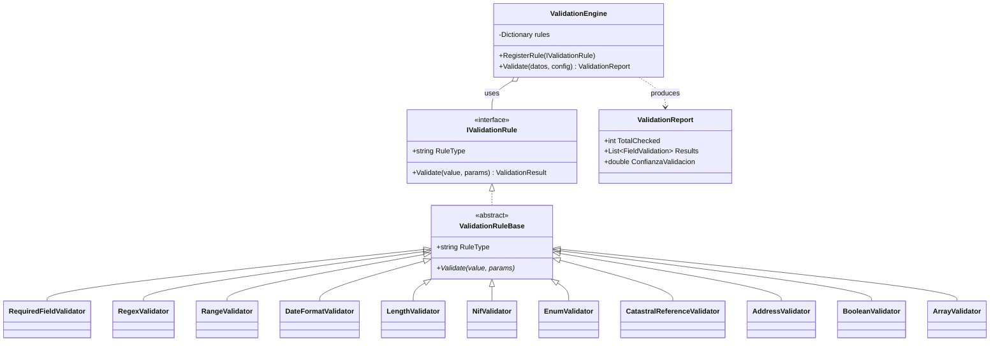

### 3.4.5 Subsistema AssetResolver

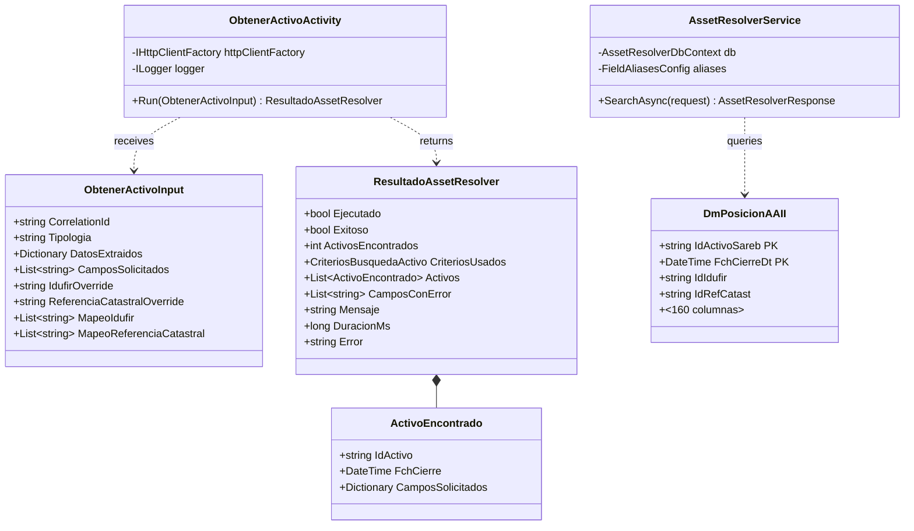

---

## 3.5 Modelo Entidad-Relacion

El modelo de datos completo (13 entidades, índices, claves foráneas, historial de las 38 migraciones y versión del esquema 1.24, `20261013092225_ClaveIntencionDedup`) vive en [DATA_MODELS_ER_DIAGRAM.md](especificaciones/DATA_MODELS_ER_DIAGRAM.md), revisado el 2026-11-22. El diagrama de clases que había aquí describía 8 entidades con atributos desfasados (`Nombre`, `Extension`, `TipologiaDetectada`, `DuracionClasifMs`...) y se retira para no mantener dos copias.

Entidades del `DocumentIADbContext`: `Documentos`, `ResultadosProcesamiento`, `Tipologias`, `Auditoria`, `DocumentoEjecuciones` (con las columnas de coste, reutilización y clave de intención), `PluginEjecuciones`, `ValidacionResultados`, `ModeloConfigs` (`Tipo` 0 a 5: Clasificacion, Extraccion, Prompt, Layout, Tarifas, Embeddings), `PluginTipologiaConfigs`, `TipologiaConfigAudit`, `CatalogoTdn1`, `CatalogoTdn2` y `PromptTemplates`.

### Indices Configurados en OnModelCreating (resumen; la lista completa está en DATA_MODELS_ER_DIAGRAM.md)

| Entidad | Indice | Tipo |
|---------|--------|------|
| `DocumentoEntity` | SHA256 | Unique |
| `DocumentoEntity` | CorrelationId | Non-unique |
| `DocumentoEntity` | Estado | Non-unique |
| `TipologiaEntity` | Codigo | Unique |
| `ModeloConfigEntity` | Key | Unique |
| `PluginTipologiaConfigEntity` | TipologiaCodigo | Unique |
| `DocumentoEjecucionEntity` | EjecucionGuid | Unique |
| `DocumentoEjecucionEntity` | FechaEjecucion (+26 INCLUDE, `..._Monitor`) | Cubriente del Monitor |
| `DocumentoEjecucionEntity` | (DocumentoId, ClaveIntencion, FechaEjecucion DESC) | Clave de intención (ADR-003) |
| `DocumentoEjecucionEntity` | EjecucionOriginalId; InstanceId (filtrado por reutilizadas); (IdActivo, DocumentoId) | Reutilización y consulta por activo |
| `DocumentoEntity` | MD5 (INCLUDE SHA256); FechaExpiracionBlob | Dedup por MD5; limpieza de blobs |
| `PromptTemplateEntity` | (PromptKey, Version) único; (PromptKey, IsActive) filtrado | Prompts versionados |
| `PluginEjecucionEntity` | (EjecucionId, PluginKey) | Compuesto |
| `ValidacionResultadoEntity` | (EjecucionId, Campo) | Compuesto |

---

## 3.6 Motor de Reglas de Validacion

### 3.6.1 Arquitectura

El motor sigue el patron **Strategy**: cada tipo de regla implementa `IValidationRule` con un `RuleType` string discriminator. Las reglas se registran en `ValidationEngine` por tipo y se resuelven dinamicamente al ejecutar la validacion.

### 3.6.2 Tipos de Regla

| RuleType | Clase | Parametros | Ejemplo |
|----------|-------|-----------|---------|
| `required` | RequiredFieldValidator | — | Campo obligatorio, no vacio |
| `regex` | RegexValidator | `pattern` | `"pattern": "^\\d{14}$"` para IDUFIR |
| `range` | RangeValidator | `min`, `max` | Importes 0-999999999 |
| `dateFormat` | DateFormatValidator | `format` | `"format": "dd/MM/yyyy"` |
| `length` | LengthValidator | `minLength`, `maxLength` | NIF: 9-9 caracteres |
| `nif` | NifValidator | — | Validacion algoritmica NIF/NIE/CIF espanol |
| `enum` | EnumValidator | `values[]` | `["Plena", "Nuda", "Usufructo"]` |
| `catastralReference` | CatastralReferenceValidator | — | 20 chars, formato catastral espanol |
| `address` | AddressValidator | — | Estructura basica de direccion |
| `boolean` | BooleanValidator | — | true/false/si/no |
| `array` | ArrayValidator | `minItems`, `maxItems`, `itemRules[]` | Arrays de titulares |

### 3.6.3 Esquema de Configuracion JSON

```json
{
  "tipologiaId": "nota.simple.1_4",
  "version": "1.4",
  "extractionConfig": {
    "expectedFields": [
      "FincaRegistral", "IDUFIR_CRU", "Direccion",
      "ReferenciaCatastral", "FechaDocumento"
    ]
  },
  "confidenceConfig": {
    "umbralOK": 0.85,
    "umbralRevision": 0.70
  },
  "fields": {
    "FincaRegistral": {
      "rules": [
        { "type": "required", "severity": "Error", "message": "Finca registral es obligatoria" },
        { "type": "regex", "severity": "Warning", "params": { "pattern": "^\\d+$" }, "message": "Formato numerico esperado" }
      ]
    },
    "IDUFIR_CRU": {
      "rules": [
        { "type": "required", "severity": "Warning" },
        { "type": "regex", "severity": "Error", "params": { "pattern": "^\\d{14}$" }, "message": "IDUFIR debe tener 14 digitos" }
      ]
    },
    "Titulares": {
      "rules": [
        { "type": "required", "severity": "Error" },
        { "type": "array", "severity": "Error", "params": { "minItems": 1 } }
      ]
    },
    "NIF_Titular": {
      "rules": [
        { "type": "nif", "severity": "Error", "message": "NIF/NIE/CIF invalido" }
      ]
    },
    "ReferenciaCatastral": {
      "rules": [
        { "type": "catastralReference", "severity": "Warning" }
      ]
    },
    "FechaDocumento": {
      "rules": [
        { "type": "required", "severity": "Warning" },
        { "type": "dateFormat", "severity": "Error", "params": { "format": "dd/MM/yyyy" } }
      ]
    }
  }
}
```

### 3.6.4 Calculo de Confianza de Validacion

```
erroresCount  = campos con al menos una regla severity=Error que falla
totalRequired = total de campos con al menos una regla severity=Error configurada

ConfianzaValidacion = 1.0 - (erroresCount / totalRequired)
```

Si `totalRequired = 0` (sin reglas Error), `ConfianzaValidacion = 1.0`.

---

## 3.7 Sistema de Plugins

### 3.7.1 Ciclo de Vida

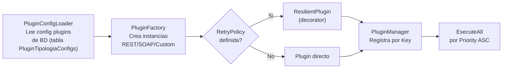

### 3.7.2 Resiliencia (ResilientPlugin)

```
Retry con backoff exponencial:
  delay = InitialDelayMs * 2^(attempt - 1)
  Ejemplo: 500ms → 1000ms → 2000ms → 4000ms

Circuit Breaker:
  - ConsecutiveFailures >= 5 → Estado OPEN
  - OPEN durante 5 minutos → Estado HALF_OPEN
  - HALF_OPEN: 1 intento → exito = CLOSED, fallo = OPEN
```

### 3.7.3 Esquema Configuracion Plugins JSON

```json
{
  "tipologiaCodigo": "nota.simple.1_4",
  "plugins": [
    {
      "pluginKey": "refCatExcel",
      "pluginType": "REST",
      "enabled": true,
      "priority": 1,
      "configuration": {
        "baseUrl": "https://api.ejemplo.com/catastro",
        "method": "POST",
        "headers": { "Authorization": "Bearer <TOKEN>" },
        "bodyTemplate": "{ \"referencia\": \"{ReferenciaCatastral}\" }",
        "responseMapping": {
          "idActivo": "$.result.idActivo",
          "direccionEnriquecida": "$.result.direccion"
        },
        "returnsIdActivo": true
      },
      "retryPolicy": {
        "maxRetries": 3,
        "initialDelayMs": 500
      }
    }
  ]
}
```

### 3.7.4 Tipos de Plugin

| Tipo | Clase | Comunicacion | Uso tipico |
|------|-------|-------------|-----------|
| `REST` | `RestPlugin` | HTTP/HTTPS (JSON) | APIs externas (catastro, atlas, enriquecimiento) |
| `SOAP` | `SoapPlugin` | HTTP/HTTPS (XML/SOAP) | Servicios corporativos legacy |
| `Custom` | `CustomPlugin` | DLL .NET cargada en proceso | Logica de negocio especifica (transformaciones, Excel) |

---

## 3.8 Configuracion Multi-Tipologia

### 3.8.1 Resolucion de Tipologia

```
Input: "nota-simple" | "nota-simple@1.4" | "nota.simple.1_4"
                 ↓
TipologiaVersionResolver
                 ↓
Buscar en TipologiaEntity WHERE Codigo = input (exacto)
  → Si no: split("@") → familia + version → buscar combinaciones
  → Si no: buscar default version de la familia
                 ↓
TipologiaConfig { Codigo, Version, Umbrales, ConfigJson }
```

### 3.8.2 Archivos de Configuración por Tipología

Los archivos JSON en `config/tipologias/` son únicamente **fuente de seed**: al arrancar la Function App, `ConfigurationSeedService` los lee y los inserta en BD si no existen. En tiempo de ejecución, **toda la configuración se lee exclusivamente desde base de datos**.

| Archivo (solo seed) | Propósito | Tabla BD en runtime |
|---------------------|-----------|---------------------|
| `{codigo}.validation.json` | Reglas de validación por campo | `Tipologias.ConfiguracionJson` |
| `{codigo}.plugins.json` | Plugins de integración | `PluginTipologiaConfigs.ConfiguracionJson` |
| `config/extraction/models.json` | Modelos de extracción | `ModeloConfigs` (tipo = Extraccion) |
| `config/classification/models.json` | Modelos de clasificación | `ModeloConfigs` (tipo = Clasificacion) |
| `config/prompt/models.json` | Modelos de prompt | `ModeloConfigs` (tipo = Prompt) |
| `config/layout/models.json` | Modelos de layout markdown | `ModeloConfigs` (tipo = Layout) |

> **Nunca editar los JSON de `config/` para cambiar el comportamiento en producción.** Para modificar tipologías, modelos o plugins existentes, usar DocumentIA.Admin o los endpoints de la Admin API y publicar el cambio en BD. Los archivos JSON siguen siendo útiles como respaldo, plantilla o re-seed en un entorno nuevo, pero pueden estar desactualizados y no deben borrarse sin confirmacion explicita.

### 3.8.3 Ciclo de Vida Draft → Published → Retired

| Accion | Endpoint | Efecto |
|--------|----------|--------|
| Crear | `POST /management/tipologias` | Estado = Draft |
| Editar | `PUT /management/tipologias/{id}` | Solo en Draft |
| Publicar | `POST /management/tipologias/{id}/publicar` | Draft → Published. Visible en pipeline. |
| Retirar | `POST /management/tipologias/{id}/retirar` | Published → Retired. Invisible en pipeline. |
| Reactivar | `POST /management/tipologias/{id}/draft` | Retired/Published → Draft |

### 3.8.4 Identidad, auditoría y modo solo lectura del Admin

`DocumentIA.Admin` (Blazor Server) resuelve la identidad del operador con `ICurrentUserService`/`CurrentUserService`:

- Con **App Service Authentication (EasyAuth)** activo, la identidad se lee de la cabecera `X-MS-CLIENT-PRINCIPAL-NAME` que inyecta la plataforma.
- Sin EasyAuth y fuera de desarrollo local, no hay identidad: `UserName = "no-autenticado"` e `IsAuthenticated = false`.
- En desarrollo local (`IWebHostEnvironment.IsDevelopment()`), se usa `dev-<usuario del SO>` y se considera identificado (la app solo es accesible desde la propia máquina).

**Modo solo lectura (AB#99999):** cuando `IsAuthenticated = false`, cualquier operación de escritura (crear/editar/publicar/retirar/activar/eliminar tipologías, modelos, prompts o configuración de plugins) se rechaza antes de llamar a la Admin API. La comprobación (`EnsureWritesAllowed()`) vive en la **capa de servicios** (`TipologiaAdminService`, `PromptManagementService`), no en las páginas Blazor, para que ninguna vista pueda saltársela por omisión. El rechazo lanza `InvalidOperationException` con el mensaje "Modo solo lectura: no hay un usuario autenticado, así que no es posible registrar quién realiza el cambio...". Las consultas (GET) no están sujetas a esta restricción.

**Auditoría:** el valor resuelto por `ICurrentUserService.UserName` es el que viaja como `usuario`/`CreatedBy`/`UpdatedBy`/`PublishedBy` en las peticiones a la Admin API. Los literales legacy `"ADMIN-UI"` y `"admin"` ya no se usan. Desde AB#100288 el alta de versiones de prompt también envía `createdBy`; si un cliente lo omite, la API persiste cadena vacía porque la columna es NOT NULL.

---

Los datos del proveedor de identidad por entorno (app registration, grupo de
acceso, ubicación del secret) se mantienen en la sección "Identidad y acceso al
Admin (EasyAuth)" de INFRAESTRUCTURA_REAL_DESPLEGADA y en la guía de activación
GUIA_EASYAUTH_ADMIN. Estado el 2026-11-22: EasyAuth activo en los tres entornos (DEV
desde el 2026-08-06, PRE y PRO desde el 2026-09-04); el modo solo lectura queda como
salvaguarda cuando no llega identidad.

### 3.8.5 Identidad visual del Admin

El Admin sigue el manual de identidad y la guía de estilo de SAREB (AB#101124). El tema se aplica con tokens CSS sobre Bootstrap 5.1.0, sin recompilarlo:

- `wwwroot/sareb.css` se carga en `App.razor` después de `bootstrap/bootstrap.min.css` y antes de `app.css`. Declara los tokens en `:root` y sobrescribe las variables de Bootstrap. En la 5.1 las utilidades `text-*` y `bg-*` leen `--bs-<color>-rgb`, así que se redefinen las dos variables de cada color; botones, foco de formularios, paginación y validación llevan colores fijos en Bootstrap y tienen reglas propias en `sareb.css`. `app.css` no conserva ningún color de la plantilla de Blazor (un test lo comprueba): el límite de error va en rojo de la paleta con texto negro y el checkbox de borde oscuro usa el verde gris.
- `Services/SarebPaleta.cs` contiene los mismos colores como constantes para lo que se pinta desde C# (gráficos). Si cambia un valor, cambia en los dos sitios.
- Logo en `wwwroot/img/sareb-logo-negativo.png` (negativo; el positivo no se incluye porque ninguna página lo usa, y un test comprueba que no quedan imágenes sin uso en `wwwroot/img`), reescalado desde `logos-sareb-services` de los recursos corporativos y recortado a su caja visible (sin margen transparente), para que a 40 px de alto la marca ocupe esa altura; el área de respeto la da el relleno de `.sareb-marca` (AB#101127). La barra lateral es verde corporativo con el logo negativo y la denominación «DocumentIA · Administración».

| Token CSS | Valor | Uso |
|---|---|---|
| `--sareb-verde` | `#00858C` | primario (`--bs-primary`), enlaces, foco, barra lateral |
| `--sareb-azul-oscuro` | `#046E97` | hover del primario, segunda serie de gráficos |
| `--sareb-azul` | `#0086AD` | `--bs-info`, tercera serie |
| `--sareb-turquesa` | `#00ABA8` | `--bs-success` (estado correcto) |
| `--sareb-verde-claro` | `#90CCB7` | cabeceras de tabla, marcador del ítem activo del menú |
| `--sareb-verde-gris` | `#6F927C` | texto secundario, etiquetas de KPI |
| `--sareb-gris` | `#BBBEB4` | bordes, `--bs-secondary` |
| `--sareb-gris-claro` | `#AFB6AC` | serie neutra adicional |
| `--sareb-naranja` | `#F39E48` | `--bs-warning` (en revisión); con texto oscuro, no llega a AA con blanco |
| `--sareb-rojo` | `#EA6B43` | `--bs-danger` (con error) |

Tipografía `Arial, Helvetica, sans-serif` (manual 3.1). El manual imprime el color 7 como «GF927C»; es una errata de `#6F927C`.

Gráficos, tablas y KPIs (AB#101126):

- `wwwroot/js/apexcharts-interop.js` fija valores por defecto globales en `window.Apex` según la guía 6.6: Arial, sin animaciones ni degradados (`fill.type = solid`) y leyenda abajo a la izquierda. Ningún color se fija ahí, ni el de la rejilla (un test lo comprueba): cada componente los pasa desde `SarebPaleta` (`MonitorGraficos`: `Neutro` para el total y `Error` para los fallos; `CostesGrafico`: `Verde`; rejilla en `GrisClaro` en los dos). Las ventanas relativas de `MonitorFiltroDto` toman el «ahora» de un `TimeProvider` (`ToQueryString(TimeProvider)`), con `TimeProvider.System` por defecto.
- `MonitorGraficos` y `CostesGrafico` reciben el parámetro `Periodo`, que las páginas rellenan con `MonitorFiltroDto.DescripcionPeriodo()` («últimas 24 horas», «últimos N días», «mes en curso» o «del d/M/yyyy al d/M/yyyy»). La tarjeta muestra título en minúscula y negrita con el periodo (`.sareb-grafico-titulo`), unidad arriba a la derecha (`.sareb-grafico-unidad`: `nº` o `€`) y la fuente en nota al pie (`.sareb-grafico-fuente`).
- Tablas según el manual 3.5: el encabezado de una tarjeta que contiene una tabla va en blanco negrita sobre verde corporativo (selector `:has`, soportado por Chrome y Edge actuales); las cabeceras de columna en negro negrita sobre verde claro; filas alternas y hover con verde claro translúcido; `table-dark` pasa a verde corporativo. Las alertas de Bootstrap 5.1 tienen colores fijos y se redefinen con la paleta.
- La superficie de los paneles de Monitor y Costes (`.mv2`: tarjetas, KPIs, cifra destacada) vivía duplicada en un bloque `<style>` de cada página; ahora está una sola vez en `sareb.css`. Los bloques `<style>` de `PromptEditor`, `EjecucionDetalle` y `JsonEditorComponent` conservan su estructura y solo cambian los literales de color por tokens.
- Los componentes de lectura del Monitor y de Costes (`MonitorLecturas`, `MonitorHistograma`, `MonitorMatriz`, `MonitorDesglose`, `MonitorCalidadKpis`, `CostesKpis`, `CostesDesglose`) tampoco llevan literales de color: los estados usan `SarebPaleta.Ok`, `Revision`, `Error` y `Neutro` (los estados de proceso con incidencia y los de error comparten `Error`); los KPIs llevan la cifra en verde corporativo y el estado en una barra lateral (`.sareb-kpi-ok`, `.sareb-kpi-revision`, `.sareb-kpi-error`), porque turquesa y naranja como texto no llegan al 3:1; el desglose por actividad, `Verde`, `AzulOscuro`, `Turquesa` y `Naranja`; la matriz proceso × calidad, la escala `SarebPaleta.Escala` (de verde claro a azul oscuro). `PaletaComponentesTests` falla si aparece en su marcado un color hexadecimal fuera de la paleta (AB#101124).
- Contraste: sobre turquesa, naranja, rojo, gris y azul el texto va en negro (6:1 o más), no en blanco (entre 1,9:1 y 4,2:1). Así se pintan badges, `btn-success`, `btn-danger`, el banner de entorno (`text-black`; `text-dark` se queda en 3,8:1 sobre el azul) y las cabeceras de tarjeta con `bg-*`. `sareb.css` cubre también hover, foco, activo, deshabilitado y `btn-check` de cada botón, y hover y foco de la paginación, para que no reaparezcan los colores de plantilla. En las cabeceras verdes de tarjetas con tabla, botones `btn-outline-primary`, enlaces y `text-muted` pasan a blanco. `SarebCssTests` y `KpisContrasteTests` vigilan estas reglas (AB#101124).


## 3.9 Manejo de Errores en Durable Functions

### 3.9.1 Patron EjecutarPasoNegocio

Todas las actividades se invocan via el wrapper `EjecutarPasoNegocio<T>()` del orchestrator:

```csharp
// Pseudocodigo del patron
async Task<T> EjecutarPasoNegocio<T>(string nombre, Func<Task<T>> accion)
{
    MarcarInicioActividad(nombre);
    PublicarEstado(nombre, "Running");
    try
    {
        var resultado = await accion();
        MarcarFinActividad(nombre, "Completed");
        return resultado;
    }
    catch (Exception ex)
    {
        MarcarFinActividad(nombre, "Failed", ex.Message);
        throw; // re-throw para que el orchestrator gestione
    }
}
```

### 3.9.2 Early Exits (Salidas Anticipadas)

| Condicion | Actividad | Estado final | Se persiste? |
|-----------|-----------|-------------|-------------|
| Documento duplicado, !forceReprocess, con ejecución de la misma intención | VerificarDuplicado | El de la ejecución original (`ReutilizadaPorDuplicado=true`) | Si: fila de reutilización vinculada a la original (AB#100258); sin contrato salvo que complete un prompt o resumen (AB#100930) |
| Documento duplicado, !forceReprocess, sin ejecución reutilizable, `Dedup__ModoEstricto=false` | VerificarDuplicado | `DUPLICADO` | Si (parcial, AB#100178). En modo estricto (defecto) no es salida anticipada: el documento se procesa con `motivoNoReutilizacion` |
| Tipologia de catalogo con confianza clasificacion < umbral | Clasificar | `BAJA_CONFIANZA_CLASIFICACION` | No: el contrato se devuelve pero no queda fila en `DocumentoEjecuciones` (comprobado en DEV con el golden del 2026-11-19, AB#101435) |
| Tipologia virtual con confianza < umbral (instrucciones ?? proveedor ?? 0,6; AB#101435) | Clasificar | `BAJA_CONFIANZA_CLASIFICACION` | Si (contrato completo de la rama virtual) |
| Tipologia no resuelta | ResolverTipologia | `NO_CLASIFICADO` (AB#100178) | Si (parcial); el prompt y el resumen se ejecutan si la peticion los pidio |
| Documento por encima del limite de paginas sin `forzarProcesadoSinLimitePaginas` | tras Clasificar | `PAGINAS_EXCEDIDAS` | Si; se omiten Extraer, Prompt, Validar, ObtenerActivo, Integrar y SubirGDC |
| Cuota Azure OpenAI agotada (429 sostenido tras reintentos/cooldown) | Clasificar | `PENDIENTE_REINTENTO` (ver 3.9.5) | No (decision AB#100178). Si se persiste el `PENDIENTE_REINTENTO` por texto no obtenido con causa transitoria (AB#100880) |

### 3.9.3 Timeout GDC

```csharp
// Patron timeout en orchestrator
var gdcTask = context.CallActivityAsync<ResultadoGDC>("SubirGDC", input);
var timeoutTask = context.CreateTimer(context.CurrentUtcDateTime.AddSeconds(120), CancellationToken.None);

var winner = await Task.WhenAny(gdcTask, timeoutTask);
if (winner == timeoutTask)
{
    // Marca timeout, continua a Persistir
    resultadoGDC = new ResultadoGDC { Exitoso = false, Mensaje = "Timeout" };
}
```

### 3.9.4 Degradacion Graceful

| Fallo | Comportamiento |
|-------|---------------|
| AI Service no disponible | Fallback a proveedor alternativo (DI → GPT, CU → GPT) |
| Plugin no critico falla | Log warning, continuar con siguiente plugin |
| Plugin critico (P=1) falla | Detener cadena plugins, datos parciales se preservan |
| GDC timeout/error | Marca error en GDC, continua a persistencia |
| BD no disponible | Exception no capturada → `runtimeStatus = Failed` |

### 3.9.5 Resiliencia ante Rate Limiting (429) de Azure OpenAI

Componente reutilizable `AzureOpenAIResilienceExecutor` (interfaz `IAzureOpenAIResilienceExecutor`, namespace `DocumentIA.Functions.Services.Resilience`, en `src/backend/DocumentIA.Functions/Services/Resilience/`) que envuelve las llamadas `ChatClient.CompleteChatAsync` del SDK `Azure.AI.OpenAI` v2 / `System.ClientModel`. Se aplica a **clasificación GPT** (`GptClasificarDataProvider`) y a **prompts** (`OpenAIPromptDataProvider`), portando el mismo patrón que ya usa `AzureContentUnderstandingProvider` para extracción (ver `ResilientGdcService` / `ResilientPlugin` en 3.4.2 y 3.7.2 como decoradores análogos). El SDK desactiva su reintento por defecto (`ClientRetryPolicy(maxRetries: 0)`) para que el executor sea la única autoridad de reintento; las respuestas de error del SDK se exponen como `ClientResultException`.

**Mecanismo**

1. **Reintento in-call** ante 429, 500, 502, 503, 504: respeta el header `Retry-After` de la respuesta si viene; si no, aplica backoff exponencial desde `InitialRetryDelayMs`. El delay efectivo se acota con `MaxRetryDelaySeconds`. El timeout por-intento (`TimeoutSeconds` del modelo) es independiente del envelope de reintentos — cada intento tiene su propio timeout y el delay entre reintentos no lo consume. Errores no reintentables (p.ej. 400) se propagan sin tocar el circuito.
2. **Circuit breaker con cooldown**, clave `circuitKey = "{endpoint}|{deployment}"`: clasificación y prompts que apuntan al mismo recurso Azure OpenAI comparten circuito (misma bolsa de cuota). Tras `CircuitBreakerFailureThreshold` fallos consecutivos el circuito abre durante `CircuitBreakerOpenSeconds`; las llamadas siguientes fallan rápido sin reintentar hasta expirar el cooldown. Un éxito resetea el contador y cierra el circuito. El estado es en memoria por instancia (no compartido entre instancias escaladas del Function host), igual que en el patrón de Content Understanding.
3. Al agotar reintentos o con el circuito abierto, el executor lanza `RateLimitExhaustedException`.

**Desenlace determinista**

| Contexto | Comportamiento |
|----------|----------------|
| Clasificación GPT | `ClasificarActivity` captura `RateLimitExhaustedException` y devuelve `ResultadoClasificacion` con `RateLimitExcedido=true`, `FallbackRazon="rate_limit_exhausted"`, `TipologiaDetectada="Desconocido"`, `Confianza=0` — señal por dato, no excepción marshalada a través de la frontera Durable. `DocumentProcessOrchestrator` hace short-circuit a `Estado="PENDIENTE_REINTENTO"`, `EstadoCalidad="ERROR"`, confianzas a 0 y `MensajeError="Clasificación pospuesta: cuota de Azure OpenAI agotada (429). Reintentar más tarde."`. Es un estado retriable, diferenciado de `NO_CLASIFICADO` (documento genuinamente no clasificable), pensado para reencolar/reprocesar más tarde. `Resultado.Estado` es un string libre (no enum cerrado). Por decisión AB#100178 este `PENDIENTE_REINTENTO` por cuota **no se persiste** (el que viene de texto no obtenido por causa transitoria sí, AB#100880); cuando hay fila, la agregación de métricas no lo cuenta como `ERROR` y el Monitor lo muestra con badge `bg-warning`. |
| Prompts | Degradado graceful: `PromptResultado.Error` con prefijo `rate_limit_exhausted:`, sin escalar el documento a `PENDIENTE_REINTENTO` (no bloqueante). Se beneficia igual del reintento + cooldown. |

**Configuración**

Sección de nivel superior `AzureOpenAIResilience` (`EnableCircuitBreaker`, `CircuitBreakerFailureThreshold`, `CircuitBreakerOpenSeconds`, `MaxRetries`, `InitialRetryDelayMs`, `MaxRetryDelaySeconds`) — ver `05_MANUAL_USO_CONFIGURACION.md` para el detalle de cada clave. Rollback instantáneo al comportamiento previo: `MaxRetries: 0` + `EnableCircuitBreaker: false`.

**Telemetría** (Application Insights, `TelemetryClient` customEvents)

| Evento | Cuándo | Propiedades |
|--------|--------|-------------|
| `AOAI.RateLimitRetry` | En cada reintento | `circuitKey`, `attempt`, `delayMs`, `statusCode` |
| `AOAI.CircuitOpen` | El circuito se abre | `circuitKey` |
| `AOAI.CircuitClosed` | El circuito se cierra (cooldown expirado o éxito) | `circuitKey` |
| `AOAI.CircuitRejected` | Llamada rechazada por circuito abierto (fail-fast) | `circuitKey` |

Análogos a los eventos `CU.CircuitOpen/Closed/Failover/Rejected` de la extracción con Content Understanding.

**Fuera de alcance**

- Failover a modelo alterno (sí existe en Content Understanding, no en GPT).
- Retry de Durable Functions sobre la actividad de clasificación.
- Extensión al proveedor de extracción `GptFallbackExtraerDataProvider` (el componente queda listo para aplicarlo).
- Limitación conocida (`AB#99901`): si GPT se configura únicamente como `GlobalFallbackProvider` (no como paso del flujo), una rama con catch amplio en `ConfigurableClasificarDataProvider` absorbe la excepción antes de llegar a `PENDIENTE_REINTENTO`. El flujo por defecto `hybrid-rules-gpt-di` no está afectado. Vigencia no comprobada en la revisión del 2026-11-22: el proveedor ya captura `RateLimitExhaustedException` en ese camino.

Feature Azure DevOps: `AB#99893`.

---

## 3.10 Proteccion de Datos y Seguridad

### 3.10.1 Estado Actual

| Aspecto | Implementacion |
|---------|---------------|
| Autenticacion API | `AuthorizationLevel.Function` (x-functions-key) |
| Credenciales AI | Configuration (local) / Key Vault (Azure) |
| Credenciales GDC | Basic Auth via configuration |
| SSL GDC | Bypass configurable (`DisableSslValidation`) para CA interna |
| Datos en transito | HTTPS (Functions + AI Services + Blob) |
| Datos en reposo BD | TDE (Azure SQL) / sin cifrado (Docker local) |
| Datos en reposo Blob | SSE con Microsoft-managed keys |
| Logs | Structured logging (sin implementación específica de masking PII) |

### 3.10.2 Estado EP7 (actualizado)

| Item | Estado |
|------|--------|
| EP7 — Protección de datos y GDPR (WI 98519) | `Removed` en ADO (2026-05-26) por decisión de producto |
| Implicación documental | No se considera funcionalidad pendiente |
| Evolución futura | Si se retoma, deberá abrirse como nueva iniciativa y redefinir alcance técnico |

---

## 3.11 Diagrama de Estados del Documento

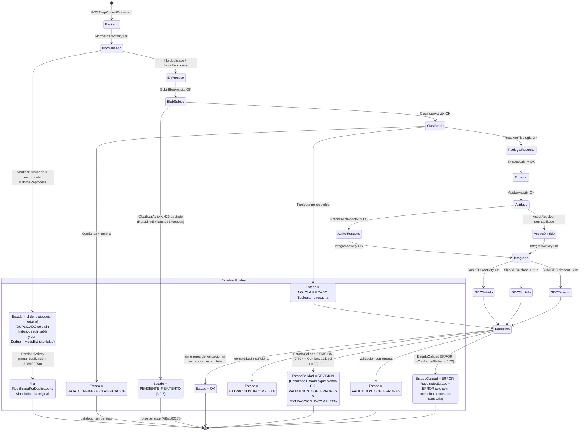

---

## 3.11b Subsistema de Costes de IA

Registra el consumo economico de cada llamada a un servicio de IA. Solo servicios
de IA: no contabiliza almacenamiento, computo ni red.

### 3.11b.1 Recorrido del dato

```
Proveedor de IA          Actividad                Orquestador            Persistencia
─────────────────       ──────────────           ─────────────          ─────────────
registra ConsumoIA  ->  aplica la tarifa    ->   acumula y agrega   ->  columnas + contrato
(tokens o paginas)      (CalculadoraCosteIA)     (AcumularConsumos)     (PersistirActivity)
```

**El calculo vive en la actividad, no en el orquestador.** El catalogo de tarifas
esta en base de datos y el orquestador de Durable Functions debe seguir siendo
determinista, asi que no puede consultarla. Lo que si puede hacer el orquestador es
sumar los importes ya calculados, porque sumar decimales es determinista.

### 3.11b.2 Piezas

| Componente | Proyecto | Responsabilidad |
|---|---|---|
| `ConsumoIA`, `CostesIA` | Core.Models | Modelo del contrato: una entrada por llamada y el agregado |
| `ProveedoresIA`, `ActividadesIA` | Core.Models | Nombres canonicos, sin dependencias de SDK |
| `TarifaRegistryLoader` | Core.Configuration | Carga el catalogo con cache de 5 min; tolerante a JSON invalido y a fila ausente |
| `CalculadoraCosteIA` | Core.Services | Resuelve la linea vigente por modelo y fecha, calcula y agrega |
| `ConsumosIA` | Core.Services | Fusiona consumos entre proveedores encadenados |
| `UsoOpenAiMapper` | Functions.Services | Traduce el bloque de uso del SDK de OpenAI; lee `cache_write_tokens` del cuerpo crudo (`TokensEscrituraCache`), que el SDK no expone |
| `UsoContentUnderstandingMapper` | Core.Services | Traduce el bloque `usage` de Content Understanding |
| `TarificadorDeConsumos` | Functions.Services | Aplica el catalogo en la actividad; un fallo no tumba el procesamiento |

### 3.11b.3 Canal de transporte

Los consumos viajan en los cinco resultados que ya cruzan la frontera de actividad:
`ResultadoClasificacion`, `ResultadoEmbeddings` (ADR-002), `ExtraccionResultado`,
`ExtraerMarkdownLayoutResultado` y `PromptResultado`. No hace falta ningun canal nuevo.

**Los proveedores compuestos deben fusionar.** Los routers de clasificacion y
extraccion, el clasificador hibrido y el rescate devuelven el resultado de un solo
proveedor y descartan el resto: sin `ConsumosIA.Fusionar`, el gasto desaparece justo
en fallback, descarte y restriccion de tipologias, que es donde mas se paga.

### 3.11b.4 Visibilidad en la salida

`ResultadoClasificacion` forma parte del contrato de salida, asi que su lista de
consumos llega tarificada. Se vacia en el envoltorio de `RunOrchestrator`, no en el
cuerpo: hay quince puntos de retorno, incluidas salidas tempranas por rate limit y
por documento sin contenido, y la regla no puede depender de acordarse en cada uno.

El bloque `DetalleEjecucion.Costes` se anula en ese mismo punto cuando la entrada no
trae `incluirCostes`. Al ser anulable, se omite del JSON.

### 3.11b.5 Invariantes

1. Los tokens cacheados vienen **incluidos** en los de entrada: se restan, no se suman.
2. Un fallo capturando o tarificando **nunca** hace fallar una ejecucion.
3. El bloque se calcula y persiste siempre; el parametro solo decide si se devuelve.
4. Los consumos descartados cuentan en el total, marcados con `Descartado`.
5. Una llamada combinada (extraccion + resumen) genera **un solo** consumo.
6. Un consumo sin ninguna magnitud no se tarifa a cero: se deja sin coste.
7. El importe es `decimal`, nunca `double`.
8. Los tokens escritos en cache (`TokensEscrituraCache`, AB#101412) son un **recargo**:
   ya se pagan como entrada plena y no se restan de ella. Se tarifican con
   `EurEscrituraCachePor1M` de la linea del catalogo. Si la linea no tiene ese precio,
   no se suma nada y `TarifaAplicada` lleva la marca `|sin-precio-escritura`.

Ver [MANUAL_COSTES_IA.md](manuales/MANUAL_COSTES_IA.md) para el detalle funcional y de uso.

---

## 3.12 Contratos API Completos

> Los ejemplos de esta sección son ilustrativos y están incompletos: el contrato vigente, campo a campo (incluidos `clasificacion.embeddings`, `ramaClasificacion`, `detalleProveedores`, `costes`, `claveIntencion`, `motivoReutilizacion`, `markdownFuente`, `restriccionTipologias`, `blobPath`, `preComputed*`, `operationId`), es [CONTRATO_API_HTTP.md](contratos/CONTRATO_API_HTTP.md). El seguimiento (`actividadesTotales`) arranca con las 7 actividades de negocio (Clasificar, Extraer, Validar, ObtenerActivo, Integrar, SubirGDC, Persistir), suma 3 si el documento entra por GDC y añade Prompt y otras de forma dinámica. `proveedorClasif: "GPT4oMini"` es un literal heredado del código y no indica el modelo efectivo.

### 3.12.1 POST /api/IngestDocument — Request

```json
{
  "instrucciones": {
    "expectedType": "",
    "skipDuplicateCheck": false,
    "forceReprocess": false,
    "skipGDCUpload": null,
    "classification": {
      "provider": "auto",
      "model": "auto",
      "umbral": null,
      "umbralCompletitud": null,
      "umbralConfianza": null
    },
    "extraction": {
      "provider": "auto",
      "model": "auto",
      "umbral": null,
      "umbralCompletitud": 0.9,
      "umbralConfianza": null
    },
    "assetResolver": {
      "enabled": true,
      "camposBusqueda": {
        "idufir": "FiledName_NewIDUFIR",
        "referenciaCatastral": null
      },
      "camposSolicitados": ["#ALL#"]
    }
  },
  "documento": {
    "name": "nota_simple_finca_12345.pdf",
    "objectIdGDC": null,
    "content": {
      "base64": "JVBERi0xLjcKMSAw..."
    }
  },
  "trazabilidad": {
    "correlationId": "a1b2c3d4-0000-0000-0000-000000000000",
    "submittedBy": "sistema-batch-sareb",
    "idActivo": "ACT-2026-00123"
  }
}
```

Reglas de validación del trigger:

- `documento.objectIdGDC` y `documento.content.base64` son mutuamente excluyentes.
- Debe informarse exactamente una fuente de documento.
- Si se usa `documento.objectIdGDC`, el backend fuerza `instrucciones.skipGDCUpload = true`.

### 3.12.2 POST /api/IngestDocument — Response 202

```json
{
  "instanceId": "abc123def456ghi789",
  "statusQueryUri": "https://srbappprodocai.azurewebsites.net/runtime/webhooks/durabletask/instances/abc123def456ghi789?code=<system-key>",
  "correlationId": "a1b2c3d4-0000-0000-0000-000000000000"
}
```

### 3.12.3 GET statusQueryUri — Running

```json
{
  "name": "DocumentProcessOrchestrator",
  "instanceId": "abc123def456ghi789",
  "runtimeStatus": "Running",
  "customStatus": {
    "version": "1.0",
    "estado": "Running",
    "actividadActual": "Extraer",
    "actividadesTotales": 7,
    "actividadesCompletadas": ["Clasificar"],
    "duracionTotalMs": 4200,
    "actividades": [
      { "nombre": "Normalizar", "estado": "Completed", "duracionMs": 120, "fallbackActivado": false },
      { "nombre": "VerificarDuplicado", "estado": "Completed", "duracionMs": 85, "fallbackActivado": false },
      { "nombre": "SubirBlob", "estado": "Completed", "duracionMs": 340, "fallbackActivado": false },
      { "nombre": "Clasificar", "estado": "Completed", "duracionMs": 2800, "fallbackActivado": true, "fallbackRazon": "Confianza DI 0.45 < umbral 0.85" },
      { "nombre": "ResolverTipologia", "estado": "Completed", "duracionMs": 15, "fallbackActivado": false },
      { "nombre": "Extraer", "estado": "Running", "duracionMs": 0, "fallbackActivado": false }
    ]
  },
  "createdTime": "2026-03-27T10:00:00Z",
  "lastUpdatedTime": "2026-03-27T10:00:04Z"
}
```

### 3.12.4 GET statusQueryUri — Completed (Exito)

```json
{
  "runtimeStatus": "Completed",
  "output": {
    "identificacion": {
      "documento": "nota_simple_finca_12345.pdf",
      "guid": "f47ac10b-58cc-4372-a567-0e02b2c3d479",
      "tipologia": "nota.simple.1_4",
      "tipologiaFamilia": "nota-simple",
      "tipologiaVersion": "1.4",
      "fechaProceso": "2026-03-27T10:00:12Z",
      "paginas": 5
    },
    "integridad": {
      "crc32": "a1b2c3d4",
      "sha256": "e3b0c44298fc1c149afbf4c8996fb92427ae41e4649b934ca495991b7852b855",
      "md5": "d41d8cd98f00b204e9800998ecf8427e",
      "rutaBlobStorage": "documents/nota_simple_finca_12345.pdf",
      "gestorDocumental": "GDC-OBJ-12345",
      "idActivo": "ACT-2026-00456",
      "idActivoEntrada": "ACT-2026-00123",
      "idActivoCambiado": true
    },
    "datosExtraidos": {
      "FincaRegistral": "12345",
      "IDUFIR_CRU": "28077000012345",
      "Direccion": "Calle Mayor 1, 28001 Madrid",
      "ReferenciaCatastral": "9872023VH5797S0001WX",
      "FechaDocumento": "15/01/2026",
      "Titulares": [
        {
          "Nombre": "GARCIA LOPEZ, MARIA",
          "NIF": "12345678Z",
          "Participacion": "100%",
          "TipoDominio": "Plena"
        }
      ],
      "Cargas": [
        {
          "Tipo": "Hipoteca",
          "Acreedor": "BANCO EJEMPLO SA",
          "Importe": 150000.00
        }
      ]
    },
    "detalleEjecucion": {
      "runTipologia": "nota.simple.1_4",
      "clasificacion": {
        "modelo": "srbdiprodocai-classifier-v1",
        "confianza": 0.92,
        "confianzaDI": 0.45,
        "confianzaGPT": 0.92,
        "proveedorClasif": "GPT4oMini",
        "ramaClasificacion": "gpt",
        "fallbackLLM": true,
        "fallbackRazon": "Confianza DI 0.45 < umbral 0.85",
        "tipologiaDetectada": "nota-simple"
      },
      "extraccion": {
        "modelo": "nota-simple-cu-v1",
        "confianzaExtraccion": 0.91,
        "proveedorExtrac": "AzureContentUnderstanding",
        "modelKeyEfectivo": "nota.simple.1_4.azure-cu.sweden",
        "endpointEfectivo": "https://upe48-mm2avmdm-swedencentral.services.ai.azure.com/",
        "processingLocationEfectiva": "swedencentral",
        "layoutEnabled": false,
        "fallbackUsado": false,
        "confianzaPorCampo": {
          "FincaRegistral": 0.98,
          "IDUFIR_CRU": 0.95,
          "Direccion": 0.87,
          "ReferenciaCatastral": 0.91,
          "FechaDocumento": 0.93
        },
        "camposConDuda": [],
        "tiemposMs": {
          "prepare": 45,
          "limiterWaitMs": 120,
          "analysis": 3200,
          "parse": 18,
          "attempts": 1
        }
      },
      "postproceso": {
        "normalizaciones": ["FechaDocumento normalizada a dd/MM/yyyy"],
        "validaciones": ["FincaRegistral: OK", "IDUFIR_CRU: OK", "NIF_Titular: OK"],
        "inconsistencias": [],
        "confianzaValidacion": 1.0
      },
      "integracion": {
        "tipologia": "nota.simple.1_4",
        "estado": "OK",
        "mensaje": "Integracion completada",
        "plugins": [
          {
            "pluginKey": "refCatExcel",
            "priority": 1,
            "success": true,
            "mensaje": "IdActivo resuelto",
            "statusCode": 200,
            "durationMs": 450,
            "datosEnriquecidos": { "idActivo": "ACT-2026-00456" }
          }
        ],
        "datosFinales": {
          "FincaRegistral": "12345",
          "idActivo": "ACT-2026-00456"
        },
        "idActivoEntrada": "ACT-2026-00123",
        "idActivoResuelto": "ACT-2026-00456",
        "idActivoCambiado": true
      },
      "assetResolver": {
        "ejecutado": true,
        "exitoso": true,
        "activosEncontrados": 1,
        "criteriosUsados": {
          "idufir": "28077000012345",
          "referenciaCatastral": "9872023VH5797S0001WX"
        },
        "activos": [
          {
            "idActivo": "ACT-2026-00456",
            "fchCierre": "2026-01-31T00:00:00Z",
            "camposSolicitados": {
              "ID_ACTIVO_SAREB": "ACT-2026-00456",
              "FCH_CIERRE": "2026-01-31T00:00:00Z",
              "ID_IDUFIR": "28077000012345",
              "ID_REF_CATAST": "9872023VH5797S0001WX"
            }
          }
        ],
        "camposConError": [],
        "mensaje": "1 activo(s) encontrado(s).",
        "duracionMs": 180,
        "error": null
      },
      "gdc": {
        "exitoso": true,
        "objectId": "GDC-OBJ-12345",
        "mensaje": "Documento creado en GDC",
        "intentos": 1,
        "duracionMs": 1200,
        "errorDetalle": "",
        "yaExistia": false
      },
      "seguimiento": {
        "version": "1.0",
        "estado": "Completed",
        "actividadActual": "",
        "actividadesTotales": 7,
        "actividadesCompletadas": [
          "Clasificar", "Extraer",
          "Validar", "ObtenerActivo", "Integrar", "SubirGDC", "Persistir"
        ],
        "duracionTotalMs": 8500,
        "actividades": [
          { "nombre": "Clasificar", "estado": "Completed", "duracionMs": 2800, "fallbackActivado": true, "fallbackRazon": "Confianza DI 0.45 < umbral 0.85" },
          { "nombre": "Extraer", "estado": "Completed", "duracionMs": 3200, "fallbackActivado": false },
          { "nombre": "Validar", "estado": "Completed", "duracionMs": 45, "fallbackActivado": false },
          { "nombre": "ObtenerActivo", "estado": "Completed", "duracionMs": 180, "fallbackActivado": false },
          { "nombre": "Integrar", "estado": "Completed", "duracionMs": 450, "fallbackActivado": false },
          { "nombre": "SubirGDC", "estado": "Completed", "duracionMs": 1200, "fallbackActivado": false },
          { "nombre": "Persistir", "estado": "Completed", "duracionMs": 85, "fallbackActivado": false }
        ]
      },
      "prompt": null
    },
    "resultado": {
      "estado": "OK",
      "mensajeError": null,
      "confianzaGlobal": 0.91,
      "estadoCalidad": "OK",
      "confianzaClasificacion": 0.92,
      "confianzaExtraccion": 0.91,
      "confianzaValidacion": 1.0,
      "reutilizadaPorDuplicado": false,
      "mensajeReutilizacion": null
    }
  }
}
```

### 3.12.5 Management Endpoints

| Metodo | Endpoint | Descripcion | Auth |
|--------|----------|------------|------|
| GET | `/api/tipologias` | Tipologias publicadas (`identificador`, `nombre`, `extraction`) | Anonymous |
| GET | `/management/tipologias` | Todas las tipologias | Function |
| POST | `/management/tipologias` | Crear tipologia | Function |
| PUT | `/management/tipologias/{id}` | Actualizar tipologia | Function |
| POST | `/management/tipologias/{id}/publicar` | Publicar | Function |
| POST | `/management/tipologias/{id}/retirar` | Retirar | Function |
| POST | `/management/tipologias/{id}/draft` | Volver a Draft | Function |
| GET | `/management/tipologias/{id}` · `/{id}/versions` · `/{id}/audit` · `/{id}/diff/{otherId}` · `/{id}/export` | Detalle, versiones, auditoria, comparacion y exportacion de una tipologia | Function |
| POST | `/management/tipologias/import` | Importar una tipologia exportada | Function |
| GET | `/management/modelos/{tipo}` | Listar modelos por tipo (clasificacion/extraccion/prompt/layout/tarifas/embeddings) | Function |
| POST | `/management/modelos` | Crear modelo | Function |
| PUT | `/management/modelos/{id}` | Actualizar modelo | Function |
| DELETE | `/management/modelos/{id}` | Desactivar modelo (soft-delete, `Activo=false`, responde `200`) | Function |
| GET | `/management/prompts` | Listar plantillas de prompt (todas las versiones) | Function |
| GET | `/management/prompts/{id}` | Obtener plantilla de prompt por Id | Function |
| GET | `/management/prompts/by-key/{promptKey}` | Listar versiones de una `PromptKey` | Function |
| POST | `/management/prompts` | Crear versión borrador (`IsActive=false`) | Function |
| PUT | `/management/prompts/{id}` | Actualizar borrador. `403` si la versión está activa | Function |
| PUT | `/management/prompts/{id}/activate` | Activar versión (desactiva la anterior activa de la misma clave) | Function |
| POST | `/management/prompts/rollback` | Reactivar una versión previa (desactiva la actual) | Function |
| DELETE | `/management/prompts/{id}` | Eliminar borrador. `403` si la versión está activa | Function |
| GET | `/management/configuration` | Diagnóstico de configuración efectiva (incluye `environment`) | Function |
| GET | `/management/plugins-tipologias` | Listado de configuraciones de plugins por tipologia | Function |
| GET | `/management/plugins-tipologias/{codigo}` | Config plugins de tipologia | Function |
| GET/POST/PUT/DELETE | `/management/catalogotdn1`, `/management/catalogotdn1/{id}`, `/management/catalogotdn2`, `/management/catalogotdn2/{id}`, `/management/catalogotdn2/by-tdn1/{codigoTdn1}` | CRUD de los catalogos TDN1 y TDN2 | Function |
| PUT | `/management/plugins-tipologias/{codigo}` | Actualizar config plugins | Function |
| POST | `/management/plugins-tipologias/{codigo}/publicar` | Publicar config plugins | Function |
| POST | `/management/plugins-tipologias/{codigo}/retirar` | Retirar config plugins | Function |
| GET | `/management/ejecuciones` | Listado paginado de ejecuciones. Query: `desde`, `hasta` (default: ultimos 7 dias), `tipologia`, `estado`, `flujo`, `submittedby`, `q` (nombre de documento o GUID), `page`, `pageSize`. Respuesta: `{items, total, page, pageSize}` | Function |
| GET | `/management/ejecuciones/agregados` | KPIs y serie temporal diaria calculados en servidor sobre el mismo filtro que el listado | Function |
| GET | `/management/ejecuciones/costes` | Agregados de coste de IA sobre el mismo filtro (`incluirestimados=true` para sumar los estimados); lo consume la pagina `/costes` del Admin | Function |
| GET | `/management/ejecuciones/{guid}/detalle` | Detalle completo por GUID de ejecucion: contrato de salida completo (`ContratoSalidaCompletoJson`), timeline de actividades y nombres de tipologia resueltos contra el catalogo TDN1/TDN2 | Function |

Fuera de `management/*`: `POST /api/healthcheck` (anonimo), `GET /api/documentos/{sha256}/markdown` y `GET /api/ejecuciones/{guid}/markdown` (Function; AB#100968) y `GET /api/tipologias`. Los endpoints `/management/ejecuciones*` son los que consume el Monitor del Admin (páginas `/monitor`, `/monitor/{guid}`, `/monitor-v2` y `/costes`). El campo `submittedBy` del listado y del detalle se resuelve con `COALESCE(DocumentoEjecuciones.SubmittedBy, Documentos.SubmittedBy)`: las ejecuciones anteriores a la migración `20260805100351_AgregarSubmittedByEjecucion` no tienen el valor propio y heredan el del documento (esto preserva, por ejemplo, el marcador `migracion-dev` de la migración operativa DEV→PRO).

En todas las respuestas de `/management/modelos*` (GET/POST/PUT/DELETE), el campo `ConfiguracionJson` sale con los valores de propiedades sensibles (nombre que contiene `apikey`, `password`, `secret` o `accountkey`, de forma recursiva) enmascarados como `"***"`. En escritura (POST/PUT), si una propiedad sensible llega con el valor `"***"` se conserva el valor previamente almacenado (round-trip seguro): esto permite editar un modelo sin reenviar la clave real y sin destruirla; para sustituirla basta con enviar el valor nuevo en claro.

La validación de contenido de `/management/prompts` (POST/PUT) es únicamente de longitud (10–16000 caracteres); los placeholders del contenido (`{CONTEXT_PROMPT}`, `{TDN1_CATALOG}`, `{TDN2_CATALOG}`, `{TDN1_CODE}`, `{DOCUMENT_TEXT}`, etc.) no se validan en backend — flexibilidad deliberada para edición iterativa. Ver [ESPECIFICACION_PROMPTS_CONFIGURABLES.md](especificaciones/ESPECIFICACION_PROMPTS_CONFIGURABLES.md).

El campo `environment` de `/management/configuration` se resuelve con prioridad desde el app setting `EnvironmentName` (nuevo, desplegado por pipeline), con fallback a `AZURE_FUNCTIONS_ENVIRONMENT`/`DOTNET_ENVIRONMENT` y por último `"Unknown"`. No se usa `AZURE_FUNCTIONS_ENVIRONMENT` como fuente principal porque en un Function App desplegado altera el comportamiento del host (fallback a BD InMemory cuando vale `"Development"`).

---

## 3.13 Referencias

| Documento | Contenido |
|-----------|-----------|
| [01_ARQUITECTURA_SISTEMA.md](01_ARQUITECTURA_SISTEMA.md) | Arquitectura, ADRs, patrones |
| [CONTRATO_API_HTTP.md](contratos/CONTRATO_API_HTTP.md) | Contrato API detallado (original) |
| [CONFIANZA_AGREGADA.md](referencias/CONFIANZA_AGREGADA.md) | Logica de confianza |
| [MANUAL_COSTES_IA.md](manuales/MANUAL_COSTES_IA.md) | Coste de IA: medicion, tarifas, consulta y relleno retroactivo |
| [TIPOLOGIAS_REFERENCIA.md](referencias/TIPOLOGIAS_REFERENCIA.md) | Catalogo de tipologias |
