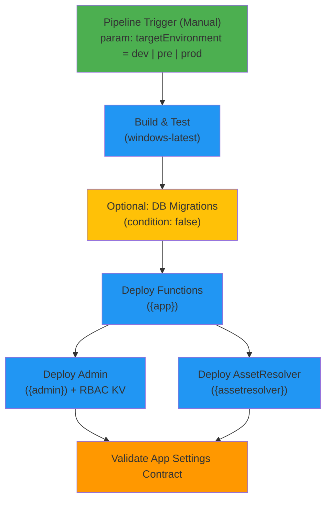

# Infraestructura Real Desplegada — DEV / PRE / PRO

> Última revisión: 2026-11-25 (AB#101553, validación TLS del GDC contra la CA de SAREB; pendiente de despliegue, DEV primero). Revisiones previas: 2026-11-25 (AB#101450, retirada de los app settings heredados sin efecto), 2026-11-22 (AB#101447, contraste con `azure-pipelines*.yml`, `infra/ai/pipeline-variables.yml`, `infra/ai/deployments.*.json` y el código). Lo que no se ha podido comprobar contra Azure en esta revisión se marca como tal.

## 🌐 Modelo multi-entorno

La solución se despliega en **tres entornos paralelos** que comparten el mismo código y el mismo contrato de configuración. El pipeline `azure-pipelines.yml` resuelve todos los nombres de recursos, la suscripción y la service connection a partir del parámetro `targetEnvironment` (`dev` | `pre` | `prod`).

Cada entorno vive en su propia **suscripción** y **resource group**:

| Aspecto | DEV | PRE | PRO |
|---------|-----|-----|-----|
| **Resource Group** | `SRBRGDEVDOCSAI` | `SRBRGPREDOCSAI` | `SRBRGDOCSAIPROD` |
| **Subscription ID** | `8764f9ff-fe37-4c03-bde9-6294622bef6d` | `a4f6b357-8f13-4488-9ee8-b9f635426f91` | `647c7246-54bc-4d31-b909-431cacf03272` |
| **Service Connection (ADO)** | `AI DocClassExt DEV` | `AI DocClassExt PRE` | `AI DocClassExt PRO` |

> **ℹ️ IA por entorno.** Cada entorno tiene su propio stack de IA: un Document Intelligence (`srbdi<env>docai`) y **dos** cuentas AIServices/Foundry (`srbaisrv01<env>docai` primaria, CU + OpenAI, y `srbaisrv02<env>docai`, CU secundaria). **DEV usa su IA propia desde 2026-09-22 y PRE desde 2026-09-23** (AB#100320). **PRO conserva sus recursos** (`upe48-mm2avmdm-swedencentral` en swedencentral, `srbaisrv-westeurope` en westeurope, DI `srbdiprodocai`) y **desde 2026-10-08 (release v1.0.0, AB#100321) los resuelve también por alias e identidad administrada**, igual que DEV y PRE. En los tres entornos los endpoints se resuelven por alias con los app settings `AI__Resources__<alias>__Endpoint` (`AiEndpointResolver`), calculados a partir de `infra/ai/pipeline-variables.yml`; ver "3) Alias e identidad por entorno" en [Recursos de IA](#recursos-de-ia). Fuentes: `infra/ai/pipeline-variables.yml`, [ADR-001](../decisiones/ADR-001-promocion-artefactos-ia-dev-pre-pro.md) y [DESPLIEGUE_IA.md](../procedimientos/DESPLIEGUE_IA.md). Ver [Recursos de IA](#recursos-de-ia) y [caveats operativos](#-known-issues--workarounds).

---

## 📋 Inventario de recursos por entorno

Verificado con `az resource list` sobre cada RG (todos los recursos en **West Europe**, salvo el AIServices primario de PROD en Sweden Central).

| Recurso (tipo) | DEV | PRE | PRO |
|---------|-----|-----|-----|
| **Azure Functions** (`Microsoft.Web/sites`) | `srbappdevdocai` | `srbapppredocai` | `srbappprodocai` |
| **App Service — Admin (Blazor)** | `srbwebadmindevdocai` | `srbwebadminpredocai` | `srbwebadminprodocai` |
| **App Service — AssetResolver** | `srbwebpluginassetresolverdev` | `srbwebpluginassetresolverpre` | `srbwebpluginassetresolver` |
| **App Service Plan (Functions)** | `srbspdevdocai` | `srbsppredocai` | `srbspprodocai` |
| **App Service Plan (Web)** | `srbaspwebdevdocai` | `srbaspwebpredocai` | `srbaspwebprodocai` |
| **Key Vault** | `srbkvdevdocai` | `srbkvpredocai` | `srbkvprodocai` |
| **SQL Server** | `srbsqldevdocai` | `srbsqlpredocai` | `srbsqlprodocai` |
| **SQL Databases** | `DocumentIA` | `DocumentIA` | `DocumentIA` |
| **Storage (documentos)** | `srbstgdevdocai` | `srbstgpredocai` | `srbstgprodocai` |
| **Storage (Durable hub)** | `srbstgdevappdocai` | `srbstgpreappdocai` | `srbstgproapppdocai` |
| **Application Insights** | `srbappidevdocai` | `srbappipredocai` | `srbappiprodocai` |
| **Log Analytics Workspace** | `srblawdevdocai` | `srblawpredocai` | `srblawprodocai` |
| **Document Intelligence** (`CognitiveServices` / FormRecognizer) | `srbdidevdocai` | `srbdipredocai` | `srbdiprodocai` |
| **AIServices / Foundry** (CU + OpenAI) | `srbaisrv01devdocai`, `srbaisrv02devdocai` | `srbaisrv01predocai`, `srbaisrv02predocai` | `upe48-mm2avmdm-swedencentral` (swedencentral), `srbaisrv-westeurope` (westeurope) |
| **Alertas Azure Monitor** | — (sin alertas) | — (sin alertas) | action group `srbagoperprodocai` y alertas descritas en [MONITOREO_ALERTAS_REAL.md](../observabilidad/MONITOREO_ALERTAS_REAL.md) |
| **Dashboards / Workbooks** | — | — | 1 dashboard + 2 workbooks |
| **GDC endpoint** | `https://srbwidd03.sareb.srb:8090/sintws/IDocService` | `https://srbwidi03.sareb.srb:8090/sintws-162/IDocService` | `https://srbwidp05.sareb.srb:8090/sintws/IDocService` |

> **Nota de naming:** DEV/PRE nombran sus cuentas AIServices como `srbaisrv0{1,2}<env>docai`; PROD usa `upe48-mm2avmdm-swedencentral` (primario) y `srbaisrv-westeurope` (secundario).

**Endpoints públicos (por entorno):**

| Componente | DEV | PRE | PRO |
|-----------|-----|-----|-----|
| **Functions API** | `https://srbappdevdocai.azurewebsites.net/api/` | `https://srbapppredocai.azurewebsites.net/api/` | `https://srbappprodocai.azurewebsites.net/api/` |
| **Admin Web** | `https://srbwebadmindevdocai.azurewebsites.net/` | `https://srbwebadminpredocai.azurewebsites.net/` | `https://srbwebadminprodocai.azurewebsites.net/` |
| **AssetResolver** | `https://srbwebpluginassetresolverdev.azurewebsites.net/` | `https://srbwebpluginassetresolverpre.azurewebsites.net/` | `https://srbwebpluginassetresolver.azurewebsites.net/` |

<a id="recursos-de-ia"></a>
### Recursos de IA

**1) Recursos de IA por entorno** (DEV y PRE los usan desde 2026-09-22 y 2026-09-23; PRO mantiene los suyos y los resuelve por alias e identidad desde 2026-10-08, AB#100321):

| Entorno | Document Intelligence | AIServices / Foundry (CU + OpenAI) |
|---------|-----------------------|-------------------------------------|
| **DEV** | `srbdidevdocai` | `srbaisrv01devdocai`, `srbaisrv02devdocai` |
| **PRE** | `srbdipredocai` | `srbaisrv01predocai`, `srbaisrv02predocai` |
| **PRO** | `srbdiprodocai` | `upe48-mm2avmdm-swedencentral` (swedencentral), `srbaisrv-westeurope` (westeurope) |

**2) Endpoints de PRO** (los tres entornos resuelven los suyos por alias `AI__Resources__<alias>__Endpoint`; PRO tiene los cuatro settings desde el run 79704 del pipeline 799, 2026-10-08). Endpoints por entorno en `infra/ai/pipeline-variables.yml`:

| Recurso PROD | Kind / SKU | Región | Endpoints | Rol |
|--------------|-----------|--------|-----------|-----|
| `upe48-mm2avmdm-swedencentral` | AIServices (Foundry) / S0 | swedencentral | CU: `https://upe48-mm2avmdm-swedencentral.services.ai.azure.com/`<br>OpenAI: `https://upe48-mm2avmdm-swedencentral.openai.azure.com` | **CU primario** + **OpenAI primario** — deployment `gpt-4o-mini` (modelo gpt-4.1-mini) = respaldo GPT de extracción y clasificación, prompt libre y resumen en PRO (ver «Modelo generativo por entorno») |
| `srbaisrv-westeurope` | AIServices (Foundry) / S0 | westeurope | CU: `https://srbaisrv-westeurope.services.ai.azure.com/`<br>OpenAI: `https://srbaisrv-westeurope.openai.azure.com/` (control-plane: `…cognitiveservices.azure.com/`) | **CU secundario** (failover / reparto de carga desde Sweden Central) + **OpenAI secundario**. Tag `Purpose=CU-secondary-endpoint`; identity SystemAssigned; reglas VNet a `RedServiciosProduccion`. **No cableado como fallback OpenAI en el pipeline** (los App Settings apuntan a Sweden Central) |
| `srbdiprodocai` | FormRecognizer | westeurope | `https://srbdiprodocai.cognitiveservices.azure.com/` (API `2024-11-30`) | **Document Intelligence** (clasificación) |

**3) Alias e identidad por entorno** (estado al 2026-10-09; fuente para PRO: `docs/releases/v1.0.0/runbook.md`, nota 6b/6c):

| Aspecto | DEV (desde 2026-09-22) | PRE (desde 2026-09-23) | PRO (desde 2026-10-08, v1.0.0) |
|---------|------------------------|------------------------|--------------------------------|
| App settings `AI__Resources__<alias>__Endpoint` | 4 (`openai_primary`, `cu_primary`, `cu_secondary`, `di`) | 4 | 4, creados por el run 79704 del pipeline 799 |
| `ModeloConfigs` | filas con `ResourceAlias`, sin `Endpoint` | 27 filas con alias (cutover del 23/09) | 28 filas activas con alias (`openai_primary` 10, `cu_primary` 13, `cu_secondary` 2, `di` 3), 0 con `Endpoint` |
| `AuthMode` de las filas | `DefaultAzureCredential` | `DefaultAzureCredential` | `DefaultAzureCredential`; `ApiKey` purgada en todas las filas activas el 2026-10-08 (`clear-model-api-keys.sql`) |
| Roles de la identidad de la Function App sobre los recursos de IA del entorno | Cognitive Services User + Foundry User | Cognitive Services User + Foundry User | `srbappprodocai` (`e700ab11…`): Cognitive Services User sobre `upe48-mm2avmdm-swedencentral`, `srbaisrv-westeurope` y `srbdiprodocai`; Foundry User sobre `upe48-mm2avmdm-swedencentral` y `srbaisrv-westeurope` (este último añadido el 2026-10-08) |
| Opciones directas (`Extraction__AzureContentUnderstanding__*`, `Classification__AzureDocumentIntelligence__*`, `GptFallback__*`) | Retiradas en AB#101450 (DEV: pendiente del despliegue a DEV, fecha al verificar) | Retiradas en AB#101450 (con su siguiente despliegue, release) | Retiradas en AB#101450 (con su siguiente despliegue, release) |
| Validación por identidad | smoke y Fase A del clasificador | smoke 6/6 (cutover 23/09) | smoke 6/6 el 2026-10-08 (DI, OpenAI y CU en `srbaisrv-westeurope`); `cu_primary` por identidad pendiente de la primera extracción real (sin tráfico de negocio entre la ventana y el 2026-10-09 09:00Z) |

Pendientes de la Fase 3 (AB#100302 / AB#100321): Plataforma retira los roles de `srbappdevdocai` y `srbapppredocai` sobre `upe48-mm2avmdm-swedencentral`, `srbaisrv-westeurope` y `srbdiprodocai` (Step 3); borrado de las 6 tablas `ModeloConfigs__bak_*` de PRO, ya sin keys, previsto el 2026-10-15 (comprobado el 2026-11-23: las dos identidades conservan Cognitive Services User sobre los tres recursos de IA de PRO y las 6 tablas `ModeloConfigs__bak_*` siguen en la BD de PRO; AB#100321 sigue en Committed, bloqueado en Plataforma).

**Deployments de OpenAI por recurso PROD** (verificado con `az cognitiveservices account deployment list`; los sufijos numéricos son aleatorios y no coinciden entre recursos):

| Deployment | Modelo (versión) | SKU | Capacidad | Recurso |
|-----------|------------------|-----|-----------|---------|
| `gpt-4o-mini` | ⚠️ **`gpt-4.1-mini`** (2025-04-14) — el nombre engaña | Standard | 150 | Sweden Central |
| `gpt-4.1-715420` | `gpt-4.1` (2025-04-14) | GlobalStandard | 150 | Sweden Central |
| `gpt-4.1-mini-622960` | `gpt-4.1-mini` (2025-04-14) | GlobalStandard | 250 | Sweden Central |
| `gpt-4o` | `gpt-4o` (2024-11-20) | GlobalStandard | 250 | Sweden Central |
| `text-embedding-3-large-030358` | `text-embedding-3-large` (1) | GlobalStandard | 150 | Sweden Central |
| `gpt-5-mini` | `gpt-5-mini` (2025-08-07) | DataZoneStandard | 50 | Sweden Central |
| `gpt-4.1-892749` | `gpt-4.1` (2025-04-14) | GlobalStandard | 250 | West Europe |
| `gpt-4.1-mini-590191` | `gpt-4.1-mini` (2025-04-14) | GlobalStandard | 250 | West Europe |
| `text-embedding-3-large-010650` | `text-embedding-3-large` (1) | GlobalStandard | 250 | West Europe |
| `gpt-5-mini` | `gpt-5-mini` (2025-08-07) | DataZoneStandard | 50 | West Europe |


> **Deployments de DEV/PRE:** replican el juego en sus cuentas 01/02 (`infra/ai/deployments.dev.json` y `infra/ai/deployments.pre.json`), incluido `gpt-5-mini`.

> **Solo DEV (gpt-5.6-luna, en producción de DEV desde el 2026-11-20, ADR-004 / AB#99939):** `srbaisrv01devdocai` tiene además el deployment `gpt-5.6-luna` (modelo `gpt-5.6-luna` 2026-07-09, `DataZoneStandard`, **150K TPM**: creado con 50 el 2026-11-17 y subido a 150 el mismo día por los 429 de la golden), creado con `scripts/migrations/gpt56-luna/create-gpt56-luna-deployment.sh` (AB#101370). Desde el cutover es el deployment por defecto de DEV: las filas `classification.gpt56-luna` y `extraction.gpt56-luna` llevan `UseAsFallback`, la 2001 usa `default.gpt56-luna_ex` y las tipologías heredan `PromptDefaults__ModelKey = prompt.gpt56-luna` (scripts 06 y 08 de `scripts/migrations/gpt56-luna/`). Sigue **sin** declararse en `infra/ai/deployments.dev.json` (comprobado el 2026-11-22): llevarlo a `deployments.*.json` y crear el deployment, las filas y la tarifa en PRE y PRO es parte de la siguiente release (ADR-004, Consecuencias). El deployment `gpt-4o-mini` de DEV se conserva para la vuelta atrás (script 07 más el setting).

### Modelo generativo por entorno (2026-11-22)

| Entorno | Deployment generativo por defecto | `PromptDefaults__ModelKey` (pipeline) | Desde |
|---------|-----------------------------------|----------------------------------------|-------|
| DEV | `gpt-5.6-luna` en `srbaisrv01devdocai` (Data Zone Standard, 150K TPM, `reasoning_effort` none) | `prompt.gpt56-luna` | 2026-11-20 (ADR-004) |
| PRE | `gpt-4o-mini` (modelo gpt-4.1-mini) en `srbaisrv01predocai` | `default.gpt4o-mini` | hasta la siguiente release |
| PRO | `gpt-4o-mini` (modelo gpt-4.1-mini) en `upe48-mm2avmdm-swedencentral` | `default.gpt4o-mini` | hasta la siguiente release |

> Los settings `Extraction__GptFallback__DeploymentName` y `Classification__GptFallback__DeploymentName` ya no existen (retirados en AB#101450); el deployment generativo lo fijan `PromptDefaults__ModelKey` y las filas de `ModeloConfigs`. Azure OpenAI retira gpt-4.1-mini el 2027-04-14.

> **Regiones:** CU/OpenAI **primarios** (`upe48-mm2avmdm-swedencentral`) en **swedencentral**; CU/OpenAI **secundarios** (`srbaisrv-westeurope`) y **todos** los recursos de aplicación y DI en **West Europe**.

**Réplica de analizadores CU (Sweden → West Europe): identidades y roles reales** (verificado 2026-07-17)

Ambos recursos AIServices tienen **identidad administrada System-Assigned**. La replicación de analizadores de Content Understanding usa estas asignaciones:

| Principal (MI) | Rol | Scope | Para qué |
|----------------|-----|-------|----------|
| `srbaisrv-westeurope` (destino, `b69cbb95-…`) | **Storage Blob Data Reader** | Storage `srbstgproapppdocai` | Leer el blob de **datos etiquetados** al **reconstruir/reentrenar** el analizador en el destino (método real de réplica). Concedido el 1-jun-2026. |
| `srbaisrv-westeurope` (destino, `b69cbb95-…`) | ~~Cognitive Services User~~ (**revertido**) | Recurso origen `upe48-mm2avmdm-swedencentral` | Se concedió el 17-jul-2026 para probar el *pull* de la **Copy API cross-resource**; **no la desbloqueó** y se **revirtió** el mismo día. La MI del destino **no** mantiene rol sobre el origen. |

> [!IMPORTANT]
> **La Copy API cross-resource de CU (`grantCopyAuthorization` + `:copy`) NO funciona entre las dos cuentas de PRO** (`upe48-mm2avmdm-swedencentral` → `srbaisrv-westeurope`, verificado 2026-07-17). Sí funciona de PRO a las cuentas de DEV y PRE: es el mecanismo de promoción de `azure-pipelines-ai-artifacts.yml` (`scripts/ai/copy-cu-analyzers.ps1`), con los analyzers registrados como `copied` en `infra/ai/cu-analyzers.<env>.manifest.json` el 2026-09-21. Detalle del caso de PRO: el grant responde `200` sin campo `source` y el copy devuelve `"has not granted the necessary permissions"` incluso con la MI del destino con `Cognitive Services User` sobre el origen; `:getCopyAuthorization` (token) da `404`. Probable limitación con analizadores project-scoped de Foundry → **caso de soporte Azure**.
> **La réplica operativa se hace reconstruyendo/reentrenando** el analizador en el destino con `scripts/deployment/recreate-cu-analyzer.ps1` (reentrena desde el blob etiquetado; requiere el rol *Storage Blob Data Reader* de la tabla). Detalle en `docs/guias/GUIA_EXTRACCION_AZURE_CONTENT_UNDERSTANDING.md` §12.

---

## 📐 Topología (por entorno)

Cada resource group replica la misma topología. Sustituye `{app}`, `{kv}`, `{sql}`, `{stg}`, `{stgapp}`, `{ai}` por los nombres del entorno según el [inventario](#-inventario-de-recursos-por-entorno).

```
<Resource Group del entorno>
├── Azure Functions
│   ├── Name: {app}                (dev: srbappdevdocai · pre: srbapppredocai · pro: srbappprodocai)
│   ├── Runtime: .NET 10 isolated
│   ├── Managed Identity: ✓ Enabled
│   └── Storage: AzureWebJobsStorage (from KeyVault)
├── App Service (Admin Blazor)
│   ├── Name: {admin}
│   ├── Runtime: .NET 8
│   ├── Managed Identity: ✓ Enabled + RBAC to KeyVault
│   └── Access: Key Vault via "Key Vault Secrets User" role
├── App Service (AssetResolver Plugin)
│   ├── Name: {assetresolver}
│   ├── Runtime: .NET 8
│   ├── Connection: AssetResolver DB (secret: user-ods-dwh)
│   └── Base URL: https://{assetresolver}.azurewebsites.net/
├── Key Vault
│   ├── Name: {kv}                 (dev: srbkvdevdocai · pre: srbkvpredocai · pro: srbkvprodocai)
│   ├── Secrets: SQL, Storage, Extraction creds, Classification creds, GDC creds, API keys
│   └── RBAC: Functions App + Admin App + AssetResolver can read
├── SQL Server + Database
│   ├── Server: {sql}              (dev: srbsqldevdocai · pre: srbsqlpredocai · pro: srbsqlprodocai)
│   ├── Database: DocumentIA
│   ├── Auth: Active Directory Managed Identity (patrón PROD)
│   ├── Connection: SqlConnectionString (from KeyVault)
│   └── Schema: DocumentIADbContext (13 entidades), migraciones EF por el pipeline `azure-pipelines-migrations.yml` (script idempotente aplicado desde el pool privado)
├── Azure Storage (Blob + Table + Queue)
│   ├── Documentos: {stg}          (dev: srbstgdevdocai · pre: srbstgpredocai · pro: srbstgprodocai)
│   ├── Durable hub: {stgapp}      (dev: srbstgdevappdocai · pre: srbstgpreappdocai · pro: srbstgproapppdocai)
│   ├── Connection: AzureWebJobsStorage + AzureStorageConnectionString (from KeyVault)
│   └── Purpose: Durable Functions hub, document storage, audit logs
├── App Service Plans
│   ├── Functions: {asp-func}      (dev: srbspdevdocai · pre: srbsppredocai · pro: srbspprodocai)
│   └── Web:       {asp-web}       (dev: srbaspwebdevdocai · pre: srbaspwebpredocai · pro: srbaspwebprodocai)
├── Application Insights
│   ├── Name: {ai}                 (dev: srbappidevdocai · pre: srbappipredocai · pro: srbappiprodocai)
│   ├── Tracing: PromptTracing enabled (20,000 char limit per prompt)
│   └── Sampling: 20 events/sec (from host.json)
├── Log Analytics Workspace: {law}  (dev: srblawdevdocai · pre: srblawpredocai · pro: srblawprodocai)
├── Networking: 5 Private Endpoints (SQL, Storage-blob, KeyVault, DI, Function App) + Private DNS Zones + VNet link
│                (dev→SRBCoreDev · pre→SRBCorePre · pro→RedServiciosProduccion)
└── Azure AI Services — por entorno (dev desde 2026-09-22, pre desde 2026-09-23, pro por alias e identidad desde 2026-10-08)
    ├── DI:        {di}         (dev: srbdidevdocai · pre: srbdipredocai · pro: srbdiprodocai)
    ├── AIServices: srbaisrv01<env>docai + srbaisrv02<env>docai   (PRO: upe48-mm2avmdm-swedencentral + srbaisrv-westeurope)
    └── Endpoints de PRO (los tres entornos: alias AI__Resources__<alias>__Endpoint, ver pipeline-variables.yml):
        ├── CU/OpenAI primario:  upe48-mm2avmdm-swedencentral  (swedencentral)
        ├── CU/OpenAI secundario: srbaisrv-westeurope           (westeurope, CU failover)
        └── Document Intelligence: srbdiprodocai                (westeurope, API 2024-11-30)
```

---

## 🔌 Networking (Private Endpoints y DNS)

Los tres entornos siguen la **misma topología de red privada**: los servicios PaaS se exponen por **Private Endpoint** y se resuelven vía **Private DNS Zones** enlazadas a la VNet del entorno.

**Private Endpoints por entorno** (5 en cada RG, todos en West Europe):

| Servicio | DEV | PRE | PRO |
|----------|-----|-----|-----|
| **SQL Server** | `pe-srbsqldevdocai` | `pe-srbsqlpredocai` | `srbpesqlprodocai` |
| **Storage (blob)** | `pe-srbstgdevdocai-blob` | `pe-srbstgpredocai-blob` | `srbpestgprodocai` |
| **Key Vault** | `pe-srbkvdevdocai` | `pe-srbkvpredocai` | `srbpekvprodocai` |
| **Document Intelligence** | `pe-srbdidevdocai` | `pe-srbdipredocai` | `srbpediprodocai` |
| **Function App** | `pe-srbappdevdocai` | `pe-srbapppredocai` | `srbpeappprodocai` |

> Naming: DEV/PRE usan `pe-<recurso>`; PROD usa `srbpe<svc>prodocai`.

**Private DNS Zones** (globales, una por servicio, presentes en los tres entornos):
`privatelink.database.windows.net` · `privatelink.blob.core.windows.net` · `privatelink.vaultcore.azure.net` · `privatelink.cognitiveservices.azure.com` · `privatelink.azurewebsites.net`

**VNet links:** DEV → `SRBCoreDev` · PRE → `SRBCorePre` · PRO → `RedServiciosProduccion` (links `srbdns…prodocai`).

> ⚠️ La resolución de `privatelink` es crítica: si la VNet del entorno no resuelve el registro privado a IP privada, el ingest y las llamadas a KV/SQL/DI fallan 

---

## 🔧 Configuración Post-Despliegue (App Settings)

Los App Settings son **idénticos en los tres entornos** salvo los valores que el pipeline parametriza: nombre de Key Vault (`$(KEY_VAULT_NAME)`), resource group, nombres de app, URL de AssetResolver, `GDC__Endpoint`, `EnvironmentName`, `PromptDefaults__ModelKey`, `DocumentIntelligence__UseInlineContent` (`true` en DEV y PRE, `false` en PRO) y `BlobRetention__BatchSize` (2000 en DEV y PRE, 5000 en PRO). Los endpoints de IA de las opciones directas (`Extraction__*`, `Classification__*`) toman los valores del entorno (`AI_CU_PRIMARY_ENDPOINT`, `AI_OPENAI_PRIMARY_ENDPOINT`, `AI_DI_ENDPOINT` de `infra/ai/pipeline-variables.yml`) y su `AuthMode` sigue en `ApiKey` desde el Key Vault del entorno; las filas de `ModeloConfigs`, que son las que usa el flujo, resuelven por alias `AI__Resources__<alias>__Endpoint` e identidad administrada (ver "3) Alias e identidad por entorno").

### **Azure Functions (`{app}`)**

| Setting | Value | Source |
|---------|-------|--------|
| **FUNCTIONS_WORKER_RUNTIME** | dotnet-isolated | hardcoded |
| **SecretsSource** | AzureVault | hardcoded |
| **KeyVaultName** | `{kv}` | pipeline var por entorno |
| **RunDatabaseMigrationsOnStartup** | false | pipeline var |
| **EnvironmentName** | dev: `Development` · pre: `Preproduction` · pro: `Production` | pipeline var por entorno (`ENVIRONMENT_NAME`); la aplican **ambos** `azure-pipelines.yml` y `azure-pipelines-admin.yml` (paso "Ensure Functions environment name" en el segundo, idempotente). La lee `GET management/configuration` con prioridad sobre `AZURE_FUNCTIONS_ENVIRONMENT`/`DOTNET_ENVIRONMENT` |
| **PromptDefaults__ModelKey** | dev: `prompt.gpt56-luna` · pre y pro: `default.gpt4o-mini` | pipeline var por entorno (`PROMPT_DEFAULTS_MODEL_KEY`, AB#99938 / ADR-004). Modelo de prompt y resumen de las tipologías sin `PromptConfig.ModelKey`; si no resuelve, prompt y resumen fallan. `ensure-app-settings.ps1` no pisa claves existentes: cambiarla tras el primer despliegue exige `az functionapp config appsettings set` |
| **DocumentIntelligence__UseInlineContent** | dev y pre: `true` · pro: `false` | pipeline var (`DI_USE_INLINE_CONTENT`) |
| **BlobRetention__BatchSize** | dev y pre: 2000 · pro: 5000 | pipeline var (`BLOB_RETENTION_BATCH_SIZE`) |

> **Settings heredados retirados (AB#101450, 2026-11-25).** Los app settings `Classification__GptFallback__*`, `Classification__AzureDocumentIntelligence__*`, `Classification__DefaultModelKey`, `Extraction__GptFallback__*` y los de conexión de `Extraction__AzureContentUnderstanding__*` (`Endpoint`, `ApiKey`, `AuthMode`, `DefaultProcessingLocation`) no se enlazaban a ninguna clase ni se leían en el código (comprobado el 2026-11-22 en `Program.cs`): los parámetros de conexión, modelo y umbrales de IA salen de las filas de `ModeloConfigs` resueltas por alias e identidad administrada. Se retiraron en AB#101450 (27 settings): `azure-pipelines.yml` (799) ya no los fija, y tanto el 799 como el 802 ejecutan `scripts/configuration/remove-legacy-app-settings.ps1` en cada despliegue para borrar los que existan; el contrato `scripts/config/azure-appsettings-contract.json` los lista en `forbiddenSettings` y falla la validación si reaparece alguno. Estado por entorno: DEV, pendiente del despliegue a DEV (fecha al verificar); PRE y PRO, con su siguiente despliegue (release). De `Extraction__AzureContentUnderstanding__*` solo se leen los siete de resiliencia (`MaxConcurrentCalls`, `HardTimeoutSeconds`, `EnableCircuitBreaker`, `CircuitBreakerFailureThreshold`, `CircuitBreakerOpenSeconds`, `MaxRetries`, `InitialRetryDelayMs`).

#### **Extraction Configuration**
| Setting | Value |
|---------|-------|
| **DefaultProvider** | azure-content-understanding |
| **CU Endpoint** | `$(AI_CU_PRIMARY_ENDPOINT)` del entorno (PRO: https://upe48-mm2avmdm-swedencentral.services.ai.azure.com/) |
| **CU AuthMode / ApiKey** | Retirado (AB#101450); la autenticación de CU/DI sale de `ModeloConfigs` por identidad administrada |
| **CU MaxConcurrentCalls** | 4 |
| **CU HardTimeout** | 90 seconds |
| **CU CircuitBreaker** | enabled (threshold=5, open=45s) |
| **CU Max Retries / Delay** | 3 · 500ms |
| **GPT Fallback Enabled** | true |
| **GPT Fallback Endpoint** | `$(AI_OPENAI_PRIMARY_ENDPOINT)` del entorno (PRO: https://upe48-mm2avmdm-swedencentral.openai.azure.com) |
| **GPT Fallback Model** | gpt-4o-mini (opción directa, literal en los tres entornos; el flujo usa la fila `UseAsFallback` de `ModeloConfigs`: gpt-5.6-luna en DEV) |
| **GPT Fallback MinFieldsRatio** | 0.9 |
| **GPT Fallback Timeout** | 60 seconds |
| **GPT Fallback Temperature / MaxTokens** | 0.0 · 2000 |

#### **Classification Configuration**
| Setting | Value |
|---------|-------|
| **DefaultProvider** | azure-document-intelligence |
| **DefaultModelKey** | default.azure-di |
| **DI Endpoint** | `$(AI_DI_ENDPOINT)` del entorno (PRO: https://srbdiprodocai.cognitiveservices.azure.com/) |
| **DI ApiKey** | Retirado (AB#101450); la autenticación de CU/DI sale de `ModeloConfigs` por identidad administrada |
| **DI API Version** | 2024-11-30 |
| **GPT Fallback Enabled** | true |
| **GPT Fallback Endpoint** | `$(AI_OPENAI_PRIMARY_ENDPOINT)` del entorno (PRO: https://upe48-mm2avmdm-swedencentral.openai.azure.com) |
| **GPT Fallback Model** | gpt-4o-mini (opción directa, literal en los tres entornos; el flujo usa la fila `UseAsFallback` de `ModeloConfigs`: gpt-5.6-luna en DEV) |
| **GPT Fallback Threshold** | 0.5 |
| **GPT Fallback Timeout** | 30 seconds |
| **GPT Fallback Temperature / MaxTokens** | 0.0 · 150 |

#### **GDC (Legacy Document Management System)**
| Setting | Value |
|---------|-------|
| **Endpoint** | `$(GDC_ENDPOINT)` — **varía por entorno** (dev: `srbwidd03` · pre: `srbwidi03` (`/sintws-162`) · pro: `srbwidp05`, réplica PRD; primario `srbwidp04`) |
| **HTTP Basic Auth** | Username + Password (from KeyVault del entorno) |
| **Application ID** | CKP1 |
| **Document Type ID** | document |
| **Content Field Name** | Content |
| **Origen Documento** | 8878 |
| **Clase Expediente** | AI04 |
| **Default Matricula** | AI-99-SCXX-00 |
| **Servicer / Entidad Origen** | 9999 · 9999 |
| **Proceso Carga** | PC01 |
| **Tipo Expediente** | AI |
| **Publico** | verdadero |
| **SSL Validation Bypass** | `true` hasta el despliegue de AB#101553; después `false` (valida contra `sareb-ca-chain.pem`) |
| **Timeout** | 60 seconds |

#### **Prompt Tracing**
| Setting | Value |
|---------|-------|
| **Enabled / IncludePromptText** | true · true |
| **Max Prompt Text Chars** | 20,000 |

#### **Storage & Database**
| Setting | Value |
|---------|-------|
| **AzureWebJobsStorage** | `@Microsoft.KeyVault(VaultName={kv};SecretName=AzureWebJobsStorage)` |
| **AzureStorageConnectionString** | `@Microsoft.KeyVault(VaultName={kv};SecretName=AzureStorageConnectionString)` |
| **SqlConnectionString** | `@Microsoft.KeyVault(VaultName={kv};SecretName=SqlConnectionString)` |

#### **Asset Resolver Integration**
| Setting | Value |
|---------|-------|
| **AssetResolver__BaseUrl** | `https://{assetresolver}.azurewebsites.net/` (varía por entorno) |
| **AssetResolver__ApiKey** | `@Microsoft.KeyVault(VaultName={kv};SecretName=AssetResolverApiKey)` |

### **App Service — Admin (`{admin}`)**

| Setting | Value |
|---------|-------|
| **FunctionsAdminApi__BaseUrl** | `https://{app}.azurewebsites.net/api/` |
| **FunctionsAdminApi__FunctionKey** | `@Microsoft.KeyVault(VaultName={kv};SecretName=FunctionsAdminApiFunctionKey)` |

**RBAC:** la Managed Identity tiene el rol "Key Vault Secrets User" sobre `{kv}`.

### **App Service — AssetResolver (`{assetresolver}`)**

| Setting | Value |
|---------|-------|
| **ConnectionStrings__AssetResolverDb** | `@Microsoft.KeyVault(VaultName={kv};SecretName=user-ods-dwh)` |
| **ApiKey** | `@Microsoft.KeyVault(VaultName={kv};SecretName=AssetResolverApiKey)` |

---

## 🚀 Proceso de Despliegue Real

**Pipelines** (todos de trigger manual; siete ficheros YAML en la raíz del repo el 2026-11-22):

- **`azure-pipelines-bootstrap.yml`** (`windows-latest`) — primera alta de entorno / remediación de prerrequisitos (permisos, carga de secretos en Key Vault, referencias KV, settings de Admin/AssetResolver, validación de contrato).
- **`azure-pipelines.yml`** (`windows-latest`; pipeline 799) — despliegue repetible completo: Functions, Admin y AssetResolver, más la validación del contrato de app settings.
- **`azure-pipelines-functions.yml`** (`windows-latest`; pipeline 802) — despliegue solo de Functions con las mismas variables de IA por entorno; es el que se usa en los cutovers de modelo (ADR-004).
- **`azure-pipelines-admin.yml`** (`windows-latest`) — hotfix del Admin (Blazor): `BuildAdmin` → `DeployAdmin`. Incluye la variable por entorno **`AZURE_ASSET_RESOLVER_WEB_APP_NAME`** (antes fija a PRODUCCIÓN, causaba un error críptico al validar en dev — AB#99997) y el step **"Ensure Functions environment name"**, que aplica `EnvironmentName=$(ENVIRONMENT_NAME)` en el Function App aunque solo se despliegue el Admin.
- **`azure-pipelines-assetresolver.yml`** (`windows-latest`) — build y despliegue del plugin AssetResolver por separado.
- **`azure-pipelines-migrations.yml`** — migraciones de BD: `Generate` (`windows-latest`, `dotnet ef migrations script --idempotent`) y `Apply` desde el pool privado `docia-mdp-private` con token de Entra, con el backfill de `ClaveIntencion` como paso opcional. Procedimiento en [DATABASE_MIGRATION_STRATEGY.md](../procedimientos/DATABASE_MIGRATION_STRATEGY.md).
- **`azure-pipelines-ai-artifacts.yml`** (pool `docia-mdp-private`) — promoción de artefactos de IA DEV → PRE → PRO según [ADR-001](../decisiones/ADR-001-promocion-artefactos-ia-dev-pre-pro.md): stages `Guard`, `Export`, `AiArtifacts` (analyzers CU, proyectos DI, deployments) y `ConfigSeed` (altas de `ModeloConfigs` y tipologías por clave natural). Procedimiento en [DESPLIEGUE_IA.md](../procedimientos/DESPLIEGUE_IA.md).

Los pipelines de despliegue aceptan el parámetro **`targetEnvironment: dev | pre | prod`**, que resuelve suscripción, RG, nombres de apps, Key Vault, service connection y `GDC_ENDPOINT`. Ambos pipelines de código (`azure-pipelines.yml` y `azure-pipelines-admin.yml`) son `trigger: none`: deben encolarse manualmente seleccionando la rama **`develop`**, que es donde viven estos cambios hasta el siguiente merge a `master`.

### **Pipeline principal (`azure-pipelines.yml`)**

| Stage | Acción | Condición |
|-------|--------|-----------|
| **1. Build & Test** | .NET 10 SDK → restore → build (Release) → unit tests → publish 3 proyectos → subir 3 artifacts | siempre |
| **2. Run Migrations** | stage heredado; las migraciones van por `azure-pipelines-migrations.yml` | ⛔ `condition: false` (deshabilitado) |
| **3. Deploy Functions** | zipDeploy a `{app}` → aplicar los app settings (83 claves en el YAML el 2026-11-22) → validar variables de resiliencia CU, PromptTracing, Dedup, PromptDefaults y BlobRetention | `succeeded()` |
| **3b. Deploy Admin** | zipDeploy a `{admin}` → asignar Managed Identity → verificar/asignar RBAC "Key Vault Secrets User" → settings Functions API → asegurar `EnvironmentName` en `{app}` | dentro del stage DeployFunctions |
| **4. Deploy AssetResolver** | zipDeploy a `{assetresolver}` → settings DB connection + API key | `dependsOn: DeployFunctions` |
| **5. Validate Contract** | `validate-azure-appsettings-contract.ps1` sobre las 3 apps; falla si faltan settings | `dependsOn: DeployFunctions + DeployAssetResolver` |

> **RBAC de Key Vault** (`manageKeyVaultRbac=false` por defecto): el pipeline **solo verifica** que la MI ya tiene "Key Vault Secrets User". Pre-asignar con `scripts/configuration/assign-keyvault-rbac.ps1 -TargetEnvironment <env>` (rol elevado/PIM). Con `=true` el pipeline intenta crear la asignación (requiere que el SP tenga permiso RBAC).

### **Orquestación**



---

## 🔑 Key Vault Secrets (por entorno)

Cada entorno tiene su propio Key Vault (`srbkvdevdocai` · `srbkvpredocai` · `srbkvprodocai`) con **el mismo conjunto de secretos**:

| Secret Name | Uso |
|-------------|-----|
| `SqlConnectionString` | Conexión a base de datos (`{sql}` / DocumentIA) |
| `AzureWebJobsStorage` | Durable Functions hub (`{stgapp}`) |
| `AzureStorageConnectionString` | Almacenamiento de documentos + blob (`{stg}`) |
| `Extraction--AzureContentUnderstanding--ApiKey` | Retirado en AB#101450; se borra tras el despliegue con `remove-legacy-keyvault-secrets.ps1` (DEV: pendiente del despliegue a DEV; PRE y PRO con su siguiente despliegue) |
| `Extraction--GptFallback--ApiKey` | Retirado en AB#101450; se borra tras el despliegue con `remove-legacy-keyvault-secrets.ps1` (DEV: pendiente del despliegue a DEV; PRE y PRO con su siguiente despliegue) |
| `Classification--AzureDocumentIntelligence--ApiKey` | Retirado en AB#101450; se borra tras el despliegue con `remove-legacy-keyvault-secrets.ps1` (DEV: pendiente del despliegue a DEV; PRE y PRO con su siguiente despliegue) |
| `Classification--GptFallback--ApiKey` | Retirado en AB#101450; se borra tras el despliegue con `remove-legacy-keyvault-secrets.ps1` (DEV: pendiente del despliegue a DEV; PRE y PRO con su siguiente despliegue) |
| `GDC--HttpBasicUsername` / `GDC--HttpBasicPassword` | Autenticación sistema legado GDC |
| `AssetResolverApiKey` | Plugin AssetResolver |
| `FunctionsAdminApiFunctionKey` | Autenticación Admin ↔ Functions |
| `user-ods-dwh` | Base de datos de AssetResolver |

> Las API keys de CU/DI/OpenAI del KV del entorno solo las usan las opciones directas (`Extraction__*`, `Classification__*`), que apuntan a los recursos de IA del propio entorno. Las filas de `ModeloConfigs`, que son las que usa el flujo, no llevan key: resuelven por alias e identidad administrada desde 2026-09-22 (DEV), 2026-09-23 (PRE) y 2026-10-08 (PRO).

---

## 🔐 Identidad y acceso al Admin (EasyAuth)

Autenticación del Admin mediante App Service Authentication (EasyAuth) con app
registration de Entra ID por entorno y grupo de seguridad con "Assignment
required = Yes". Procedimiento y comandos: [GUIA_EASYAUTH_ADMIN.md](../guias/GUIA_EASYAUTH_ADMIN.md).

| Entorno | App registration | Client ID | Grupo de acceso | Secret (Key Vault) | Estado |
|---------|------------------|-----------|-----------------|--------------------|--------|
| DEV | `DocumentIA Admin - DEV` | `32aba075-f88e-4012-9ed4-44655123001d` | `GSEC-DocumentIA-Admin-DEV` | `srbkvdevdocai` / `AdminEasyAuthClientSecret` | **Activada** (login corporativo operativo desde 2026-08-06) |
| PRE | `DocumentIA Admin - PRE` | `5dbd017b-03a0-44cc-9376-f60e217aecfa` | `GSEC-DocumentIA-Admin-PRE` | `srbkvpredocai` / `AdminEasyAuthClientSecret` | **Activada** (2026-09-04; `GUIA_EASYAUTH_ADMIN.md`) |
| PROD | `DocumentIA Admin - PRO` | `c216f80f-8fa4-40cf-b28a-6b7f6a640fce` | `GSEC-DocumentIA-Admin-PRO` | `srbkvprodocai` / `AdminEasyAuthClientSecret` | **Activada** (configuración verificada en el App Service 2026-09-04; `GUIA_EASYAUTH_ADMIN.md`) |

Tenant: `1a213c5a-2e3d-4ae4-b0ba-075c42f9700e`. El secret de EasyAuth se
almacena en el Key Vault del entorno y el App Service lo lee vía referencia en
el app setting `MICROSOFT_PROVIDER_AUTHENTICATION_SECRET`. EasyAuth está activo en los tres
entornos; sin usuario autenticado el Admin opera en modo solo lectura.

---

## 📊 Características clave del despliegue

### 🔒 Seguridad
- ✅ Managed Identities en las 3 apps de cada entorno.
- ✅ RBAC "Key Vault Secrets User" (sin secretos en código — todo desde Key Vault).
- ✅ SQL con autenticación por Managed Identity (patrón PROD replicado en DEV/PRE).
- ✅ Recursos de IA (DI, CU, OpenAI) consumidos por `ModeloConfigs` con identidad administrada (`DefaultAzureCredential`) y sin API keys en BD en los tres entornos (DEV 2026-09-22, PRE 2026-09-23, PRO 2026-10-08); las opciones directas de App Settings conservan `ApiKey` desde Key Vault.
- ⚠️ GDC con SSL bypass (`BypassSslValidation=true`): a 2026-11-25 el código valida el certificado del GDC contra la CA de SAREB (`config/certs/sareb-ca-chain.pem`) y el pipeline fija `false` (AB#101553), pero está pendiente de despliegue (DEV primero; PRE y PRO con la siguiente release). Hasta entonces los tres entornos siguen con `true`. Las hojas del GDC caducan el 2027-01-20 en PRE (`srbwidi03`), el 2027-01-23 en PRO (`SRBWIDP05`) y el 2028-11-12 en DEV (comprobado con openssl el 2026-11-25); con la validación activa una hoja caducada se rechaza, así que antes de la release a PRE/PRO hay que confirmar con el equipo del GDC la renovación y verificar la hoja nueva con `openssl verify -CAfile src/backend/DocumentIA.Functions/config/certs/sareb-ca-chain.pem`.
- ✅ Admin con EasyAuth activo en los tres entornos (DEV desde 2026-08-06, PRE y PRO desde 2026-09-04; ver [GUIA_EASYAUTH_ADMIN.md](../guias/GUIA_EASYAUTH_ADMIN.md)). Histórico: hasta el 2026-07-31 el App Service del Admin (dev y prod) estaba sin autenticación y con acceso público; el modo solo lectura automático del Admin (sin usuario autenticado) rechaza toda escritura.

### ⚡ Concurrencia y resiliencia
- **CU MaxConcurrentCalls:** 4 (App Settings post-deploy).
- **DF Activity / Orchestrator Concurrency:** 4 (host.json / runtime).
- **Circuit Breaker CU:** threshold=5, open=45s. **Retries:** 3× con 500ms inicial.
- **Cadena de fallback:** CU → GPT (extracción), DI → GPT (clasificación).

### ⏱️ Timeouts
| Servicio | Timeout | Configurable |
|----------|---------|--------------|
| CU (Content Understanding) | 90s | ✓ App Settings |
| GPT (Extraction fallback) | 60s | ✓ App Settings |
| DI (Document Intelligence) | 120s (inferido) | ✓ App Settings |
| GPT (Classification fallback) | 30s | ✓ App Settings |
| GDC | 60s | ✓ App Settings |

### 📡 Observabilidad
- ✅ Application Insights por entorno (`srbappidevdocai` · `srbappipredocai` · `srbappiprodocai`).
- ✅ Prompt tracing habilitado (límite 20.000 caracteres por prompt).
- ✅ Sampling 20 eventos/seg (host.json).
- ✅ Alertas Azure Monitor en PRO (2026-08-04, AB#99083): 5 scheduled query rules sobre `srbappiprodocai` (`srbalerterrprodocai`, `srbalertlatprodocai`, `srbalertfbkprodocai`, `srbalertexcprodocai`, `srbalertidleprodocai`) + 2 metric alerts de plataforma (`srbalertcpuprodocai`, `srbalertmemprodocai`), notificando por correo al action group `srbagoperprodocai`. Gestión: `scripts/observability/create-monitor-alerts.ps1`; detalle en `docs/observabilidad/MONITOREO_ALERTAS_REAL.md`. Corrección (2026-10-01): las dos metric alerts no tenían action group. Desde el 2026-10-01 `srbalertmemprodocai` vigila el working set por instancia (> 2,25 GiB) y notifica al action group, y se añade `srbalertoomprodocai` (OutOfMemoryException, Sev 1); `srbalertcpuprodocai` sigue sin action group (AB#100815). Además existen 3 alertas de calidad (`srbalertdupprodocai`, `srbalertexpprodocai`, `srbalertsctprodocai`) y la de capacidad de BD > 80 % (`srbalertstoprodocai`); el detalle vive en MONITOREO_ALERTAS_REAL.md. DEV y PRE no tienen alertas.

---


**Última actualización:** 2026-11-22 (revisión AB#101447; anterior 2026-10-09)

