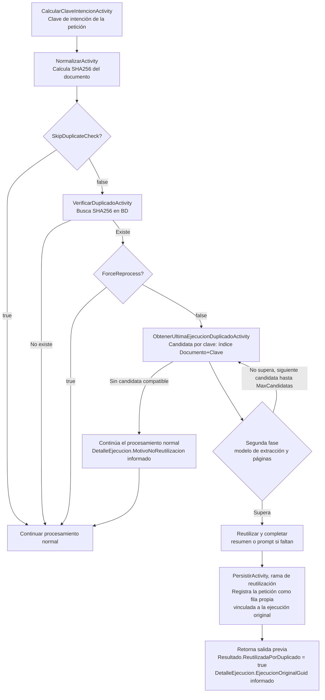

# Manual de Deduplicación Interna — DocumentIA

## 1. Propósito

El sistema incluye un mecanismo de deduplicación basado en hash SHA256 del contenido del documento. Su objetivo es **evitar reprocesar el mismo documento dos veces con el mismo objetivo** y reutilizar el resultado de la ejecución anterior, ahorrando tiempo de procesamiento y costes de llamadas a servicios IA. Desde AB#100930 la ejecución anterior solo se reutiliza si perseguía exactamente la misma **intención** que la petición nueva (ver 2.1); si no existe, el documento se procesa como uno más.

Este mecanismo es **independiente** de la deteccion de duplicados en el GDC (Gestor Documental), que se describe en [ESPECIFICACION_CAPA_SERVICIO_GDC_SINTWS.md](../especificaciones/ESPECIFICACION_CAPA_SERVICIO_GDC_SINTWS.md).

---

## 2. Cómo funciona

### 2.1 Flujo de decisión

Pasos (AB#100930): clave de intención, `VerificarDuplicadoActivity`, candidata por clave (índice), segunda fase (modelo de extracción y páginas), y después reutilizar y completar o procesar con motivo.



1. **Clave de intención.** Al inicio de la orquestación, antes de cualquier verificación de duplicados, `CalcularClaveIntencionActivity` calcula la clave a partir de la petición y la configuración activa. Se persiste en toda ejecución, también sin duplicado y también con `Dedup__ModoEstricto = false`.
2. **`VerificarDuplicadoActivity`** (SHA256) o, en peticiones por `objectIdGDC`, `VerificarDuplicadoPorMD5Activity` antes de descargar (MD5 de GDC). Las dos ramas comparten el mismo punto de reutilización.
3. **Candidata por clave.** Se busca la última ejecución del documento con contrato y la misma clave, servida por el índice `IX_DocumentoEjecuciones_Documento_Clave`. Las filas de reutilización y las de estado `DUPLICADO` nunca son candidatas.
4. **Segunda fase** sobre la candidata: el modelo de extracción (solo en modo completo) y la cobertura de páginas. Si no la supera se examina la siguiente con la misma clave, hasta `Dedup__MaxCandidatas`.
5. **Reutilizar y completar**, o **procesar con motivo**: sin candidata válida el documento se descarga (en la rama GDC) y se procesa por el flujo normal; la ejecución queda como una más del documento con `motivoNoReutilizacion` (`sin-historica`, `clave-distinta`, `modelo-extraccion-distinto`, `paginas-insuficientes`, `historica-fallida`, `contrato-invalido`).

Con `Dedup__ModoEstricto = false` el flujo vuelve a la regla anterior (ver 12).

### 2.2 Posición en el pipeline

La verificación ocurre después de normalizar (paso 1) y **antes** de subir el blob (paso 2.5), clasificar y extraer. Si se detecta duplicado **con una ejecución de la misma intención**, el pipeline se **corta early** sin repetir la clasificación ni la extracción (solo se ejecuta el prompt o el resumen que la histórica no traiga, ver 3.4). Sin ejecución compatible no hay corte: el pipeline continúa.

Desde AB#100258 ese corte **no es silencioso**: antes de devolver la respuesta reutilizada, el orquestador llama a `PersistirActivity` por su rama de reutilización (ver 3.4) y la petición queda registrada como una fila propia en `DocumentoEjecuciones`, vinculada a la ejecución cuyo contrato se devuelve. Antes de ese cambio la petición no dejaba rastro: no existía para el Monitor ni para ningún recuento.

```
CalcularClaveIntencionActivity → NormalizarActivity → [VerificarDuplicadoActivity → ObtenerUltimaEjecucionDuplicadoActivity] → SubirBlobActivity → ClasificarActivity → ...
```

---

## 3. Actividades implicadas

### 3.1 `NormalizarActivity`

Calcula los hashes del documento a partir del contenido Base64:

| Hash | Uso principal |
|---|---|
| SHA256 | Deduplicación interna (clave de búsqueda en BD). |
| MD5 | Deduplicación en GDC (campo `MD5` en SINTWS). |
| CRC32 | Integridad (campo adicional en `Integridad`). |

La normalización también extrae: `TamañoBytes`, `NombreNormalizado`, `FechaNormalizacion`.

### 3.2 `VerificarDuplicadoActivity`

**Firma:** `Run([ActivityTrigger] string sha256) → bool`

Consulta `IDocumentoRepository.ExistsBySHA256Async(sha256)` contra la base de datos interna. Devuelve:

- `true` → el documento ya existe en BD.
- `false` → no existe; continuar procesamiento normal.

### 3.3 `ObtenerUltimaEjecucionDuplicadoActivity`

**Firma (AB#100930):** `Run([ActivityTrigger] ObtenerUltimaEjecucionDuplicadoInput) → ObtenerUltimaEjecucionDuplicadoResultado`

Input: `SHA256`, `ClaveIntencion` (la calculada para la petición), la necesidad de páginas (`DocumentoCompleto` o `PaginasMinimas`), `ExtraccionModelKeyPedido` (el modelo de `instrucciones.extraction.model` cuando no es `auto`; manda sobre el de la tipología) y, solo para el modo legado, `ClassificationOnly` y `NivelClasificacion`.

Resultado: `Salida` (el contrato reutilizado, o `null`), `MotivoNoReutilizacion` y `ModoEstricto` (cómo se aplicó el interruptor).

Cuando se detecta duplicado y `ForceReprocess = false`, en modo estricto:

1. Busca el `DocumentoEntity` por SHA256. Si no existe, o la petición llega sin clave, no reutiliza (`sin-historica` y `clave-distinta` respectivamente).
2. **Candidata por clave:** `GetCandidatasPorClaveAsync` devuelve la última ejecución del documento con la misma `ClaveIntencion`, sin contar las filas de reutilización, las de estado `DUPLICADO` ni las filas en estado de fallo (`EstadoEjecucion.NoReutilizables`, AB#100956), ordenadas por fecha descendente.
3. **Derivación al vuelo (filas antiguas):** si el documento no tiene ninguna fila con esa clave, se cargan sus ejecuciones con contrato y sin clave (como mucho `Dedup__MaxDerivacionAlVuelo`, las más recientes), se deriva la clave de cada una desde su contrato con `ClaveIntencionDerivador` (la misma función que el backfill), se graba en la fila para no repetirlo y se consideran candidatas las que coinciden.
4. **Sin ninguna candidata:** `historica-fallida` si hay ejecuciones con esa clave en estado de fallo (`ERROR`, `PENDIENTE_REINTENTO`, `SIN_CONTENIDO_DOCUMENTO`; nunca son candidatas, AB#100956), `clave-distinta` si el documento tiene alguna ejecución con contrato de otra intención y `sin-historica` si no.
5. **Segunda fase por candidata** (hasta `Dedup__MaxCandidatas` candidatas, de una en una): estado fuera de `EstadoEjecucion.NoReutilizables` (lo garantiza la consulta); contrato legible y distinto de `DUPLICADO` (`contrato-invalido`); en modo completo, el `ModelKeyEfectivo` persistido debe coincidir con el modelo que la tipología publicada de la candidata usaría hoy (el primario o el secundario de su configuración, o el pedido en la petición; si la tipología tiene la extracción desactivada, el modelo esperado es vacío aunque conserve `modelKey`, AB#100988) y la tipología debe seguir publicada y activa (`modelo-extraccion-distinto`); la candidata debe cubrir las páginas pedidas con la regla de cobertura del resolutor de markdown (`paginas-insuficientes`). Si falla, pasa a la siguiente; si se agotan, el resultado lleva el motivo de la última descartada. Las ejecuciones anteriores a esta versión de tipologías con extracción GPT directo o Document Intelligence no llevan `ModelKeyEfectivo` y se reprocesan una vez por documento e intención; desde esta versión los tres proveedores (Content Understanding, GPT directo y Document Intelligence) lo persisten.
6. **Candidata válida:** deserializa el contrato y establece `Resultado.ReutilizadaPorDuplicado = true`, `Resultado.MensajeReutilizacion` (literal del código, sin tildes: «Documento ya procesado previamente. Se reutiliza la ultima ejecucion con la misma intencion.»), `DetalleEjecucion.MotivoReutilizacion = "clave-igual"` y `DetalleEjecucion.EjecucionOriginalGuid = EjecucionGuid` de la fila seleccionada. Es el único puente hacia la ejecución original: ese GUID se genera al persistir y no viaja dentro del contrato (`Identificacion.Guid` es el GUID del documento, no de la ejecución).

**Modo legado (`Dedup__ModoEstricto = false`).** Se aplica la regla anterior: la primera ejecución con `ContratoSalidaCompletoJson` poblado que coincide en `ClassificationOnly` y `NivelClasificacion`; sin coincidencia exacta, la última con contrato (AB#100177). Sin ninguna con contrato devuelve `null` y el orquestador responde `DUPLICADO` vacío en la rama SHA256 (AB#100178). La clave se calcula y se persiste igualmente.

Las filas de reutilización (3.4) nacen sin contrato salvo que completen un prompt. En modo estricto nunca son candidatas, porque `GetCandidatasPorClaveAsync` excluye `ReutilizadaPorDuplicado`, el estado `DUPLICADO` y las filas en estado de fallo (`EstadoEjecucion.NoReutilizables`, AB#100956): una reutilización no se reutiliza y no se forman cadenas.

### 3.4 `PersistirActivity` — rama de reutilización (AB#100258)

Antes de devolver la respuesta reutilizada, el orquestador comprueba si la histórica trae lo que la petición pide (**reutilizar y completar**, AB#100930): el resumen (resumen por defecto forzado, o nivel TDN1 en solo clasificación, y el contrato histórico no tiene `Resumen`) y el prompt libre (la petición trae `instrucciones.prompt` y la histórica no ejecutó la misma plantilla, comparada por `detalleEjecucion.prompt.plantillaHash`). Si falta algo, obtiene el markdown guardado de la histórica (sin llamar a Document Intelligence), comprueba que cubre las páginas necesarias y ejecuta solo `PromptActivity`; el resultado se añade a `datosExtraidos`. Si la histórica no tiene markdown que cubra, no completa y marca `detalleEjecucion.prompt.omitido = "markdown-insuficiente"`: no se reprocesa el documento por un prompt. Un fallo del prompt no convierte la reutilización en error.

Después corrige la identidad del contrato (`DetalleEjecucion.InstanceId` y `OperationId` pasan a ser los de **esta** llamada; hasta entonces llegaban los de la orquestación histórica) y llama a `PersistirActivity` con un `ReutilizacionInput` (`EjecucionOriginalGuid` + `SHA256`). La actividad:

| Escribe | No toca |
|---|---|
| Una fila en `DocumentoEjecuciones` con `ReutilizadaPorDuplicado = 1`, `EjecucionOriginalId` = Id de la original, `ClaveIntencion`, `ClaveIntencionJson` y `MotivoReutilizacion = 'clave-igual'`. Sin completar: `ContratoSalidaCompletoJson = NULL` y sin coste (`CosteIAEur = NULL`). **Si completó un prompt o resumen** (`ReutilizacionInput.Completada`): persiste el contrato devuelto (con lo añadido) y el coste de ese paso (`CosteIAEur`, `TokensIA` y `CostePromptEur`), que es el único coste de IA de la reutilización. Lleva `InstanceId`, `OperationId`, `SubmittedBy`, `ClassificationOnly`, `NivelClasificacion` y `DuracionTotalMs` de la llamada actual, y copia `Tipologia`, `EstadoFinal` y confianzas de la original para que la fila sea legible sin join. | `Documentos` (existe por definición; su markdown y su caducidad de blob son del original). |
| Una fila de `Auditoria` con acción `REUTILIZACION_DUPLICADO`. | `ResultadosProcesamiento`, plugins y validaciones (no se ejecutaron). |

Reglas:

- **Una reutilización completada deja de ser «sin contrato»**: tiene contrato y coste propios (solo el del prompt); `ReutilizadaPorDuplicado = 1` sigue siendo lo que la distingue de una ejecución de IA completa, y `costes.reutilizadaPorDuplicado` sigue a `true`.
- **`EstadoFinal` es el de la original a propósito**: como una original en estado de fallo ya no se reutiliza (AB#100956), una reutilización nunca cuenta como error.
- **Idempotente por `InstanceId`**: si ya existe una fila de reutilización con ese `InstanceId`, no inserta otra (un reintento de Durable tras un fallo posterior al commit no duplica la traza).
- **Nunca falla la respuesta**: el orquestador envuelve la llamada en su propio `try/catch`; si registrar la traza falla, se loguea y la respuesta reutilizada se devuelve igual.
- Si la ejecución original no se localiza por su GUID, la fila se graba sin vínculo (`EjecucionOriginalId = NULL`) con un aviso en el log. Las reutilizaciones grabadas antes de la corrección `36dbd24` (el orquestador pasaba el GUID del documento en vez del de la ejecución) están en esa situación y no suman en el coste evitado.

---

## 4. Comportamiento según combinación de flags

| `SkipDuplicateCheck` | `ForceReprocess` | Existe en BD | Comportamiento |
|---|---|---|---|
| `false` | `false` | No | Pipeline completo normal. |
| `false` | `false` | Sí, con salida previa de la misma clave | **Short-circuit**: devuelve salida previa (completando resumen o prompt si faltan). `Estado` = el de la ejecución previa. `ReutilizadaPorDuplicado = true`. Registra una fila de reutilización vinculada a la original (3.4). |
| `false` | `false` | Sí, sin histórica con la misma clave | **Se procesa** el documento por el flujo normal (modo estricto, defecto). La ejecución queda como una más del documento, con su `ClaveIntencion` y `motivoNoReutilizacion` (`sin-historica`, `clave-distinta`, `modelo-extraccion-distinto`, `paginas-insuficientes`, `historica-fallida` o `contrato-invalido`). `Estado` es el del procesamiento. |
| `false` | `false` | Sí, sin salida previa, con `Dedup__ModoEstricto = false` | Modo legado: **short-circuit**, devuelve respuesta vacía. `Estado = "DUPLICADO"`. `ReutilizadaPorDuplicado = true`. Persiste una ejecución normal con ese estado (AB#100178) y `ReutilizadaPorDuplicado = 0` en BD: no reutilizó nada. |
| `false` | `true` | Sí | Reprocesa completamente, ignorando el duplicado. |
| `true` | — | — | Omite verificación. Pipeline completo. |

---

## 5. Campos en la respuesta relativos a deduplicación

En `ContratoSalida.Resultado`:

| Campo | Tipo | Descripción |
|---|---|---|
| `resultado.estado` | string | En reutilización con ejecución previa, el estado es el de dicha ejecución (normalmente `"OK"`). `"DUPLICADO"` solo se emite con `Dedup__ModoEstricto = false`; en modo estricto un duplicado sin ejecución reutilizable se procesa y el estado es el del procesamiento. |
| `resultado.reutilizadaPorDuplicado` | bool | `true` cuando se devuelve una ejecución anterior o, en modo legado, cuando el estado es `DUPLICADO`. |
| `resultado.mensajeReutilizacion` | string? | Mensaje descriptivo del motivo de reutilización. |

En `ContratoSalida.DetalleEjecucion` (AB#100258):

| Campo | Tipo | Descripción |
|---|---|---|
| `detalleEjecucion.instanceId` | string | Siempre el de **esta** llamada, también en una respuesta reutilizada. Antes de AB#100258 llegaba el de la orquestación histórica, y no se podía ir de la respuesta a la llamada que la produjo. |
| `detalleEjecucion.operationId` | string | Ídem: el `operation_Id` de App Insights de esta llamada. |
| `detalleEjecucion.ejecucionOriginalGuid` | string? | Solo en respuestas reutilizadas: `EjecucionGuid` de la ejecución cuyo contrato se devuelve. En una ejecución normal es `null` y **se omite del JSON**. Es el campo con el que localizar la ejecución original en el Monitor. |
| `detalleEjecucion.claveIntencion` | string | AB#100930. Clave de intención de la petición (32 hex). Siempre informada. |
| `detalleEjecucion.claveIntencionComponentes` | objeto | AB#100930. `{ modo, nivel, universo, expectedType, modeloClasificacion }`. |
| `detalleEjecucion.motivoReutilizacion` | string? | AB#100930. Solo en reutilizadas: `clave-igual`. |
| `detalleEjecucion.motivoNoReutilizacion` | string? | AB#100930. Solo tras un duplicado sin reutilización: `sin-historica`, `clave-distinta`, `modelo-extraccion-distinto`, `paginas-insuficientes`, `historica-fallida` o `contrato-invalido`. |
| `detalleEjecucion.prompt.plantillaHash` | string? | AB#100930. Hash (16 hex) del prompt ad hoc pedido; permite saber si la histórica ya lo ejecutó. |
| `detalleEjecucion.prompt.omitido` | string? | AB#100930. `markdown-insuficiente` si la reutilización no pudo completar el prompt. |
| `detalleEjecucion.costes.reutilizadaPorDuplicado` | bool | `true` en reutilización. El bloque de costes llega a cero salvo que la reutilización complete un prompt o resumen: entonces lleva el coste de ese paso. |
| `detalleEjecucion.costes.costeEjecucionOriginalEur` | decimal? | Coste de la original, informativo. Ver [MANUAL_COSTES_IA.md](MANUAL_COSTES_IA.md) §4.6. |

**Compatibilidad con clientes (AB#100930).** `resultado.estado = "DUPLICADO"` deja de emitirse en modo estricto y los duplicados sin ejecución compatible se procesan; es el único cambio de semántica. Los campos nuevos de `detalleEjecucion` son aditivos y se omiten del JSON cuando no aplican. Ver [CONTRATO_API_HTTP.md](../contratos/CONTRATO_API_HTTP.md) §5 y §8.

**Compatibilidad con clientes (AB#100258).** El cambio es aditivo: `ejecucionOriginalGuid` solo aparece en respuestas reutilizadas y un deserializador que ignore campos desconocidos no lo nota. Lo único que cambia de valor es `instanceId` / `operationId` en respuestas reutilizadas, que pasan de ser los de otra orquestación a los correctos. `statusQueryUri`, los estados y el resto del contrato no cambian.

---

## 6. Casos de uso típicos

### Reenvío accidental del mismo documento

El sistema detecta el SHA256 idéntico, recupera la ejecución anterior con la misma intención y devuelve ese resultado sin reprocesar. Si la anterior tenía otra intención (otro modo, nivel, restricción de tipologías, `expectedType` o modelo) el documento se procesa de nuevo y la respuesta lleva `motivoNoReutilizacion`. Cuando se reutiliza, el cliente recibe `reutilizadaPorDuplicado = true`.

### Forzar reprocesamiento (corrección de datos)

Si se ha actualizado la configuración de tipología o se requiere reextracción, enviar con `forceReprocess = true`. El documento se procesa completamente aunque ya exista.

### Importación masiva con documentos potencialmente repetidos

Enviar `skipDuplicateCheck = false` (default) para que el sistema filtre automáticamente duplicados, ahorrando tiempo y coste en lote.

### Entornos de prueba sin BD

Enviar `skipDuplicateCheck = true` para omitir la verificación y siempre procesar, independientemente del estado de la BD.

---

## 7. Persistencia en base de datos

La deduplicación se apoya en dos repositorios:

| Repositorio | Entidad | Uso |
|---|---|---|
| `IDocumentoRepository` | `DocumentoEntity` | Índice de documentos únicos por SHA256. Consultado por `VerificarDuplicadoActivity` y `ObtenerUltimaEjecucionDuplicadoActivity`. |
| `IDocumentoEjecucionRepository` | `DocumentoEjecucionEntity` | Historial de ejecuciones con `ContratoSalidaCompletoJson`. Consultado por `ObtenerUltimaEjecucionDuplicadoActivity`. |

Los documentos se persisten al final del pipeline por `PersistirActivity`. El SHA256 se registra en ese momento. Si la función se interrumpe antes de `PersistirActivity`, el documento no queda registrado y no se detectará como duplicado en futuras ejecuciones.

Columnas de `DocumentoEjecuciones` propias de la reutilización (migración `20260911093509_ReutilizacionPorDuplicado`, AB#100258):

| Columna | Tipo | Significado |
|---|---|---|
| `ReutilizadaPorDuplicado` | `bit NOT NULL DEFAULT 0` | 1 = la fila registra una petición servida con el contrato de otra ejecución. No es una ejecución de IA. |
| `EjecucionOriginalId` | `int NULL`, FK a `DocumentoEjecuciones.Id` | Ejecución cuyo contrato se devolvió. Solo informada cuando el flag es 1. |

Columnas de la clave de intención (migración `20261013092225_ClaveIntencionDedup`, AB#100930):

| Columna | Tipo | Significado |
|---|---|---|
| `ClaveIntencion` | `nvarchar(32) NULL` | Hash de la petición (modo, nivel, universo, `expectedType`, modelo de clasificación). Se graba en toda ejecución nueva. |
| `ClaveIntencionJson` | `nvarchar(max) NULL` | Los componentes con sus nombres, para auditoría y Monitor. |
| `MotivoReutilizacion` | `nvarchar(40) NULL` | En filas reutilizadas, `clave-igual`; en filas no reutilizadas tras un duplicado, el motivo (`sin-historica`, `clave-distinta`, `modelo-extraccion-distinto`, `paginas-insuficientes`, `historica-fallida`, `contrato-invalido`); vacío en el resto. |

Índice `IX_DocumentoEjecuciones_Documento_Clave` sobre `(DocumentoId, ClaveIntencion, FechaEjecucion DESC)` con `EjecucionGuid`, `Tipologia`, `EstadoFinal` y `ReutilizadaPorDuplicado` incluidas: sirve la consulta de la candidata.

- **En PRO** la migración no se aplica tal cual: el `CreateIndex` de EF no emite `ONLINE = ON` y la tabla es grande. Se usa `scripts/database/indice-documento-clave-pro.sql` (columnas, índice ONLINE y registro en `__EFMigrationsHistory`), de modo que el pipeline Migrations-BD quede en `Pendientes: 0`. Ver `docs/procedimientos/RELEASE_MANAGEMENT.md` 2.1.3.
- **Backfill del histórico:** `scripts/database/backfill-clave-intencion.ps1` rellena `ClaveIntencion` y `ClaveIntencionJson` por lotes de Id con la misma forma canónica y el mismo hash que `ClaveIntencionBuilder`. Se lanza en el mismo run de Migrations-BD que la migración activando el parámetro `backfillClaveIntencion` (el pipeline hace antes `-SelfTest` y `-WhatIf`); es idempotente y reanudable con `-DesdeId` si hay que relanzarlo a mano. Ver `docs/procedimientos/RELEASE_MANAGEMENT.md` 4.8.
- **Filas antiguas de reutilización sin clave:** el backfill se salta las filas de reutilización (`ReutilizadaPorDuplicado = 1`, su petición no se conoce), las que no tienen contrato y las de estado `DUPLICADO`, que quedan con `ClaveIntencion = NULL`. Las reutilizaciones grabadas antes de AB#100930 no muestran clave en el Monitor; las nuevas la llevan.
- **Red de seguridad:** las filas con contrato que sigan sin clave se derivan al vuelo la primera vez que su documento se repite (3.3), acotado por `Dedup__MaxDerivacionAlVuelo`.

Cualquier lector directo de la tabla debe filtrar `ReutilizadaPorDuplicado = 0` si espera contratos: las filas de reutilización tienen `ContratoSalidaCompletoJson`, `DatosOriginalesJson` y `DatosFinalesJson` a NULL. El Monitor de Admin, los agregados de costes y el procedimiento `sp_ObtenerDocumentoEjecucionesPorIdActivo` ya lo hacen por defecto (ver 8 y 9).

---

## 8. Ver las reutilizaciones en el Monitor de Admin

Desde AB#100258 el Monitor (`/monitor`) las distingue:

- **Por defecto quedan fuera** del listado, de los KPIs, del histograma, de la matriz y de los costes: no son ejecuciones de IA y contarlas falsearía calidad y coste. Las cifras históricas del Monitor no cambian por su llegada.
- **Selector tri-estado** en los filtros: *Excluir* (por defecto), *Incluir* y *Solo reutilizadas*. El endpoint `GET /api/management/ejecuciones*` lo recibe como `reutilizadas=incluir|solo` (cualquier otro valor excluye).
- **Listado**: badge "Reutilizada" en la fila; el modal del contrato JSON se deshabilita en esas filas con el texto "el contrato es el de la ejecución #X", enlazada.
- **Detalle, en los dos sentidos**: en la reutilización, banner "Servida reutilizando la ejecución #X del \<fecha\>" más lo que sí es suyo (fecha, solicitante, `InstanceId`, `OperationId`, duración real). En la original, bloque "Reutilizada N veces" con la lista de peticiones que la aprovecharon.
- **Clave de intención y motivo (AB#100930)**: el detalle de una ejecución muestra la clave, el motivo (`clave-igual`, o el de no reutilización) y sus cinco componentes (modo, nivel, universo, `ExpectedType`, modelo). Los agregados no cambian.
- **Filtro «Motivo dedup»** (parámetro `motivo` del endpoint): *Todos*, `clave-igual`, `sin-historica`, `clave-distinta`, `modelo-extraccion-distinto`, `paginas-insuficientes`, `historica-fallida`, `contrato-invalido`. Se combina con el selector tri-estado: las filas `clave-igual` son reutilizaciones, así que para verlas hay que elegir *Incluir* o *Solo reutilizadas*; los demás motivos son de ejecuciones propias.
- **KPIs**, calculados aparte sobre la misma ventana temporal: **peticiones servidas por reutilización** (recuento) y **coste evitado** (suma del `CosteIAEur` medido de las ejecuciones originales reutilizadas; si la original no tenía coste medido o el vínculo falta, no suma).

## 9. Consumidor externo: `sp_ObtenerDocumentoEjecucionesPorIdActivo`

El procedimiento gana el parámetro `@IncluirReutilizadas BIT = 0`. Sin informarlo devuelve **exactamente las mismas filas que antes** (las de reutilización, con contrato NULL, quedan fuera). Con `@IncluirReutilizadas = 1` entran, y las dos columnas nuevas al final del resultset (`ReutilizadaPorDuplicado`, `EjecucionOriginalId`) permiten distinguirlas sin deducirlo del contrato vacío. Se aplica con `scripts/database/sp-obtener-ejecuciones-por-idactivo-reutilizaciones.sql`; no viaja en ninguna migración de EF.

## 10. Evidencia en entorno real

`tests/e2e-postdeploy/run-validacion-dedup.ps1` demuestra las invariantes DUP-01..DUP-10 contra DEV. DUP-01..DUP-05 (AB#100258) cubren que (fila propia con contrato en una ejecución real; fila de reutilización sin contrato ni coste y vinculada a la original; `forceReprocess` reejecuta sin marcar reutilización; los agregados y el coste del periodo no se mueven y el contador de reutilizadas sube en uno; la traza lleva el `InstanceId` de la petición y se registra una sola vez). DUP-06..DUP-10 (AB#100939) cubren la clave de intención: una restricción de tipologías frente al universo completo, solo clasificación frente a completo en los dos sentidos, la misma clave que completa un prompt y una petición con más páginas que reprocesa. Ver `tests/e2e-postdeploy/README.md`.

---

---

## 11. Diferencia con deduplicación en GDC

| Aspecto | Deduplicación interna (BD) | Deduplicación en GDC (SINTWS) |
|---|---|---|
| Clave | SHA256 del contenido + clave de intención de la petición | `id_expediente` + `checksum` (MD5) |
| Momento | Paso 2 del pipeline (antes de clasificar) | Paso subida GDC (`SubirGDCActivity`) |
| Efecto en duplicado | Short-circuit del pipeline si hay ejecución con la misma intención; si no, se procesa | Subida omitida; `GDC.YaExistia = true` |
| Control | `SkipDuplicateCheck` / `ForceReprocess` | No configurable desde el contrato de entrada |
| Documentado en | Este documento | [ESPECIFICACION_CAPA_SERVICIO_GDC_SINTWS.md](../especificaciones/ESPECIFICACION_CAPA_SERVICIO_GDC_SINTWS.md) |

---

## 12. Interruptor `Dedup__ModoEstricto`

App setting `Dedup__ModoEstricto` (sección `Dedup` de `DedupOptions`; `true` por defecto). Los otros dos, `Dedup__MaxCandidatas` (5) y `Dedup__MaxDerivacionAlVuelo` (50), se describen en `docs/05_MANUAL_USO_CONFIGURACION.md`.

| | `true` (modo estricto, defecto) | `false` (modo legado, vuelta atrás) |
|---|---|---|
| Selección de la histórica | Misma clave de intención, más segunda fase (modelo de extracción y páginas) | `ClassificationOnly` y `NivelClasificacion`, con fallback a la última con contrato (AB#100177) |
| Duplicado sin histórica compatible | Se procesa el documento; `motivoNoReutilizacion` informado | Rama SHA256: `Estado = "DUPLICADO"` vacío persistido (AB#100178). Rama MD5 de GDC: se descarga y procesa. Excepción (AB#100956): si todas las históricas con contrato están en estado de fallo, el modo legado también reprocesa y la ejecución lleva `historica-fallida` |
| Clave de intención | Se calcula y persiste | Se calcula y persiste igualmente |
| Completar resumen o prompt | Sí | Sí (el orquestador completa en ambos modos) |

Desactivarlo no pierde datos: la clave se graba en ambos modos y las columnas nuevas son nullable. Poner `false` solo si un integrador depende del `DUPLICADO` vacío mientras se avisa; es una vuelta atrás de comportamiento, no de esquema.

**Plan de retirada:** el interruptor se retira en la release siguiente a la validación del modo estricto en PRO (spec AB#100930, sección 6). Tras la retirada solo queda la selección por clave.

**Despliegue:** la release que introduce la clave cambia la secuencia de actividades del orquestador (AB#100930), así que antes de desplegar la Function App hay que drenar las orquestaciones en vuelo (pasos 2.2.6 y 4.15 de `docs/procedimientos/RELEASE_MANAGEMENT.md`).
